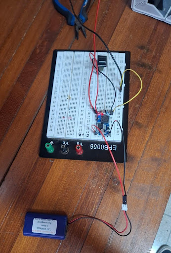
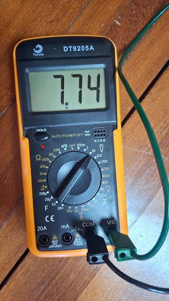
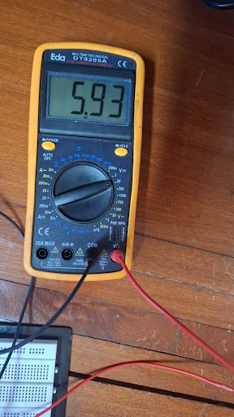
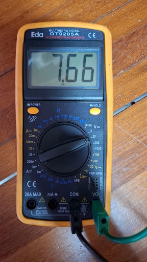
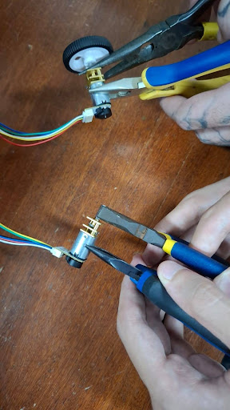
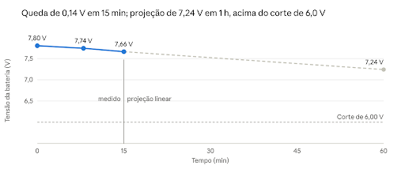

# Testes de Energia

>Apresentar com detalhes os testes feitos para conferir se as demandas energéticas do projeto foram atendidas.

| **ID** | **Descrição** | **Data de Início** | **Data de Conclusão** | **Responsável** | **Resultados Esperados** | **Resultados Obtidos** | **Aprovação Interna (S/N)** | **Aprovação do Orientador (S/N)** | **Observações** |
|:------:|---------------|--------------------|-----------------------|-----------------|--------------------------|------------------------|:---------------------------:|:--------------------------------:|-----------------|
| 2.1 | Conferência das especificações nominais do pack de baterias Li-ion | 21/10/2026 | 21/10/2026 | Subgrupo de Energia | Pack 2S de 7,4 V, 3300 mAh, com tensão entre 6,0 V (corte) e 8,4 V (carga máxima) | Confirmado: 2S (células 18650), 7,4 V nominal, 3300 mAh (≈ 24,4 Wh), corte de 6,0 V e carga máxima de 8,4 V | S | - | Fabricante, modelo, datasheet e presença de BMS/PCM não disponíveis |
| 2.2 | Verificação do dimensionamento da capacidade da bateria frente ao projeto conceitual | 21/10/2026 | 21/10/2026 | Subgrupo de Energia | Capacidade ≥ 3,16 Ah (4,5 W por 4 h = 18 Wh ≈ 2,43 Ah a 7,4 V, mais 30% de margem) | Pack de 3300 mAh atende ao mínimo calculado de 3159 mAh | S | - | O ensaio serve para conferir essa escolha com medições reais |
| 2.3 | Montagem da bancada: bateria → regulador buck MP1584 → 2 motores N20, com multímetros DT9205A | 21/10/2026 | 21/10/2026 | Subgrupo de Energia | Bancada capaz de medir a tensão na bateria, a tensão na saída do regulador e a corrente | Bancada montada em protoboard, com um multímetro na bateria, um na saída do buck e um para a corrente | S | - | Ensaio feito sem a ESP, que ainda não estava pronta |
| 2.4 | Ensaio de operação contínua dos 2 motores por 15 min: queda de tensão da bateria | 21/10/2026 | 21/10/2026 | Subgrupo de Energia | Tensão estável e bem acima do corte de 6,0 V durante todo o ensaio | 7,80 V (0 min), 7,74 V (≈ 8 min), 7,66 V (15 min): queda de 0,14 V (≈ 1,8%) | S | - | Bateria não estava com carga total (7,80 V inicial). Só 3 pontos de medição |
| 2.5 | Projeção linear da tensão para 1 h de operação | 21/10/2026 | 21/10/2026 | Subgrupo de Energia | Tensão projetada acima de 6,0 V | Sem ESP: ≈ 7,24 V em 1 h (0,56 V/h). Com ESP (0,264 W, ≈ +18%): ≈ 7,14 V (0,66 V/h). Ambos acima do corte | S | - | Projeção linear; a curva real de descarga Li-ion não é linear |
| 2.6 | Medição da tensão na saída do regulador buck durante a operação dos motores | 21/10/2026 | 21/10/2026 | Subgrupo de Energia | Saída regulada estável em ≈ 6 V | 5,93 V estáveis (buck ajustado em 6 V) | S | - | Entrada do MP1584: 4,5 a 28 V |
| 2.7 | Medição da corrente média e da capacidade consumida no ensaio de 15 min | 21/10/2026 | 21/10/2026 | Subgrupo de Energia | Consumo coerente com a potência média estimada de 4,5 W (≈ 0,6 A a 7,4 V) | Relatório registra I_médio ≈ 6 A e ΔC ≈ 1,5 Ah em 15 min | S | - | **Revisar este valor** (ver nota abaixo da tabela) |
| 2.8 | Monitoramento de temperatura durante o ensaio de 15 min | 21/10/2026 | 21/10/2026 | Subgrupo de Energia | Sem aquecimento anormal | Nenhuma alteração de temperatura observada | S | - | Observação qualitativa, sem medição por instrumento |
| 2.9 | Ensaio de travamento dos eixos dos motores por 6 s: queda instantânea de tensão | 21/10/2026 | 21/10/2026 | Subgrupo de Energia | Tensão mínima acima de 6,0 V, sem desligamento do regulador | Partiu de 7,66 V e caiu para 7,33 V (−0,33 V). Saída do regulador se manteve em 5,93 V | S | - | Eixos travados com alicate. Tempo curto para evitar superaquecimento |
| 2.10 | Medição da corrente de pico com os motores travados | 21/10/2026 | 21/10/2026 | Subgrupo de Energia | Corrente de pico dentro da capacidade do regulador (3 A) | Pico de 0,74 A (740 mA) | S | - | Medido no borne de 20 A do multímetro (respeitado o ciclo de 10 s a cada 15 min). Só o máximo foi anotado. Multímetro lento pode não capturar o pico real |
| 2.12 | Cálculo da resistência interna equivalente do pack | 21/10/2026 | 21/10/2026 | Subgrupo de Energia | Queda de tensão em carga pequena em relação à tensão nominal | R_int = (7,66 − 7,33) / 0,74 ≈ 0,45 Ω | S | - | Estimativa limitada pela leitura de corrente com multímetro |
| 2.13 | Avaliação do risco de brownout / reinício do microcontrolador por travamento | 21/10/2026 | 21/10/2026 | Subgrupo de Energia | Tensão sempre acima de 6 V (regulador) e 5 V (motores) | Mínimo de 7,33 V. Sem desligamento e sem reinício. Risco de brownout descartado | S | - | Condição simulada: colisão ou travamento em parede do labirinto |
| 2.15 | Cálculo da autonomia útil: T_útil = (3,3 Ah × 0,8) / I_médio | 21/10/2026 | 21/10/2026 | Subgrupo de Energia | Autonomia ≥ 4 h (tempo estimado das provas, com margem) | Fórmula definida (corte de 6,0 V e fator operacional de 80%). O relatório não apresenta o valor numérico final | S | - | Com I_médio = 6 A, o resultado seria ≈ 0,44 h (≈ 26 min); com 0,6 A, ≈ 4,4 h. Confirmar a corrente |
| 2.16 | Validação não destrutiva (sem descarga total) e recomendação de proteção | 21/10/2026 | 21/10/2026 | Subgrupo de Energia | Validar a bateria sem expô-la a descarga profunda | Menor tensão registrada: 7,33 V, bem acima de 6,0 V. Descarga total não realizada, por risco de dissolução de cobre, curto interno e fuga térmica. Recomendado circuito UVLO em 6,0 V | S | - | Um professor recomendou o teste, mas o grupo decidiu não executá-lo após pesquisa (ver Seção 2 do relatório) |

# Relatório de Testes da Bateria – Micromouse Resolvedor de Labirintos

**Projeto Integrador de Engenharia – Micromouse Resolvedor de Labirintos**
**Subgrupo de Energia**

---

## 1. Objetivo e Especificações Nominais da Bateria

### 1.1 Objetivo

Este relatório documenta o ensaio do pack de baterias Li-ion que alimentará o Micromouse. O objetivo é verificar se a bateria funciona de forma adequada durante o tempo estabelecido para a resolução dos três labirintos, observando como a tensão se comporta com os motores em operação contínua e sob esforço extremo (motores travados).

Para isso foram realizados dois ensaios curtos e controlados: (1) operação contínua dos dois motores por 15 minutos, para acompanhar a queda de tensão e a duração da bateria; e (2) travamento dos motores por 6 segundos, para medir a corrente de pico e a queda instantânea de tensão. A autonomia total será estimada por cálculo, sem descarregar a bateria até o fim (justificativa na Seção 2).

### 1.2 Contexto no projeto

No projeto conceitual de energia [13], a potência média do sistema foi estimada em cerca de 4,5 W. Para 4 h de operação, isso resulta em aproximadamente 18 Wh, ou cerca de 2,43 Ah a 7,4 V. Aplicando uma margem de segurança de 30%, chega-se a cerca de 3,16 Ah (3.159 mAh), e por isso foi escolhido um pack de 3300 mAh. Este ensaio serve para conferir essa escolha com medições reais.

### 1.3 Especificações nominais da bateria

| Parâmetro técnico | Valor nominal | Condição / detalhe |
|---|---|---|
| Química | Íon de lítio (Li-ion), recarregável | Conforme etiqueta do pack |
| Configuração | 2S (duas células em série) | Células tipo 18650 (lista de compras [14]); 7,4 V indica 2 células em série |
| Tensão nominal | 7,4 V | 3,7 V por célula |
| Tensão máxima de carga (100%) | 8,4 V | 4,2 V por célula |
| Tensão mínima de corte (cut-off) | 6,0 V | 3,0 V por célula |
| Capacidade nominal | 3300 mAh | 3,3 Ah |
| Energia nominal (calculada) | ≈ 24,4 Wh | 7,4 V × 3,3 Ah |

> **Observação:** os valores de tensão máxima e de corte são os usuais para células Li-ion de 3,7 V. Fabricante, modelo e datasheet do pack não estão disponíveis, e não há informação sobre placa de proteção (BMS/PCM) interna.

---

## 2. Justificativa Técnica – Por que não foi realizada a descarga total

O ensaio de descarga completa (até a tensão de corte de 6,0 V ou abaixo dela) não foi realizado. Apesar de um dos professores terem recomendado o teste, após discussões e pesquisas o grupo decidiu não executá-lo. Descarregar uma bateria Li-ion além do seu limite causa danos que não se revertem e cria riscos de segurança. Os motivos estão detalhados a seguir.

### 2.1 Tensão de corte e margem de segurança

Para células Li-ion de 3,7 V, o limite usual de descarga é de cerca de 3,0 V por célula: a maioria dos equipamentos portáteis desliga nesse ponto, o que reduz o desgaste da bateria e deixa uma pequena reserva de energia [1]. Em um pack 2S, isso equivale a 6,0 V. A resistência interna da célula também aumenta à medida que ela se esgota [1], de modo que o fim da descarga é a fase mais estressante.

Em packs em série, diferenças de capacidade entre as duas células podem fazer uma delas ficar abaixo de 3,0 V mesmo quando a tensão total marca 6,0 V [11]. Ou seja, levar o pack até o corte, sem proteção individual por célula, já traz risco.

### 2.2 Degradação química irreversível: dissolução do cobre

Na descarga profunda, o potencial do anodo (grafite) sobe. Ao passar de cerca de 3,3 a 3,6 V em relação ao lítio, o coletor de corrente de cobre do anodo começa a oxidar e a se dissolver no eletrólito líquido [3][4]. Esse processo danifica o coletor de forma irreversível [12] e provoca perda severa de capacidade [5]. Estudos conduzidos por laboratórios da Universidade de Maryland (CALCE) e da Marinha dos EUA analisaram esse fenômeno em células sobredescarregadas [2].

### 2.3 Risco de curto-circuito interno

O cobre dissolvido migra pelo eletrólito, atravessa o separador (a membrana porosa que isola o anodo do catodo) e se deposita no lado oposto, podendo formar uma ponte condutora entre os dois eletrodos [3][6][7]. A literatura descreve esses depósitos como dendritos de cobre capazes de perfurar o separador [10]. O curto-circuito interno se agrava conforme a descarga profunda continua [7]. Na recarga seguinte, a célula é carregada já com o defeito instalado, e os pontos de cobre depositados podem se tornar locais de deposição de lítio metálico [8].

### 2.4 Perigo de fuga térmica (*thermal runaway*)

Fuga térmica é uma reação em cadeia exotérmica e autossustentada: ela ocorre quando a geração de calor dentro da célula supera a capacidade de dissipá-lo [9]. Um curto-circuito interno gera aquecimento localizado, que pode danificar ainda mais o separador e acelerar as reações, levando a superaquecimento, fogo ou explosão [10]. A descarga profunda é apontada como um dos tipos de abuso que podem desencadear esse cenário [3]. Em um pack, o calor ainda pode se propagar para as células vizinhas [9].

### 2.5 Validação não destrutiva adotada

Por esses motivos, o ensaio foi planejado para manter a bateria longe do limite de corte. A menor tensão registrada foi de 7,33 V (durante o travamento dos motores), bem acima dos 6,0 V. A autonomia total será estimada por cálculo, a partir da corrente média medida no ensaio de 15 minutos, conforme a Seção 5, o que preserva a integridade e a vida útil da bateria que será usada no robô. Como proteção adicional, a Seção 6 recomenda um circuito de proteção contra subtensão (UVLO) ajustado em 6,0 V.

---

## 3. Metodologia e Bancada de Testes

### 3.1 Condições iniciais

O ensaio de 15 minutos começou com a bateria em 7,80 V (cerca de 3,90 V por célula). A bateria não estava totalmente carregada (100% corresponde a 8,4 V), pois o mesmo pack já havia sido usado em testes anteriores. O ensaio de travamento começou logo em seguida, com a tensão que a bateria tinha ao final do ensaio anterior (7,66 V), sem recarga entre os dois. Por isso, os resultados devem ser lidos considerando que o pack partiu de uma carga abaixo da máxima.

### 3.2 Materiais e instrumentos

- **Instrumentos utilizados:** 2 multímetros digitais DT9205A: o primeiro mediu a tensão na saída da bateria e o segundo, a tensão já regulada na saída do regulador buck. A corrente foi medida com um multímetro ligado ao regulador buck.
- **Bateria:** pack Li-ion 2S, 7,4 V, 3300 mAh (Seção 1.3).
- **Regulador de tensão:** módulo buck MP1584 [13]: entrada de 4,5 a 28 V, saída ajustável de 0,8 a 20 V, até 3 A [15]. Saída medida em ≈ 5,93 V (Figura 3).
- **Motores:** 2 motores (N20-6V com encoder, conforme o projeto [13] e a lista de compras [14]).
- **Montagem:** protoboard, jumpers, regulador buck, motores e conector da bateria.
- **Ferramenta:** alicate, usado para travar o eixo dos motores.

### 3.3 Montagem da bancada

A bateria foi ligada ao regulador buck, montado na protoboard, e a saída do regulador alimentou os dois motores. A tensão da bateria foi lida na saída da bateria (entrada do regulador) por um multímetro, e a tensão já regulada foi lida na saída do regulador buck pelo outro, ambos ligados em paralelo. A corrente foi medida por um multímetro ligado ao regulador buck.

*Figura 1 – Bancada de testes do ensaio de 15 min: bateria, regulador buck na protoboard e ligação aos motores*

### 3.4 Procedimento 1 – Operação contínua (15 minutos)

1. Com a bateria em 7,80 V, o circuito foi ligado: bateria → regulador buck → 2 motores.
2. Os motores ficaram em operação contínua por 15 minutos, para obter a curva de descarga e estimar a duração da bateria.
3. A tensão da bateria (entrada do regulador) foi registrada no início (7,80 V, 0 min), no meio do ensaio (7,74 V, ≈ 8 min) e no final (7,66 V, 15 min). A tensão na saída do regulador, já regulada, foi de ≈ 5,93 V.
4. A corrente média de operação (I médio) ficou próxima de 6 A, e será usada nos cálculos de autonomia da Seção 5.

*Figura 2 – Tensão na entrada do regulador aos ≈ 8 min (7,74 V)*

*Figura 3 – Tensão na saída do regulador (5,93 V)*

*Figura 4 – Tensão da bateria ao final dos 15 min (7,66 V)*

### 3.5 Procedimento 2 – Travamento dos motores (6 segundos)

5. Com a bateria em 7,66 V, o eixo de saída dos motores (*shaft*), que é a parte que gira e transmite o movimento à roda, foram travados com um alicate, impedindo-os de girar.
6. Os motores foram mantidos travados por 6 segundos, tempo curto para evitar superaquecimento dos motores e da fiação.
7. Foram medidos o pico de corrente e a queda instantânea de tensão da bateria.

*Figura 5 – Ilustração do procedimento de travamento do eixo com alicate*

> **Observação sobre o multímetro:** Diante do pico de corrente de 0,74 A, superior à capacidade da entrada de miliampères (limitada a 500 mA por fusível), o multímetro foi conectado ao borne dedicado de 20 A. O tempo de execução do ensaio (6 s) respeitou o ciclo de trabalho estipulado pelo fabricante para essa entrada (máximo de 10 s de condução a cada 15 min).

### 3.6 Dados brutos registrados

Leituras de tensão da bateria (entrada do regulador) ao longo do ensaio de 15 minutos:

| Tempo (min) | Tensão (V) | Observação |
|:---:|:---:|---|
| 0 | 7,80 | Início do ensaio |
| ≈ 8 | 7,74 | Leitura intermediária (Figura 2) |
| 15 | 7,66 | Fim do ensaio (Figura 4) |

Resumo dos dois ensaios:

| Ensaio | Condição | Tensão inicial | Tensão final / mínima | Variação | Corrente |
|---|---|:---:|:---:|:---:|---|
| Operação contínua (15 min) | 2 motores via buck | 7,80 V | 7,66 V | −0,14 V | I médio: próximo de 6 A |
| Travamento (6 s) | Eixos travados | 7,66 V | 7,33 V (queda instantânea) | −0,33 V | 0,74 A (740 mA) |

Tensão medida na saída do regulador buck durante o ensaio: ≈ 5,93 V (Figura 3). A análise desses dados (consumo, risco de brownout) está na Seção 4.

### 3.7 Limitações do ensaio

- Sem osciloscópio, não há registro da forma do transiente de tensão; o multímetro digital atualiza a leitura devagar e pode não capturar o pico real de corrente.
- A tensão da bateria foi registrada em apenas três instantes (0, ≈ 8 e 15 min), e a bateria não estava totalmente carregada.

---

## Passo 4: Análise dos Resultados do Ensaio

### Ensaio de 15 minutos (regime contínuo)

O ensaio foi feito só com os dois motores, sem a ESP (ainda não estava pronta). A tensão da bateria caiu de 7,80 V para 7,66 V em 15 min (queda de 0,14 V, cerca de 1,8%).

| Tempo (min) | Tensão (V) | Ponto de medição |
|:---:|:---:|---|
| 0 | 7,80 | Bateria |
| 8 | 7,74 | Entrada do regulador |
| 15 | 7,66 | Bateria |

*Gráfico – Queda de 0,14 V em 15 min; projeção de 7,24 V em 1 h, acima do corte de 6,0 V. Medições do ensaio de 15 min (7,80 / 7,74 / 7,66 V); projeção linear até 60 min*

- **Projeção para 1 hora:** mantida a taxa de queda (cerca de 0,56 V por hora), a tensão chegaria a cerca de 7,24 V, bem acima do corte de 6,0 V. Como a ESP não estava ligada (componente não estava pronto no momento dos testes) e é um componente que apresenta um consumo real da bateria (0,264 W) podemos estimar que a queda da tensão seria um pouco maior, um aumento em cerca de 18%. Nessa análise, a taxa de queda seria de 0,66 V por hora, o que ainda apresenta uma margem segura de operação, mesmo com a bateria não operando em carga total (tensão da bateria chegaria em 7,14 V, ainda acima do corte de 6,0 V).
- **Temperatura:** sem alteração observada durante o ensaio.
- **Saída do regulador** com os motores em funcionamento: 5,93 V (buck ajustado em 6 V).
- **Corrente média e capacidade consumida:** I_médio ≈ 6 A e ΔC ≈ 1,5 Ah em 15 min (ver Seção 5).

### Ensaio de 6 segundos (motores travados)

| Grandeza | Valor |
|---|---|
| Tensão em vazio (V_vazio) | 7,66 V |
| Tensão mínima transiente (V_stall) | 7,33 V |
| Corrente de pico (I_stall) | 0,74 A (só a máxima foi anotada) |

**Risco de brownout:** mesmo com os motores travados, a bateria entregou no mínimo 7,33 V, uma queda instantânea de 0,33 V, um valor consideravelmente baixo comparado a operação da bateria. Esse valor está acima dos 6 V do regulador buck e dos 5 V necessários aos motores. A saída do regulador se manteve em 5,93 V e não houve desligamento. Portanto, não há risco de brownout nem de reinício do microcontrolador por travamento nas paredes do labirinto.

---

## Passo 5: Cálculos de Engenharia

### Resistência interna equivalente

`R_int = (V_vazio − V_stall) / I_stall = (7,66 − 7,33) / 0,74 ≈ 0,45 Ω`

V_vazio é a tensão da bateria logo antes do travamento (7,66 V, Seção 3.5). R_int é uma estimativa, limitada pela leitura de corrente com multímetro (Seção 3.7).

### Autonomia útil

A corrente média (I_médio) foi registrada no ensaio de 15 min, com os dois motores e sem a ESP. Com ela, a capacidade consumida (`ΔC = I_médio × 0,25 h`) e a autonomia são calculadas pela fórmula abaixo.

`T_útil = (3,3 Ah × 0,8) / I_médio`

Considera o corte de segurança de 6,0 V e o fator operacional de 80%.

---

## Passo 6: Conclusões e Recomendações

Os ensaios práticos realizados pelo subgrupo de Energia permitiram validar a escolha e a viabilidade do pack de baterias Li-ion de 7,4 V e 3300 mAh para a alimentação do Micromouse, sem a necessidade de expor o componente a testes de descarga profunda até o limite de corte (6,0 V).

A análise conjunta dos dois testes experimentais permitiu extrair as seguintes conclusões de engenharia:

- **Estabilidade em Regime Contínuo (Ensaio de 15 min):** Durante o teste de operação contínua dos dois motores, a bateria apresentou uma queda de tensão extremamente sutil (de 7,80 V para 7,66 V, ou apenas 1,8%), mantendo a saída do regulador buck estável em ≈ 5,93 V e sem registrar qualquer alteração de temperatura. Os dados coletados permitiram projetar a curva de descarga ao longo do tempo, comprovando que, mesmo considerando o acréscimo de consumo dos demais subsistemas (como a ESP32), a bateria opera com uma ampla margem de segurança acima do limiar crítico de 6,0 V durante o tempo estimado para a execução das provas.
- **Imunidade a Brownout e Resposta a Transientes (Ensaio de 6 s):** O teste de travamento dos eixos demonstrou que, sob condição extrema de sobredemanda (corrente de pico de 0,74 A por 6 s), o afundamento instantâneo de tensão da bateria foi de apenas 0,33 V, atingindo o patamar mínimo de 7,33 V. Como essa tensão permanece significativamente superior ao limite operacional do regulador buck (≈ 6,0 V) e à tensão de alimentação do microcontrolador (5 V / 3,3 V), fica comprovado que o sistema elétrico é imune a redefinições indesejadas (brownouts) em caso de colisões ou travamentos mecânicos nas paredes do labirinto.
- **Validação Não Destrutiva e Projeção Prolongada:** A estratégia de utilizar ensaios curtos e controlados para extrapolar matematicamente o consumo e a autonomia útil do robô mostrou-se plenamente eficaz. Essa abordagem permitiu extrair parâmetros reais do sistema em bancada, como a taxa de queda de tensão por hora (`ΔV/Δt`) e a resistência interna equivalente (`R_int`), preservando as células contra fenômenos degradantes irreversíveis (como a dissolução do coletor de cobre, formação de dendritos e risco de fuga térmica).

---

## Referências (Seções 1 a 3)

[1] Battery University. BU-802c: How Low Can a Battery Be Discharged? https://batteryuniversity.com/article/bu-802c-how-low-can-a-battery-be-discharged

[2] Hendricks, C. E. et al. Copper Dissolution in Overdischarged Lithium-ion Cells: X-ray Photoelectron Spectroscopy and X-ray Absorption Fine Structure Analysis. Journal of The Electrochemical Society, v. 167, 2020. DOI 10.1149/1945-7111/ab697a. https://web.calce.umd.edu/articles/abstracts/2020/20_Copper_dissolution_in.html

[3] US Patent 10,797,320. Cell design to prevent over-discharge in li-ion batteries. https://image-ppubs.uspto.gov/dirsearch-public/print/downloadPdf/10797320

[4] US Patent 10,305,104. Li-ion battery cathode materials with over-discharge protection. https://image-ppubs.uspto.gov/dirsearch-public/print/downloadPdf/10305104

[5] UL Research Institutes. Elucidating Copper Dissolution Phenomenon in Li-Ion Cells under Overdischarge Extremes. https://ul.org/library/elucidating-copper-dissolution-phenomenon-li-ion-cells-under-overdischarge-extremes

[6] NASA Tech Briefs, NPO-19950 e NPO-19966 (proteção de células Li-ion contra curto interno na sobredescarga). https://www.techbriefs.com/component/content/article/32058-npo19950 e https://www.techbriefs.com/component/content/article/32303-npo19966

[7] Scientific Reports (Nature), artigo srep30248, sobre os mecanismos de sobredescarga forçada em baterias Li-ion. https://www.nature.com/articles/srep30248

[8] Vora, F. T. Internal Short Circuit in Lithium-Ion Batteries. Dissertação (M.Sc.), Purdue University. https://hammer.purdue.edu/articles/thesis/INTERNAL_SHORT_CIRCUIT_IN_LITHIUM-ION_BATTERIES/20069648

[9] Shahid, S.; Agelin-Chaab, M. A review of thermal runaway prevention and mitigation strategies for lithium-ion batteries. Energy Conversion and Management: X, v. 16, 2022, 100310. https://doaj.org/article/effc518aab7740669ae5f8d7bd481b33 e MDPI Processes, v. 13, n. 8, 2025, art. 2499. https://www.mdpi.com/2227-9717/13/8/2499

[10] US Patent 9,905,836. Rechargeable battery with internal current limiter and interrupter. https://image-ppubs.uspto.gov/dirsearch-public/print/downloadPdf/9905836

[11] All About Circuits (fórum). LiPo Battery Deep Discharge Protection cut-off circuit. https://forum.allaboutcircuits.com/threads/lipo-battery-deep-discharge-protection-cut-off-circuit.118686/ (discussão técnica, fonte de apoio)

[12] COMSOL Multiphysics. Copper Current-Collector Dissolution (documentação de modelo). https://doc.comsol.com/6.4/doc/com.comsol.help.models.battery.cu_current_collector_dissolution/models.battery.cu_current_collector_dissolution.pdf

[13] Projeto Integrador – Micromouse. 4.2 Projeto conceitual de Energia (documento interno do grupo).

[14] Projeto Integrador – Micromouse. 6 – Orçamento (documento interno do grupo, atualizado em 30/09/2026).

[15] Especificações do módulo regulador MP1584. https://www.embeddedrelated.com/parts/p/MP1584EN e https://45-in-1-sensor-kit.readthedocs.io/en/latest/41.mp1854en.html