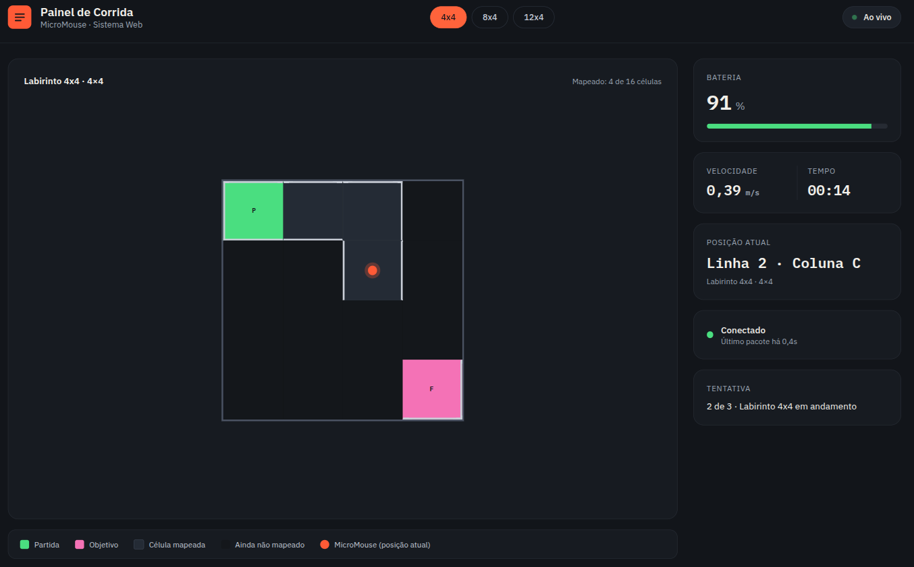
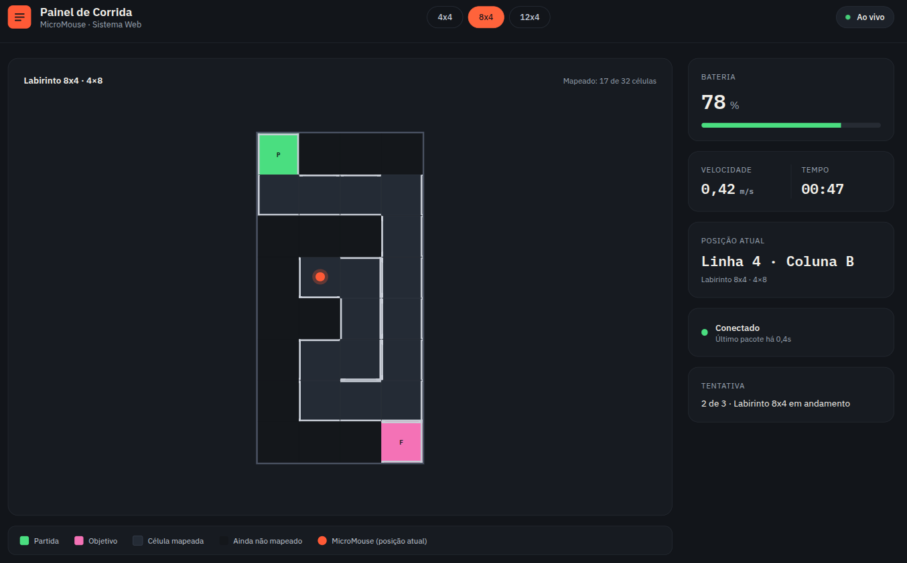
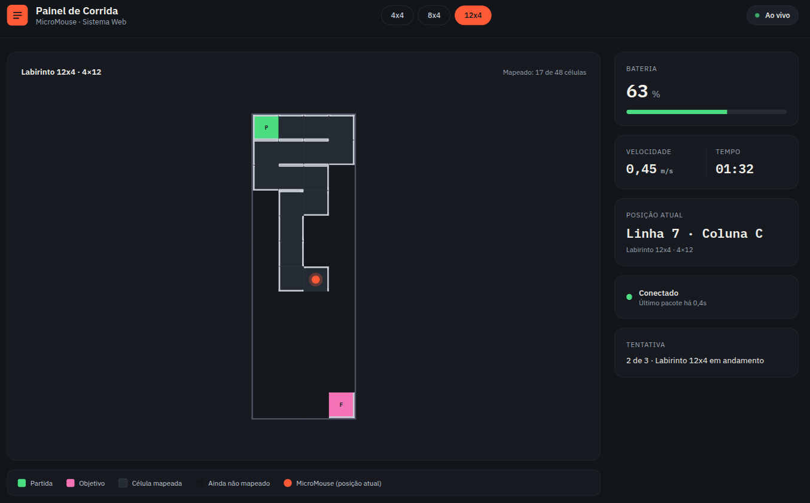
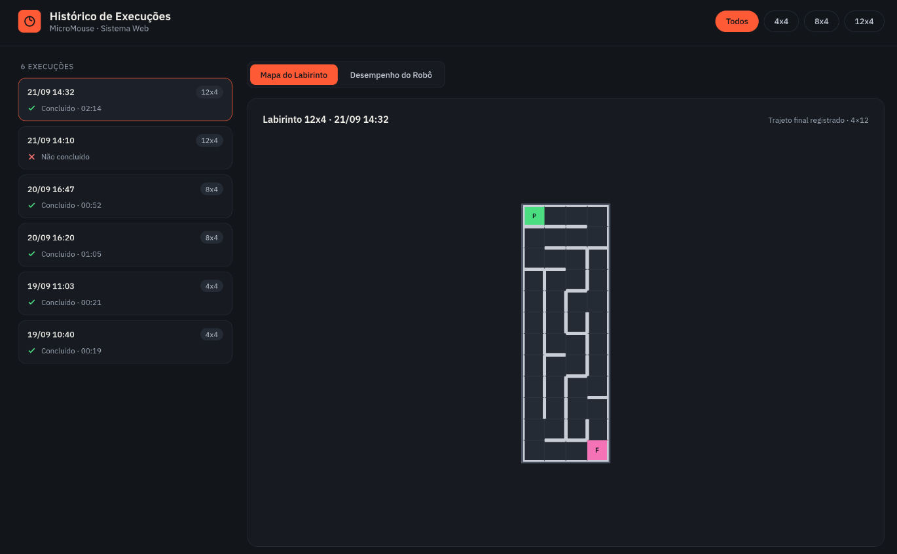
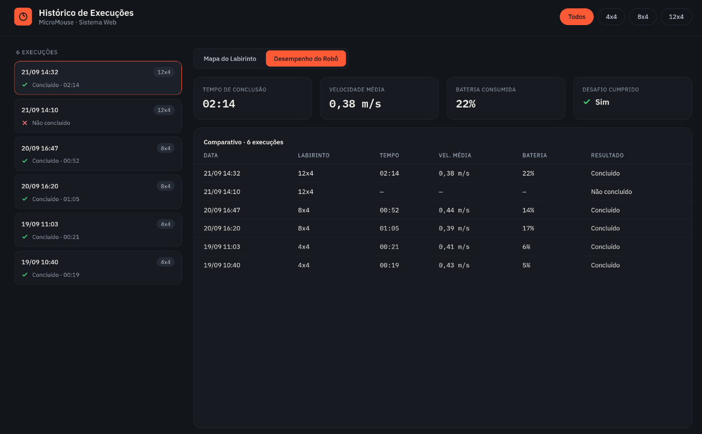
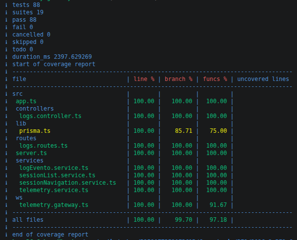
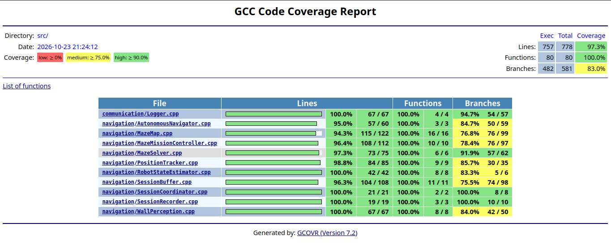

# 7.4 — Testes de software

## Objetivo e estratégia de testes

Os testes de software verificam as regras de negócio, a comunicação entre os componentes e os fluxos que o usuário executa pela interface. A estratégia combina testes unitários, testes de integração entre módulos e testes funcionais de ponta a ponta (*end-to-end*, E2E). Os testes de diagnóstico de hardware são documentados separadamente, pois exigem a ESP32 e componentes físicos.

A suíte do backend utiliza o executor de testes nativo do Node.js com TypeScript carregado por `tsx`. O firmware dispõe de um ambiente nativo do PlatformIO para executar testes no computador, sem gravar o programa na ESP32. Para a interface web, a suíte E2E utiliza Playwright Test com TypeScript.

## Histórias de usuário, protótipos e casos funcionais

A tabela relaciona as histórias de usuário de software com os protótipos disponíveis e com os cenários E2E implementados.

| História de usuário | Protótipo relacionado | Casos funcionais E2E |
|---|---|---|
| **HU-08 — Exibição dos dados estruturais e do mapa do labirinto.** | Painel da corrida com labirintos 4×4, 8×4 e 12×4, apresentados nas figuras abaixo. | `dashboard.spec.ts`: abertura do painel, seleção do tamanho do labirinto e reinício. `simulacao.spec.ts`: apresentação e evolução do mapa no modo de simulação. |
| **HU-09 — Exibição das informações de status e telemetria do robô.** | Painel da corrida, com indicadores e informações do estado do robô. | `simulacao.spec.ts`: estado e indicadores exibidos. `telemetria.spec.ts`: atualização da interface a partir de mensagens WebSocket controladas. |
| **HU-10 — Transmissão de dados de bordo para o dashboard.** | Painel da corrida com o mapa e os indicadores atualizados. | `telemetria.spec.ts`: recepção e interpretação de mensagens WebSocket. `integracao.spec.ts`: envio de mensagens de teste ao backend e verificação da informação apresentada na interface. |
| **HU-11 — Armazenamento das informações de navegação.** | Protótipos do histórico e do trajeto da execução. | `historico.spec.ts`: consulta de sessão e pontos do trajeto. `integracao.spec.ts`: verificação dos dados persistidos no banco e recuperados pela aplicação. |
| **HU-12 — Histórico de sessões, eventos e diagnósticos.** | Protótipos do histórico de execuções e de desempenho. | `historico.spec.ts`: listagem de sessões e filtro de eventos por severidade. `integracao.spec.ts`: consulta de sessão, evento e percurso persistidos. |

### Protótipos da interface

**HU-08 e HU-09 — Painel da corrida**



*Figura 1 — Protótipo do painel da corrida para labirinto 4×4.*



*Figura 2 — Protótipo do painel da corrida para labirinto 8×4.*



*Figura 3 — Protótipo do painel da corrida para labirinto 12×4.*

**HU-11 e HU-12 — Histórico de execuções**



*Figura 4 — Protótipo do histórico de execuções e do trajeto no mapa.*



*Figura 5 — Protótipo do histórico de execuções e indicadores de desempenho.*

## Testes unitários e de integração do backend

Os testes do backend estão em `src/backend/src/` e usam `node:test`/`node:assert` por meio de TypeScript carregado com `tsx`. Os testes verificam os serviços de domínio, controladores, rotas HTTP, inicialização da aplicação e do servidor, a fábrica do Prisma e o gateway WebSocket. Em diferentes testes, as dependências de persistência ou serviços são substituídas por doubles/fakes; portanto, nem todos os testes se conectam a um PostgreSQL real.

| Arquivo de teste | Escopo principal |
|---|---|
| `src/__tests__/app.test.ts` | Health check, CORS, montagem de rotas e ordem dos middlewares. |
| `src/__tests__/server.test.ts` | Configuração da porta, inicialização HTTP/WebSocket e tratamento de falhas de criação da conexão de banco. |
| `lib/__tests__/prisma.test.ts` | Comportamento da fábrica/instância de Prisma. |
| `routes/__tests__/logs.routes.test.ts` | Encaminhamento dos endpoints para os serviços e validação de identificadores. |
| `controllers/__tests__/logs.controller.test.ts` | Respostas dos controladores, validação e tratamento de erros nas operações de sessões, percurso e eventos. |
| `services/__tests__/sessionList.service.test.ts` | Consulta e transformação da lista de sessões. |
| `services/__tests__/sessionNavigation.service.test.ts` | Criação e finalização de sessões, validações e persistência/consulta dos pontos do trajeto, com dependências controladas nos testes. |
| `services/__tests__/logEvento.service.test.ts` | Validação e registro de eventos de diagnóstico. |
| `services/__tests__/telemetry.service.test.ts` | Validação e processamento de mensagens de telemetria, mapa, posição e sessão. |
| `ws/__tests__/telemetry.gateway.test.ts` | Conexões WebSocket, identificação do papel do cliente, validação de mensagens, retransmissão, snapshots e erros do gateway. |

### Como executar os testes do backend

Na pasta `src/backend`:

```bash
npm test
```

Esse comando executa a suíte definida no `package.json`. Para executar os testes de cobertura descritos na seção abaixo, utilize `npm run test:coverage`.

## Testes unitários e de integração do firmware

O firmware configura o ambiente `[env:native]` em `src/firmware/platformio.ini`. Esse ambiente compila os módulos selecionados para execução nativa no computador, usando testes automatizados com dependências de sensores, transporte e armazenamento simuladas quando aplicável. Ele permite validar regras de navegação e integração entre módulos, mas não substitui os testes físicos com a ESP32.

| Suíte em `src/firmware/test/` | Escopo principal |
|---|---|
| `test_maze_map` | Inicialização do mapa, dimensões válidas e representação das células/paredes. |
| `test_maze_solver` | Resolução do labirinto e cálculo de caminhos para diferentes configurações. |
| `test_autonomous_navigator` | Integração entre mapa, solucionador e navegação autônoma. |
| `test_maze_mission_controller` | Coordenação da missão e interação com componentes de navegação e rastreamento. |
| `test_position_tracker` | Atualização da posição/orientação com leitores de odometria e orientação substituíveis por mocks. |
| `test_wall_perception` | Interpretação das leituras dos sensores de parede. |
| `test_robot_state_estimator` | Estimativa e atualização do estado do robô a partir de dados de entrada de teste. |
| `test_logger` | Geração e encaminhamento de registros usando transporte de log de teste. |
| `test_session_buffer` | Bufferização dos dados da sessão e gestão dos dados pendentes. |
| `test_session_recorder` | Registro dos metadados e dos pontos do percurso. |
| `test_session_coordinator` | Coordenação da sessão, registro e integração com logger/armazenamento substituíveis. |
| `test_tracking_adapter` | Adaptação das interfaces de rastreamento utilizadas pelos demais módulos. |

### Como executar os testes do firmware

Na pasta `src/firmware`:

```bash
pio test -e native
```

O filtro `test_filter` do ambiente `native` define as suítes listadas acima. Uma execução bem-sucedida indica que os testes nativos selecionados passaram; não comprova, por si só, o funcionamento elétrico dos sensores, motores ou da comunicação Wi-Fi na placa física.

### Diagnósticos de hardware

Os projetos independentes em `src/firmwareTest/` destinam-se à verificação de componentes físicos com a ESP32 para os testes de Hardware. Esses diagnósticos são executados separadamente, podem exigir ação do operador e não fazem parte da cobertura esperada para os testes de Software. Os resultados dependem das conexões, da alimentação e do hardware disponível durante a execução.

## Cobertura de código (*coverage*)

As imagens abaixo registram os relatórios de cobertura produzidos para os módulos testados. A cobertura indica a parte do código executada durante os testes e deve ser interpretada junto com os cenários e as asserções; não garante, isoladamente, a ausência de defeitos.

### Cobertura do backend



*Figura 6 — Captura do relatório de cobertura do backend.*

O relatório do backend é produzido pelo script `src/backend/scripts/test-coverage.sh`, executado pelo comando `npm run test:coverage`. O script utiliza o recurso de cobertura do executor nativo do Node.js (`--experimental-test-coverage`) e carrega os arquivos TypeScript por meio de `tsx`. Para cada alvo, executa os testes correspondentes, inclui o arquivo de implementação medido e exclui arquivos de teste do cálculo.

Para reproduzir o relatório/validação:

```bash
cd src/backend
npm run test:coverage
```

### Cobertura do firmware



*Figura 7 — Captura do relatório de cobertura do firmware.*

A cobertura do firmware é coletada no ambiente nativo do PlatformIO. Em `src/firmware/platformio.ini`, o ambiente `[env:native]` habilita a instrumentação do compilador com `--coverage` e `-lgcov`, além de símbolos de depuração (`-g`) e otimização desativada (`-O0`) para facilitar a medição. A execução dos testes gera os dados de execução usados pelo GCC/gcov; o relatório HTML versionado em `src/firmware/coverage.html` identifica o **gcovr 7.2** como gerador do relatório detalhado.

Para reproduzir a execução dos testes que alimentam a cobertura:

```bash
cd src/firmware
pio test -e native
```

Após executar os testes instrumentados, o `gcovr` pode processar os dados gerados e atualizar o relatório HTML, conforme as opções do ambiente de desenvolvimento. A figura `CoverageFirmware.png` registra visualmente esse resultado. A cobertura abrange os arquivos incluídos pelo filtro de compilação do ambiente `native`; não representa a cobertura de todo o firmware embarcado nem dos diagnósticos físicos em `src/firmwareTest/`.

## Testes funcionais E2E da interface web

A suíte E2E fica em `src/frontend/e2e/` e utiliza Playwright Test com TypeScript. Os cenários padrão substituem respostas HTTP e mensagens WebSocket por dados controlados, para permitir execuções repetíveis sem um robô físico ou banco de dados preenchido previamente.

| Arquivo/caso | Histórias/área | Verificações funcionais |
|---|---|---|
| `dashboard.spec.ts` | HU-08/HU-09 | Abertura do painel, seleção de labirintos 4×4/8×4/12×4, reinício e tratamento de indisponibilidade da API de sessões. |
| `simulacao.spec.ts` | HU-08/HU-09 | Execução simulada sem hardware, posição do robô e indicadores de bateria, rodas e PID. |
| `historico.spec.ts` | HU-11/HU-12 | Consulta da sessão, pontos do trajeto, filtro por severidade e retorno ao dashboard. |
| `telemetria.spec.ts` | HU-08/HU-09/HU-10 | Recepção de mensagens WebSocket controladas e atualização do mapa, do estado do robô e das métricas. |
| `integracao.spec.ts` | HU-10/HU-11/HU-12 | Cenário com backend e PostgreSQL reais: envio de dados de sessão/telemetria, persistência e consulta de eventos e pontos do percurso pela interface. |

### Como executar os testes E2E

Na pasta `src/frontend`:

```bash
npm install
npx playwright install chromium
npm run test:e2e
```

Para executar pela interface interativa do Playwright:

```bash
npm run test:e2e:ui
```

O cenário com backend real deve ser executado somente com o backend iniciado, `DATABASE_URL` apontando para um PostgreSQL exclusivo de teste, Prisma Client gerado e migrações aplicadas:

```bash
npm run test:e2e:backend
```

Esse cenário cria registros persistentes e não deve ser executado contra banco de produção ou compartilhado. O Playwright pode produzir relatório HTML, screenshots, vídeo e trace de falhas conforme a configuração da suíte; esses artefatos devem ser preservados quando forem utilizados como evidência da execução.

**Estado da validação:** na última execução relatada de `npm run test:e2e:backend`, o teste de integração falhou porque a sessão permaneceu com status `EM_ANDAMENTO`, enquanto o caso esperava `CONCLUIDO`. Portanto, esse cenário ainda precisa ser corrigido/reexecutado antes de ser registrado como aprovado. Não se deve considerar a suíte E2E integralmente aprovada apenas porque os arquivos de teste e a configuração estão presentes.

## Limitações e interpretação dos resultados

- Testes com mocks validam os componentes e seus contratos, mas não garantem que uma dependência real (como PostgreSQL, rede ou sensor físico) esteja configurada corretamente.
- A cobertura apresentada corresponde apenas aos módulos e arquivos instrumentados pelos respectivos scripts/configurações. Ela não equivale à cobertura total de todo o sistema.
- Os testes nativos do firmware não movimentam motores nem verificam as ligações elétricas reais. Para isso, devem ser utilizados os diagnósticos em `src/firmwareTest/` e o roteiro de testes físicos.
- O cenário E2E com backend e PostgreSQL reais só deve ser considerado aprovado após passar integralmente e ter seu relatório de execução preservado.