# 7.5 — Testes de integração

## Sumário

- [Objetivo, alcance e resultado geral](#1-objetivo-alcance-e-resultado-geral)
- [Matriz consolidada do modelo](#2-matriz-consolidada-do-modelo)
- [Configuração, instrumentos e condições](#3-configuração-instrumentos-e-condições)
- [Evolução dos testes](#4-evolucao-dos-testes)
- [Procedimentos e resultados por subsistema](#5-procedimentos-e-resultados-por-subsistema)
- [Evidências em vídeo](#6-evidencias-em-video)

## 1. Objetivo, alcance e resultado geral

| Campo | Definição do relatório |
|---|---|
| Objetivo | Consolidar os testes de integração do MicroMouse — Projeto Integrador 1, Grupo 2, UnB |
| Período | Ensaios instrumentados de 12–18/11/2026 e atualização com vídeos identificados em 22–23/11; revisão em 23/11/2026 |
| Resultado geral | Acionamento, frenagem, giros, avanços, Bluetooth e comandos pelo site demonstrados; registros recentes mostram curva no labirinto e locomoção sem cabo |
| Evolução da montagem | Motor travado substituído; bateria elevada com duas espumas para liberar o disco do encoder; peça mais alta do chassi em impressão |
| Alcance | Curvas realizadas com repetibilidade ainda variável, conforme a equipe; travessia completa do labirinto não aferida neste conjunto de registros |
| Responsáveis / aprovações | A confirmar pela equipe e pelo orientador; êxito em um teste não equivale à aprovação formal |
| Ordem de leitura | Por dependência técnica; a seção 4 resume as etapas da campanha |

### Como ler os resultados

| Tipo de registro | O que informa | Limite |
|---|---|---|
| Instrumentado | Encoder, IMU, pulso, ACK ou log | Resolução numérica não equivale à exatidão física |
| Observação do operador | Contato, cabo preso e medida com régua | Distâncias podem ser aproximadas |
| Foto / vídeo | Sentido, sequência e contato visível | Câmera móvel, perspectiva e ausência de escala limitam medidas |
| Estimativa / cálculo | Contagens por volta, raio e posição nominal | Depende das hipóteses indicadas |
| Teste automatizado | Software com entradas controladas | Não substitui alimentação, aderência, montagem ou percurso real |

| Convenção | Significado |
|---|---|
| Ângulos nas tabelas | Sem sinal: magnitude do giro; D = direita e E = esquerda |
| Yaw nos registros | Mantém o sinal fornecido pelo firmware; valores negativos nas curvas à direita não são erro de transcrição |
| Sensores F / E / D | Frontal / esquerdo / direito; unidade indicada em cada tabela |
| Flags F=1 / E=0 / D=1 | Validade das leituras, não presença/ausência de parede |
| Velocidades dos perfis | Máximos de referência comandados; não são medição independente da velocidade física de pico |
| Duração | Tempos do firmware incluem as parcelas informadas; tempo de vídeo em câmera lenta não é tempo real de movimento |

## 2. Matriz consolidada do modelo

As 16 famílias resumem a evolução dos ensaios, das dificuldades identificadas às correções e aos resultados alcançados. Os testes iniciais e os registros recentes são apresentados separadamente para mostrar o progresso do projeto.

| **ID** | **Descrição** | **Data de Início** | **Situação do ensaio** | **Sub-equipes** | **Responsável** | **Resultados Esperados** | **Resultados Obtidos** | **Aprovação Interna (S/N)** | **Aprovação do Orientador (S/N)** | **Observações** |
|:---:|---|---|---|---|---|---|---|---|---|---|
| [5.1](#t51) | Ambiente, compilação e gravação | 12/11/2026 | Compilação, gravação e execução demonstradas | Software / Eletrônica | A confirmar | Compilar no Mac ARM64 e executar a versão gravada | Uploads verificados; ESP identificada e diagnósticos executados | A confirmar | A confirmar | Ambiente VS Code/PlatformIO disponível e utilizado |
| [5.2](#t52) | ESP32, DRV8833 e motores | 12/11/2026 | Acionamento demonstrado após ajustes | Eletrônica / Energia / Software | A confirmar | Acionar os motores e liberar sua rotação | Motor travado substituído; bateria elevada, liberando o disco do encoder; rodas acionadas | A confirmar | A confirmar | Duas espumas elevam a bateria enquanto a peça mais alta do chassi é impressa |
| [5.3](#t53) | Encoders e conversão para distância | 12/11/2026 | Sinais e fatores de conversão estabelecidos | Eletrônica / Software | A confirmar | Relacionar contagens e deslocamento das rodas | Sinal direito corrigido; fatores provisórios de 292 e 284 contagens/volta | A confirmar | A confirmar | Calibração por marca preta; contato mecânico com a bateria corrigido na montagem |
| [5.4](#t54) | Frenagem e repouso | 12/11/2026 | Repouso registrado nos ensaios | Software / Eletrônica / Energia | A confirmar | Reduzir sobrepassagem e confirmar parada | Frenagem ativa, aproximação do alvo e espera de estabilização incorporadas | A confirmar | A confirmar | Controle passou a distinguir desligamento, frenagem e repouso |
| [5.5](#t55) | Giros de bancada com IMU e encoders | 12/11/2026 | Giros de 30°, 90° e 180° demonstrados | Software / Eletrônica / Estruturas | A confirmar | Girar próximo do alvo e equilibrar as rodas | Controle individual melhorou o giro; alvo de 90° chegou a 89,61° pela IMU | A confirmar | A confirmar | Área aberta de 30 cm; evolução no labirinto registrada em 5.13 |
| [5.6](#t56) | Avanços de 30 e 180 mm | 12/11/2026 | Avanços controlados demonstrados | Software / Eletrônica | A confirmar | Avançar e preservar rumo | Alvos atingidos aproximadamente pelos encoders e pela conferência física | A confirmar | A confirmar | Correção de rumo e sincronização das rodas ajustadas |
| [5.7](#t57) | Velocidade e movimentos encadeados | 13/11/2026 | Perfis mais rápidos comparados | Software / Eletrônica / Estruturas | A confirmar | Reduzir o tempo dos movimentos | Retas a até 100 mm/s e giros a até 55°/s; bloco V17 cerca de 9,4% mais rápido que a repetição V16 | A confirmar | A confirmar | Tempos de trechos; ensaio afetado pelo cabo excluído da comparação |
| [5.8](#t58) | Ultrassons, montagem e calibração | 16/11/2026 | Reconexões e calibração estática realizadas | Eletrônica / Software / Estruturas | A confirmar | Obter medidas coerentes nas referências de bancada | Reconexão dos fios e offsets melhoraram a correspondência com referências de 3, 5 e 10 cm | A confirmar | A confirmar | Leituras dinâmicas variaram; alimentação de 3,3 V relatada pela equipe |
| [5.9](#t59) | Percepção, filtros e recuperação de eco | 16–17/11/2026 | Filtro e pausa/retomada exercitados | Software / Eletrônica | A confirmar | Tratar leituras isoladas e recuperar aquisição | Janela válida, mediana de três disparos e recuperação com quadros novos implementadas | A confirmar | A confirmar | Proteções mantidas para leituras repetidamente inválidas |
| [5.10](#t510) | Bluetooth real no Mac | 17/11/2026 | Enlace e reconexões demonstrados | Software / Eletrônica | A confirmar | Transmitir dados e reconectar | Receptor RFCOMM recebeu 115 quadros válidos em três conexões | A confirmar | A confirmar | Solução nativa restabeleceu a recepção após as dificuldades da porta virtual |
| [5.11](#t511) | Yaw e compensação de repouso | 17/11/2026 | Estabilidade em repouso demonstrada | Software / Eletrônica | A confirmar | Reduzir deriva quando imóvel | Ensaio de 30,06 s manteve yaw transmitido em 0,0161° | A confirmar | A confirmar | Resultado do diagnóstico Bluetooth; orientação relativa |
| [5.12](#t512) | Site original, telemetria e comandos | 17/11/2026 | Telemetria e início/parada integrados | Software / Eletrônica | A confirmar | Exibir dados reais e controlar a missão | Dashboard original preservado; confirmações reais de START e STOP; estados acompanhados no painel | A confirmar | A confirmar | Monitor ao vivo; banco histórico não configurado nessa campanha |
| [5.13](#t513) | Navegação e locomoção no 4×4 | 16–23/11/2026 | Trechos e manobras demonstrados | Todas as interfaces envolvidas | A confirmar | Integrar movimento, leitura e acompanhamento no labirinto | Avanços e giros iniciais; vídeos recentes acrescentam curva e movimento sem cabo | A confirmar | A confirmar | Curvas ainda variam entre repetições; sem travessia completa aferida |
| [5.14](#t514) | Comparação de curvas segmentadas | 17–18/11/2026 | Estratégias comparadas e reservas ajustadas | Software / Eletrônica / Estruturas | A confirmar | Comparar giros de 45°/30° e pequenos avanços | Etapas executadas e folgas medidas orientaram ajustes de trajetória | A confirmar | A confirmar | Ensaios históricos; novo vídeo de curva analisado separadamente em 5.13 |
| [5.15](#t515) | Perfil de arco contínuo e recuo | 18/11/2026 | Perfil implementado e simulado | Software / Eletrônica / Estruturas | A confirmar | Preparar curva contínua após observar abertura | Controle de arco integrado e cenários aprovados em software | A confirmar | A confirmar | Na tentativa física arquivada dessa versão, recuo interrompido antes do arco |
| [5.16](#t516) | Testes automatizados e integração de software | 12–18/11/2026 | Suítes executadas nas revisões registradas | Todas as sub-equipes | A confirmar | Verificar controlador, comunicação e interface | Progressão até 207 testes de firmware no marco do perfil de arco | A confirmar | A confirmar | Contagens históricas por versão, sem somar execuções de diferentes revisões |

## 3. Configuração, instrumentos e condições

### 3.1 Ambiente e identificação da montagem

| Elemento | Registro desta campanha | Limitação |
|---|---|---|
| Computador | MacBook Air Apple Silicon, arquitetura ARM64; VS Code e PlatformIO | Ambiente já estava disponível quando foi inspecionado, apesar da hipótese inicial de ambiente limpo |
| Toolchain | PlatformIO Core 6.2.1b2; pioarduino 55.03.312; Arduino-ESP32 3.3.12; ferramentas Apple de compilação | Descreve versões verificadas nos registros históricos |
| Placa | ESP32-D0WD-V3, revisão 3.1, dois núcleos, flash de 4 MB | Interface USB CP2102; porta observada `/dev/cu.usbserial-0001` |
| Atuação | Dois motores N20 com encoders e ponte H DRV8833 | Alimentação USB da lógica não prova que os motores estejam alimentados |
| IMU | Módulo identificado como MPU6500; identificador lido 0x70 | Menções iniciais a MPU6050 não substituem essa identificação; yaw relativo |
| Distância | Três HC-SR04, frontal/esquerdo/direito, em TRIG/ECHO | Nomes de driver/comentários ainda referiam US-100; isso não muda o módulo físico informado |
| Energia | Bateria do robô e USB conforme a etapa; vídeo V13 mostra locomoção sem USB | O cabo facilitava novas gravações durante os ajustes; o ensaio sem cabo demonstra operação alimentada pela bateria |
| Folga motor–bateria | Motor travado substituído; disco do encoder estava raspando na bateria | Duas espumas elevam a bateria; nova peça do chassi, mais alta, em impressão |
| Referências físicas | Régua, medidas aproximadas do operador, marca preta nas rodas, quadrado de 30 cm e percurso improvisado de 30×50 cm | Ausência de instrumentação metrológica para aferir erro milimétrico ou angular em todos os ensaios |
| Comunicação e interface | Bluetooth Classic SPP/RFCOMM, ponte nativa no Mac, backend local e React | Monitor sem persistência PostgreSQL; capturas locais arquivadas como evidência, não como banco da aplicação |

| Interface | GPIOs / configuração |
|---|---|
| Motor esquerdo / direito | 16–17 / 18–19; DRV8833 |
| Habilitação e PWM | nSLEEP 5; 20 kHz / 8 bits |
| Encoder esquerdo / direito | 32–33 / 25–26; direita invertida no software |
| Sonar frontal / esquerdo / direito | TRIG–ECHO: 4–35 / 14–36 / 27–39 |
| I2C | SDA21/SCL22; endereço configurado da IMU 0x68 |
| Identificação da IMU | WHO_AM_I 0x70 não é endereço I2C |
| Limite da pinagem | Software e pontos inspecionados; não é ensaio completo de continuidade |

| Etapa | Condição registrada |
|---|---|
| Início | Rodas suspensas; bateria/USB conforme o ensaio |
| Bancada no piso | Área aberta e percurso improvisado; cabo supervisionado |
| Labirinto | No chão; bateria ligada quando confirmada |
| Montagem revista | Segundo o operador, todos os vídeos, exceto os primeiros ensaios com problema nos motores, já usam as espumas; V12–V13 também usam o motor substituído |

### 3.2 Geometria confirmada e hipóteses descartadas

| Grandeza | Valor adotado no recorte | Origem/observação |
|---|---:|---|
| Diâmetro da roda com pneu | 34 mm | Medida informada pelo operador |
| Bitola entre centros dos pneus | Aproximadamente 120 mm | Não é largura externa total |
| Largura externa máxima | Aproximadamente 125 mm | Medida posterior do operador |
| Vão livre entre faces das paredes | 170 mm | Confirmado após dúvida sobre comprimento das peças |
| Espessura adotada da parede | 10 mm | Informação para o cálculo do passo; foto posterior anota 1,2 cm em um elemento de encaixe, que exige conciliação futura |
| Passo entre centros das células | 180 mm = 170 + 10 mm | Não usar 160 mm da peça como vão livre |
| Eixo até extremidade frontal/traseira | 86/34 mm, aproximadamente | Medidas anteriores; reconfirmar se a montagem mudar |
| Avanço longitudinal do sensor lateral em relação ao eixo | Aproximadamente 40 mm | Foto anotada; **não é distância do eixo à face do sensor frontal** |
| Eixo até face do sensor frontal, no comprimento | Não confirmado neste recorte | Impede calcular de forma definitiva uma referência frontal de centro |

| Cálculo / hipótese | Resultado | Interpretação |
|---|---|---|
| Passo entre centros | 170 + 10 = 180 mm; dois avanços 360 mm; três 540 mm | Célula já ocupada não conta como avanço; `16+1+16+1+16` não define três passos |
| Folga estática | (170−125)/2 = 22,5 mm por lado | Robô centralizado; não necessariamente leitura da face do sensor |
| Quadrado ideal de 120 mm | Diagonal ≈169,7 mm | Quase todo o vão de 170 mm; eixo real deslocado e cabos alteram a envoltória |
| Quina retangular hipotética | √(86²+62,5²) ≈106,3 mm de raio | Limite conservador; chassi arredondado e aberturas podem mudar o resultado |
| Referência frontal de centro | 85 mm − projeção eixo–face do sensor frontal | Projeção não confirmada; referência definitiva pendente |
| Cálculo de 4,5 cm descartado | Usava os 4 cm da foto lateral como se fossem frontais | Não foi aplicado como referência de centro |
| Limite de partida de 4,5 cm | Usado depois para avanço de 1 cm com reserva de 3,5 cm | Outro conceito; não é o cálculo geométrico descartado |

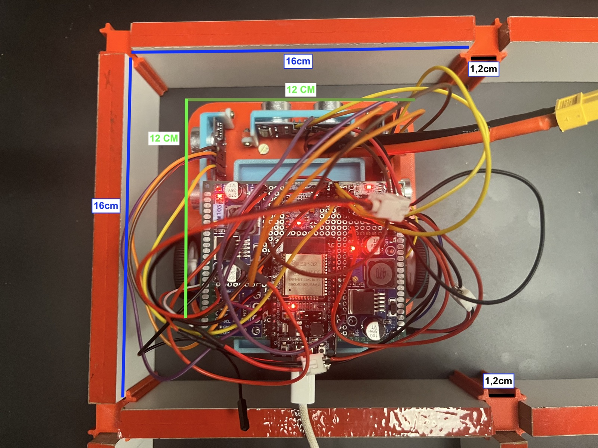

*Figura 1 — Foto IMG_4101: chassi indicado como 12×12 cm, peças de parede indicadas como 16 cm e detalhe de encaixe como 1,2 cm. As anotações não substituem a medição do vão livre de 17 cm nem confirmam o passo a partir da perspectiva.*

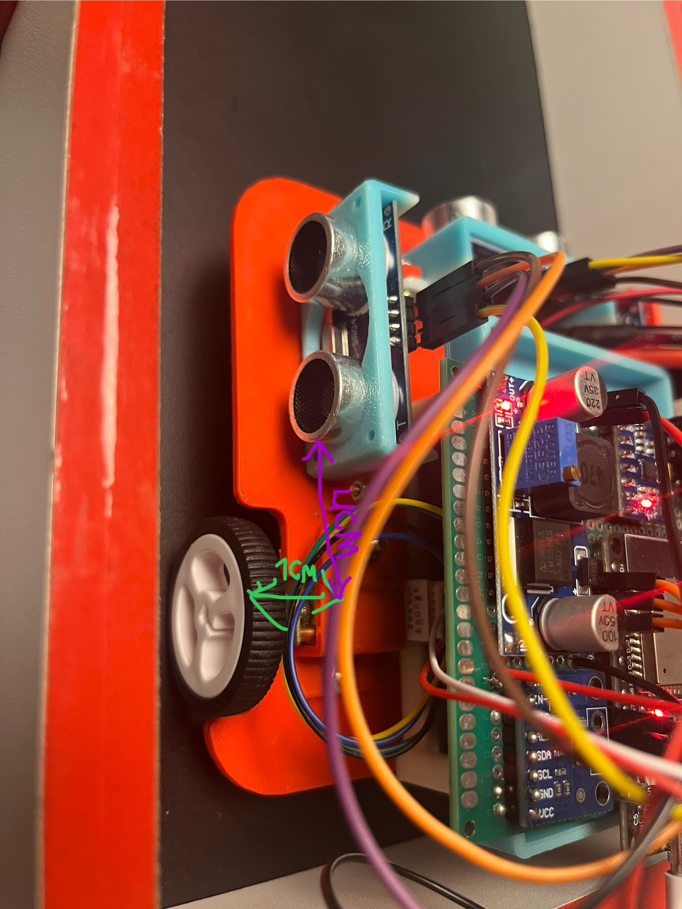

*Figura 2 — Deslocamento do sensor lateral à frente do eixo. A indicação de 1 cm é lateral junto à roda; não define a ponta frontal a 5 cm do eixo.*

## 4. Evolução dos testes

| Período | Trabalho realizado | Marco e limite |
|---|---|---|
| 12/11 | Verificação do ambiente, USB, bancada de motores, encoders, frenagem, IMU, giros e primeiros avanços | Movimentos observados; calibrações ainda provisórias |
| 13/11 | Encadeamento supervisionado, redução do desvio de rumo, evolução V9–V17 e perfis mais rápidos | Melhoras de bancada; não equivalem a navegação autônoma |
| 16/11 | Integração do controle ao firmware principal, partida manual, medidas reais do labirinto e calibração dos ultrassons | Vão de 17 cm esclarecido; sensores apresentaram discrepâncias |
| 17/11 | Bluetooth, correção do yaw diagnóstico, site original, comandos remotos, filtragem e missões no 4×4 | Enlace e comando demonstrados; paradas por leitura e colisões persistiram |
| Noite de 17 para 18/11 | Comparação entre curvas segmentadas, conferência estática e proposta de arco | Medidas e resultados das etapas orientaram a revisão da trajetória |
| 18/11 | Navegação experimental com arco e teste esquerdo isolado | Missão parou por eco; teste isolado parou durante recuo |
| Atualização recebida em 23/11 | Diagnóstico mecânico: motor travado e disco do encoder raspando na bateria | Motor substituído; duas espumas elevam a bateria; peça mais alta do chassi em impressão |
| Arquivos identificados em 22–23/11 | Novos vídeos de curva e deslocamento sem cabo | Montagem corrigida; sem reposicionamento manual informado; repetibilidade da curva ainda variável |
| 23/11 | Consolidação dos resultados e vídeos no Drive | Revisão documental; nenhuma nova execução de motores para elaborar o relatório |

## 5. Procedimentos e resultados por subsistema

| Etapa de leitura | Famílias | Dependência / objetivo |
|---|---|---|
| A — Preparação e bancada | [5.1–5.7](#t51) | Identificar ambiente; acionar, medir, frear, girar, avançar e ajustar velocidade |
| B — Sensores e percepção | [5.8–5.9](#t58) | Comparar medidas e tratar validade, idade, outliers e recuperação |
| C — Comunicação e interface | [5.10–5.12](#t510) | Transmitir dados, estabilizar yaw diagnóstico e confirmar comandos pelo site |
| D — Integração no percurso | [5.13–5.15](#t513) | Observar paredes, analisar falhas e comparar curvas segmentadas com a proposta de arco |
| E — Consolidação | [5.16](#t516) | Separar testes automatizados, evidência física, motivos de parada e pendências |

### Etapa A — Preparação e movimento em bancada

#### 5.1 Ambiente de desenvolvimento, compilação e gravação

| Item | Procedimento / condição | Resultado e limite |
|---|---|---|
| Objetivo | Identificar ESP, compilar no Mac ARM64 e gravar diagnóstico | Compilação, gravação e execução serial demonstradas |
| Ambiente | VS Code, PlatformIO, toolchain e porta inspecionados | Já estavam disponíveis; Core privado não exigiu inclusão no PATH |
| USB | CP2102 em `/dev/cu.usbserial-0001`; fechar monitores concorrentes | ESP32-D0WD-V3 identificada; a posição da USB-C não define o nome serial |
| Gravação | Upload e verificação dos dados; conferir mensagem de inicialização | Hashes verificados; gravar substitui a aplicação anterior da ESP |
| Evolução | Diagnóstico USB → motores/encoders → Bluetooth → missão | A versão integrada passou a exigir partida explícita e espera de 5 s |
| Ressalva | Microbenchmark inicial sob cobertura falhou e passou isoladamente | Não equivale a falha física; compilação também não valida a navegação |

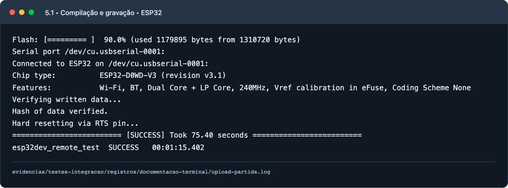

*Figura 3 — Trecho do log de upload com identificação, verificação e conclusão. Fonte: `upload-partida.log`; não houve nova gravação para produzir o relatório.*

#### 5.2 Ponte H e acionamento dos motores

| Etapa | Diagnóstico / ação | Resultado alcançado |
|---|---|---|
| Inspeção inicial | Um motor estava travado | Motor substituído por uma unidade nova |
| Paradas intermitentes | Disco traseiro do encoder raspava na bateria, dificultando a rotação | Identificada a interferência mecânica responsável pela ocorrência relatada |
| Solução provisória | Duas espumas elevam a bateria e afastam-na do disco do encoder | Rotação liberada para dar continuidade aos ensaios |
| Solução estrutural | Peça mais elevada do chassi em impressão | Incorpora à geometria a folga obtida provisoriamente com as espumas |
| Acionamento elétrico | DRV8833; nSLEEP GPIO5; PWM 20 kHz/8 bits; espera de 10 ms; sketch de referência a 230/255 | Ambas as rodas acionadas e sentido de avanço confirmado |
| Primeiro pulso fraco | 200 ms a 60/255, sem movimento visível | O diagnóstico evoluiu do ajuste de comando para a inspeção e correção mecânica; esse pulso isolado não identifica a causa |
| Reteste da montagem | Operador confirmou motor substituído nos vídeos V12–V13 e uso das espumas nos vídeos posteriores aos ensaios iniciais problemáticos | Registros recentes mostram deslocamento no piso e manobra no labirinto |

A revisão combinou ajustes de comando e correções mecânicas: substituição do motor travado e afastamento da bateria. Com o disco do encoder livre, a equipe deu continuidade aos ensaios de deslocamento e curva.

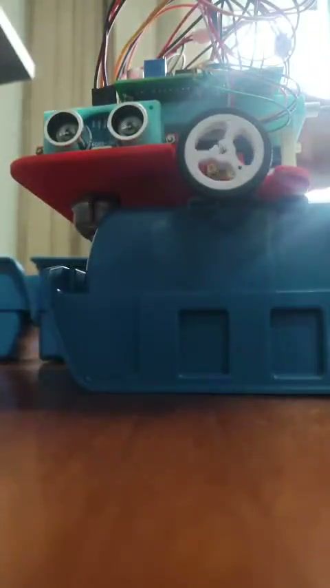

*Figura 4 — Ensaio motor–encoder, extraído de V01 em 3,0 s: registro da roda e da montagem utilizada na bancada.*

#### 5.3 Encoders: sinais, voltas e fatores provisórios

| Etapa | Método | Resultado / decisão |
|---|---|---|
| Sentido | PCNT e comparação com avanço físico | Esquerdo positivo; direito bruto negativo; configurada inversão do direito |
| Liberdade mecânica | Inspeção posterior identificou o disco raspando na bateria | Elevação com duas espumas liberou sua rotação; folga incorporada à nova peça do chassi |
| Referência visual | Marca preta acompanhada nos vídeos; acionamento pelos motores | Não girar as rodas à força; distinguir marca física de padrões repetidos dos raios |
| Validade | Contagem final após parar, comparada às voltas estimadas | Perspectiva, sobrepassagem e escorregamento limitam a calibração |

| Vídeo / roda | Contagem final | Voltas estimadas | Contagens por volta |
|---|---|---|---|
| V01 — esquerda, 1º vídeo | 797 | 2,74 | ≈291 |
| V02 — esquerda, alvo 290 | 387 | 1,32 | ≈293–294 |
| V03 — direita, alvo 290 | 402 | 1,415–1,42 | ≈284 |

| Referência adotada | Cálculo / valor | Limite |
|---|---|---|
| Roda esquerda | 292 contagens/volta → 2,73372 contagens/mm | Provisório |
| Roda direita | 284 contagens/volta → 2,65882 contagens/mm | Provisório |
| Perímetro | π × 34 mm ≈ 106,81 mm | Diâmetro informado; efetivo sob carga ainda a conferir |
| Hipótese descartada | 720 contagens/volta | Incompatível com as voltas observadas nesse modo PCNT |

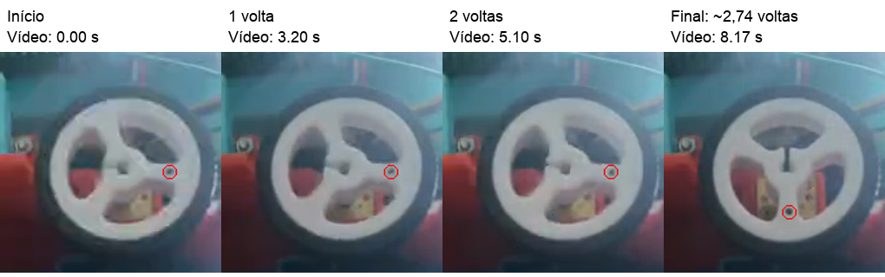

*Figura 5 — V01 — Conferência da marca preta; cerca de 2,74 voltas para 797 contagens finais.*

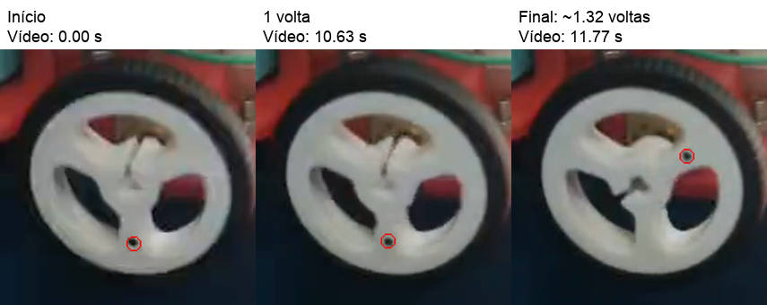

*Figura 6 — V02 — Alvo de 290 contagens, com leitura posterior de 387; o alvo não garante parada após uma volta.*

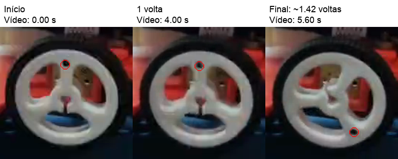

*Figura 7 — V03 — Estimativa visual de aproximadamente 1,42 voltas para 402 contagens finais.*

**Vídeos:** [V01](https://drive.google.com/file/d/1g3uV95nU0twike6R5Prvyv-zLltl7K9L/view?usp=drivesdk) · [V02](https://drive.google.com/file/d/1Pcbvug-mPit7MYGtWEw2yyGuBOxlYoUc/view?usp=drivesdk) · [V03](https://drive.google.com/file/d/1ffQdXgLyXSgeOBjFqEAIfD5uGMia3oBu/view?usp=drivesdk).

#### 5.4 Sobrepassagem, frenagem ativa e estabilização

| Condição | Registro | Conclusão do ensaio |
|---|---|---|
| Sleep / roda livre | Contagens continuavam crescendo após desligar | Desligar a ponte não produz frenagem imediata |
| Esquerda: alvo 290, frenagem de 80 ms | 351 após frear; 387 depois → +97 contagens | Frenagem fixa ainda permitiu sobrepassagem relevante |
| Direita: alvo 290, frear até repouso | 372 ao terminar; 372 nas consultas posteriores → +82 contagens | Estabilidade observada, ainda com cerca de 31 mm de sobrepassagem de roda |
| Nova condição de parada | Pelo menos 200 ms de freio; 80 ms sem contagem; teto de 800 ms | Melhora de assentamento em um reteste, não distância universal de frenagem |
| Evolução do controle | Redução de velocidade perto do alvo e antecipação da frenagem | Passou a diferenciar parada comandada, freio aplicado e repouso confirmado |
| Integração | Falha caso o repouso não se confirme | Uma proteção pode parar depois de ocorrer contato com a parede |

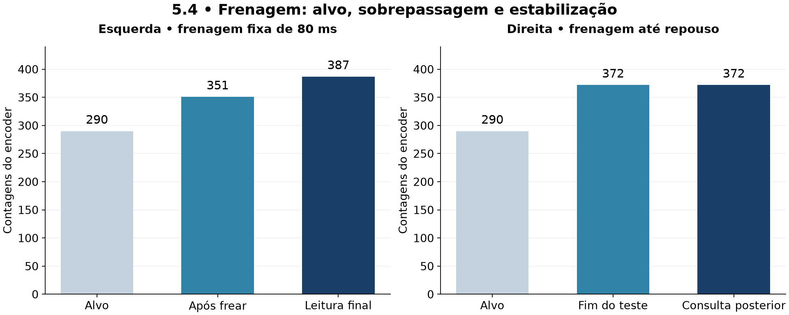

*Figura 8 — Alvo, leitura após frear e estabilização nos ensaios registrados. Rodas/condições diferentes; não é comparação estatística pareada.*

#### 5.5 IMU, controle independente e giros em área aberta

| Preparação | Controle | Condição de validação |
|---|---|---|
| Quadrado de 30×30 cm; eixo referenciado; IMU calibrada imóvel | Yaw pela IMU e progresso individual por encoder | Área aberta; não comprova giro no vão de 17 cm |
| Correção individual por roda e frenagem da adiantada | Substituiu o comando simétrico insuficiente | Equilíbrio de arcos foi estimado pelos fatores provisórios |

| Alvo / configuração | Ângulo final | Encoders / deslocamento | Interpretação |
|---|---|---|---|
| 30° D, comando simétrico | 26,50° | +8 / −143; recuo médio estimado ≈25 mm | Uma roda quase não avançou |
| 30° D, controle individual | 28,50° | +76 / −87; média ≈−2,5 mm | Vídeo compatível com cerca de 29°; translação não aferida em mm |
| Primeiro 90° D | 88,19° | +262 / −252; arcos ≈95,8 / 94,8 mm | Equilíbrio interno favorável neste ensaio |
| Primeiro 90° E | 88,48° | Sentido conferido no robô | Vídeo próximo de um quarto de volta |
| Primeiro 180° D | 178,47° | +524 / −510; arcos ≈191,7 / 191,8 mm | Meia-volta confirmada visualmente |
| 90° D, freio angular revisto | 89,61° | Subgiro reduzido neste ensaio | Requer repetição nas demais condições |

| Ajuste / ressalva | Registro |
|---|---|
| Antecipação angular | De `max(2°, taxa×0,07 s)` para `max(0,6°, taxa×0,04 s)` |
| Travessia −180°/+180° | Acumulador validado em software; primeiro giro físico de 180° parou antes dessa travessia |
| Exatidão | Decimais são da IMU; vídeo verifica sentido e ordem de grandeza |
| Beco sem saída | Meia-volta de bancada não alterou automaticamente a ré de uma célula usada por determinada versão da missão |

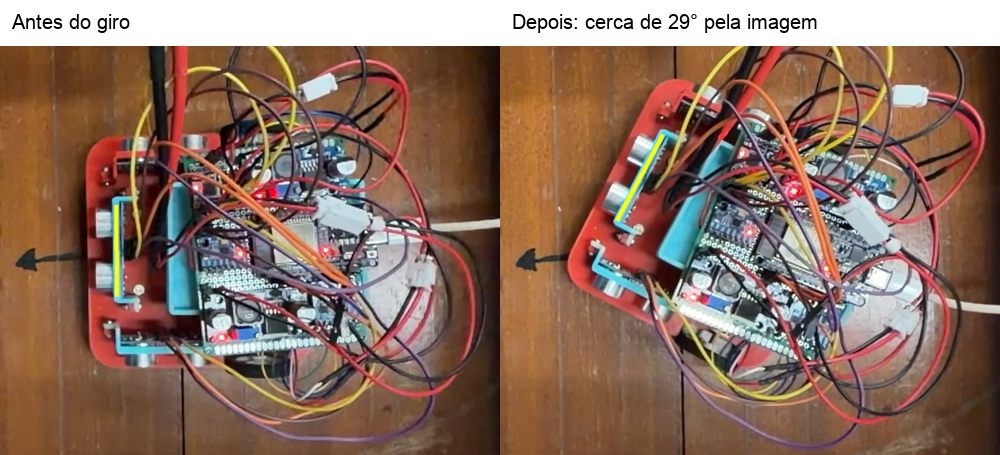

*Figura 9 — Giro curto: controle individual reduziu a translação estimada; rodas parcialmente ocultas no vídeo.*

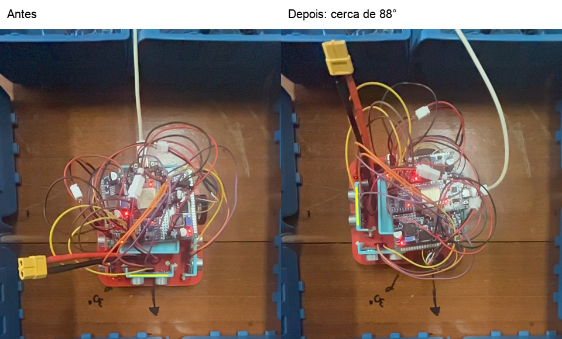

*Figura 10 — Primeiro giro próximo de 90° à direita na área de 30 cm.*

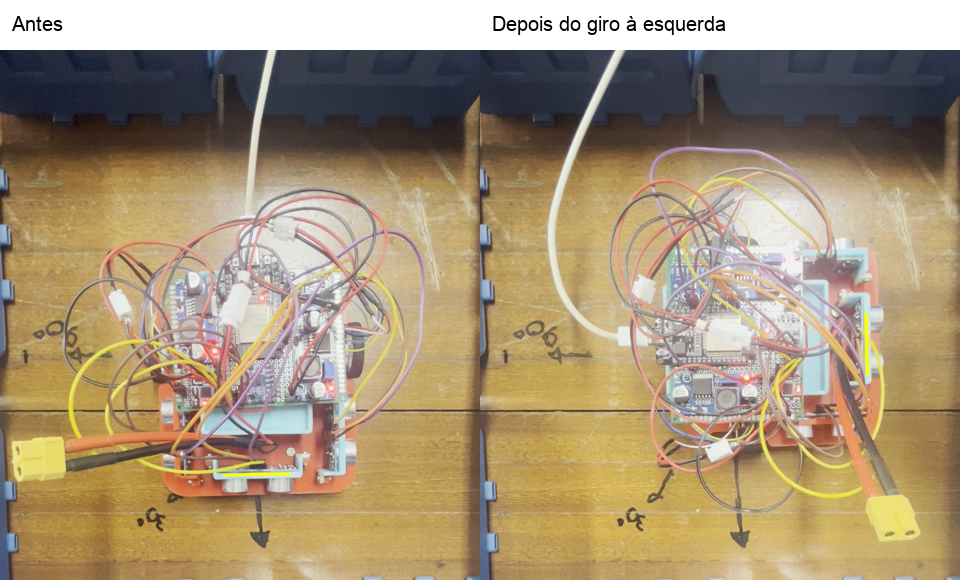

*Figura 11 — Giro à esquerda: sinal e direção conferidos fisicamente.*

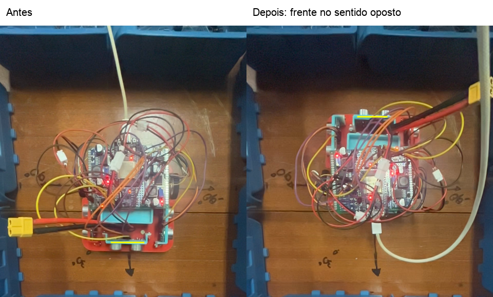

*Figura 12 — Meia-volta em área aberta; o movimento intermediário diferencia 180° de uma aresta apenas paralela.*

**Vídeos:** [V04 — 30°](https://drive.google.com/file/d/1XshExiNuJp6V0N8PnZQ97OnG-0I9o-sm/view?usp=drivesdk) · [V05 — 90° D](https://drive.google.com/file/d/1FvackZ1Vj3jki98nqpRXuJQKnRAk82ZR/view?usp=drivesdk) · [V06 — 90° E](https://drive.google.com/file/d/1Su8u5aY7EkhU0Si4bGWjrIw2qeWo65KM/view?usp=drivesdk) · [V07 — 180°](https://drive.google.com/file/d/1RZpXxqMh529cs7Z3KZSX6IkRdbkfwpYL/view?usp=drivesdk).

#### 5.6 Avanço linear: 30 mm e uma célula

| Objetivo | Procedimento | Referência |
|---|---|---|
| Atingir deslocamento e preservar rumo | Velocidade por roda, yaw, aproximação e frenagem | Encoder + vídeo + régua aproximada; sonar não foi a única régua de calibração |

| Ensaio | Resultado instrumentado | Conferência / limite |
|---|---|---|
| Primeiro alvo de 30 mm | Média 12,24 mm; yaw −0,30°; frente ≤5 cm | Operador: avanço ≈1,5 cm e folga ≈5 cm; alvo não concluído |
| 30 mm após reposicionar | Média 29,11 mm; yaw −0,32° | Folga física aproximada de 10 para 7 cm, coerente com avanço de 3 cm |
| Primeiros 180 mm | Yaw −2,58° e −2,12° | Viés recorrente; rever disputa entre sincronização e rumo |
| V9, dois avanços de 180 mm | Médias 179,16 / 179,15 mm; yaw −0,52° / −0,81° | Resultado interno favorável; não é exatidão física milimétrica |

| Correção | Resultado / limitação |
|---|---|
| Reduzir ganho e saturação da sincronização por progresso | Fatores dos encoders eram provisórios e podiam competir com a IMU |
| Reforçar correção angular | Preservados limites de tempo, deslocamento e falta de progresso |
| Comparação com régua | Medidas aproximadas não autorizam declarar erro <1 mm no percurso |

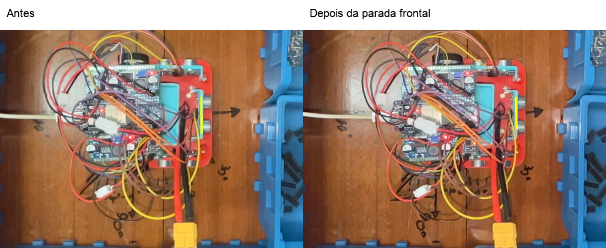

*Figura 13 — Primeiro avanço interrompido pela reserva frontal; sem escala para converter pixels em milímetros com precisão.*

**Vídeo:** [V08 — repetição do avanço curto](https://drive.google.com/file/d/1SgI7gGA2wv6gW7GtrynKYS6sn2KP1OHm/view?usp=drivesdk).

#### 5.7 Encadeamento supervisionado e ganho de velocidade

| Aspecto | Registro / resultado |
|---|---|
| Sequência inicial | Avançar → parar → inspecionar → girar, por comandos separados; não era descoberta autônoma de curva |
| Conflito identificado | Freio por diferença de progresso podia contrariar a correção de rumo |
| V13, dois ensaios válidos a até 60 mm/s | Yaw +0,08° / −0,09°; tempos 4,084 / 4,069 s com repouso |
| Ensaio com cabo preso | Yaw −12,76° e interrupção; operador confirmou interferência. Excluído da comparação de desempenho, mantendo registro da ocorrência |
| Condições | Poucas repetições; bateria, piso e força do cabo não foram isolados estatisticamente |

| Perfil de 180 mm | Média pelos encoders | Yaw final | Tempo com repouso |
|---|---|---|---|
| V13 — 60 mm/s | 179,18 mm | −0,09° | 4,069 s |
| V14 — 80 mm/s | 179,00 mm | −0,08° | 3,475 s |
| V15 — 80 mm/s em bloco | 178,99 mm | −0,56° | 3,450 s |
| V16 — 100 mm/s, filmado | 179,19 mm | −0,02° | 3,233 s |
| V16 — 100 mm/s, repetição | 179,19 mm | −0,11° | 3,230 s |
| V17 — 100 mm/s, novas rampas | 178,80 mm | +0,06° | 2,872 s |

| Bloco | 90° / duração | 180° / duração | Tempo total e ressalva |
|---|---|---|---|
| V16 filmado, até 55°/s | 89,60° / 2,905 s | 179,51° / 4,495 s | 10,633 s com avanço; corrige anotação inicial de 9,633 s |
| V16 repetido | 89,63° / 2,935 s | 179,63° / 4,590 s | 10,755 s; exclui pausas externas de supervisão |
| V17 | 89,59° / 2,650 s | 179,41° / 4,220 s | 9,742 s; ≈9,4% menos que a repetição V16 |
| Ganho obtido | V17 reduziu o bloco para 9,742 s | Ajustes de rampas somaram-se ao aumento de velocidade | Melhora de aproximadamente 9,4% em relação à repetição V16 |

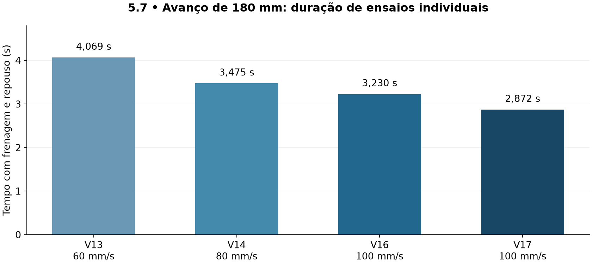

*Figura 14 — Durações de ensaios individuais de 180 mm. V16 e V17 têm o mesmo máximo e rampas diferentes; não são tempos de missão.*

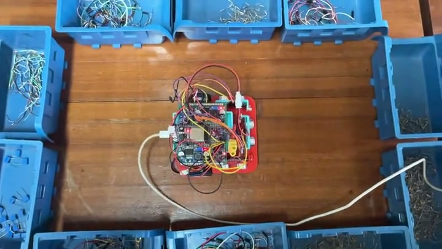

*Figura 15 — V10, quadro de 1,6 s: registro do avanço; a velocidade vem dos logs, não da imagem isolada.*

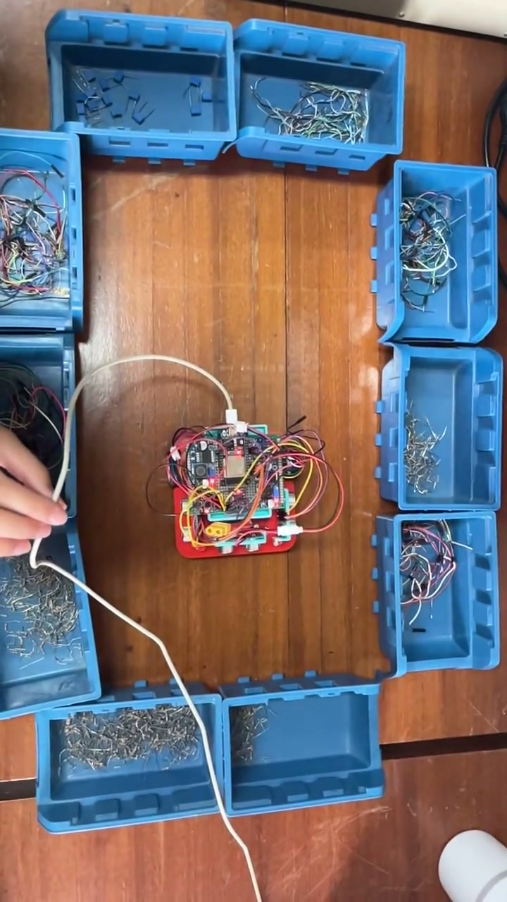

*Figura 16 — V11, quadro de 30 s. Operador relatou manejo do cabo sem tocar no chassi; ausência de força do cabo não foi medida.*

**Vídeos:** [V09 — avanço/giro supervisionados](https://drive.google.com/file/d/1-bfJdrKqS_yH2kUeqtWG9nm4tYjyY8Xu/view?usp=drivesdk) · [V10 — 80 mm/s](https://drive.google.com/file/d/1snlR8IHzIljVjgEetfgyBiRSwTzJGpde/view?usp=drivesdk) · [V11 — bloco 100 mm/s e 55°/s](https://drive.google.com/file/d/13eiValY3BYbyxBiM53FouCKT6677217W/view?usp=drivesdk).

### Etapa B — Sensores e percepção

#### 5.8 Sensores ultrassônicos, conexões e calibração

| Verificação | Procedimento / ocorrência | Resultado e limite |
|---|---|---|
| Modelo | Operador identificou HC-SR04; nomes do código ainda citavam US-100 | Não atribuir modo UART de outro sensor ao módulo instalado |
| Fiação | Inspeção identificou fios frontal e esquerdo desconectados em momentos diferentes | Reconexão restabeleceu as leituras nos diagnósticos; variações posteriores motivaram o filtro |
| Ruído “tri tri” | Aquisição pausada para isolar a ocorrência | Ruído cessou; diagnóstico permitiu retomar a investigação dos sensores |
| Comparação com régua | Motores parados; tarefa pausada; dez leituras isoladas por sensor | Referências aproximadas de 3/5/10 cm a partir da face metálica |
| Fotos | Localização de jumpers e GPIOs | Cor de fio/foto não mede tensão nem comprova continuidade da placa |

| Canal | Offset provisório final | Referências → leituras corrigidas |
|---|---|---|
| Frente | +0,82 cm | 3→3,130; 5→5,354; 10→9,872 cm |
| Esquerda | +0,50 cm, revisto de −0,21 cm | 3→3,138; 5→5,069; 10→9,940 cm |
| Direita | +0,65 cm | Conferência estática próxima de 3 cm: 2,960 cm |

| Divergência / alimentação | Evidência | Conclusão |
|---|---|---|
| Frente em referência de 5 cm | Uma posição: bruto/corrigido 5,500/6,320; outra: 4,534/5,354 cm | Comparação identificou a sensibilidade à posição e orientou a conferência de montagem |
| Esquerda em referência de 3 cm | Houve leitura anterior equivalente a ≈1,68 cm brutos | Calibração dependia da montagem/posição |
| Offsets | Pontos manuais aproximados; alguns usados no próprio ajuste | Sem ganho de escala ou exatidão universal validada |
| Alimentação relatada | Daniel informou 3,3 V; TRIG/ECHO diretos na ESP, por mensagem repassada | Sem registro independente de multímetro ou correção elétrica neste recorte |
| Especificação HC-SR04 | Datasheet: 5 V e faixa nominal a partir de 2 cm | Motivo de investigação; não prova causa única das falhas |

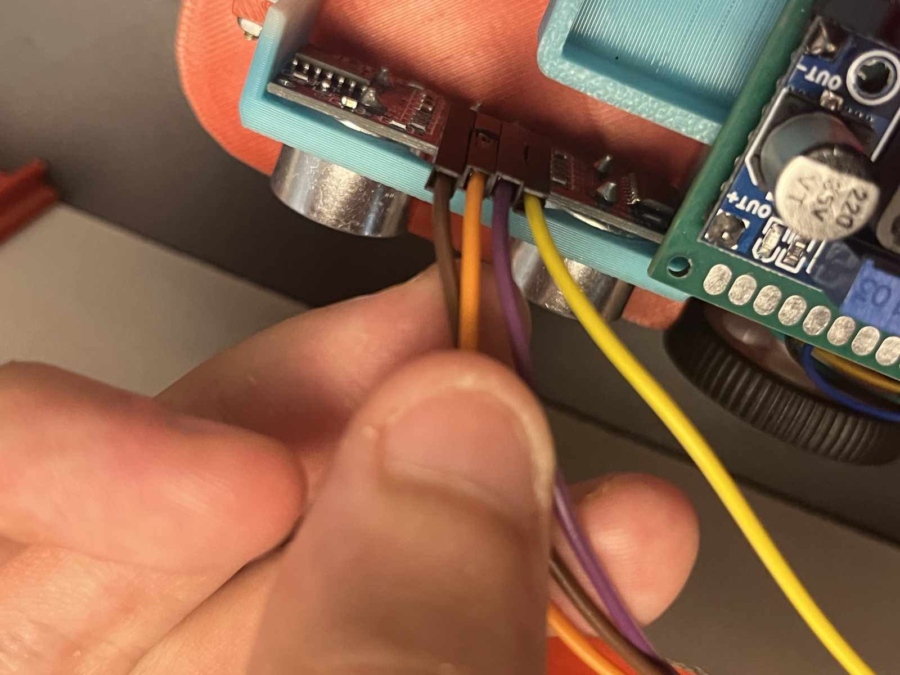

*Figura 17 — IMG_4093 — Ligações inspecionadas na montagem; não constitui medição de VCC/ECHO.*

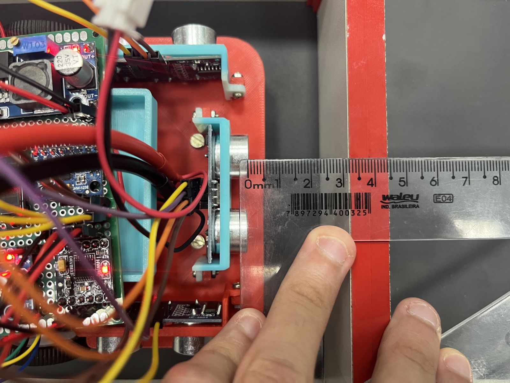

*Figura 18 — IMG_4085 — Referência física na face do sensor; foto parada, sem comprovar contato durante o movimento.*

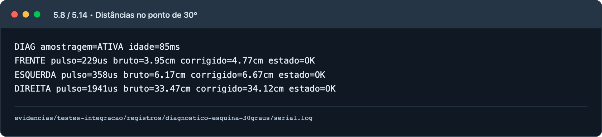

*Figura 19 — Diagnóstico parado após o giro de 30°: um quadro do registro. A mediana das 20 amostras é apresentada no teste 5.14.*

#### 5.9 Aquisição, percepção, mediana e recuperação de eco

| Problema / mecanismo | Regra ensaiada | Resultado / limite |
|---|---|---|
| Idade do quadro | 3 × (timeout 20 ms + silêncio 25 ms) = orçamento de 135 ms | Timestamp da medição mais antiga pode chegar a ≈245 ms antes do próximo quadro |
| Vencimento indevido | Limite de 150 para 270 ms; pico parado observado de 197 ms | Evitou descartar por idade quadros compatíveis com a temporização real de aquisição |
| Três disparos distintos | 3 válidos: mediana; 2: média; menos de 2: inválido | Inclui falhas; sem inventar pulso ou filtrar repetidamente o mesmo snapshot |
| Frontal curto | Primeira suspeita freia/verifica; duas curtas em três quadros confirmam | Tolera outlier isolado sem ignorar obstáculo persistente |
| Recuperação de eco | Frear; integrar encoders/IMU; manter alvo; retomar com quadros novos e assentamento | Pausa mínima 200 ms; até 1.200 ms/episódio e três recuperações/trecho |
| Observação de célula | Quadros novos e coerentes no centro e após giro | Prazo 1.500 ms; ausência de leitura não vira abertura |
| Chegada | Odômetro nas células comuns; referência frontal adicional quando usada no ajuste | Corrigida regressão que exigia frente a 3 cm mesmo com parede a 21,11 cm |
| Tempo de missão | 180 s inclui pausas | Recuperação não pode suspender indefinidamente a missão |

| Sessão do filtro: 65 quadros | Frente | Esquerda | Direita |
|---|---|---|---|
| Distâncias nulas | 0 | 14 | 0 |
| Interpretação | Sem nulos nessa captura | 21,5% dos quadros sem estimativa | Sem nulos nessa captura |
| Resultado do ensaio | Pausa e retomada exercitadas; parada final com código 7 | Canal com maior perda identificado para diagnóstico | Frente e direita sem distância nula nessa captura |

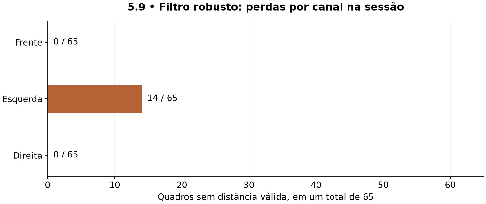

*Figura 20 — Contagens da sessão do filtro: 14/65 nulos à esquerda. O percentual se refere a quadros, não ao erro métrico do sensor.*

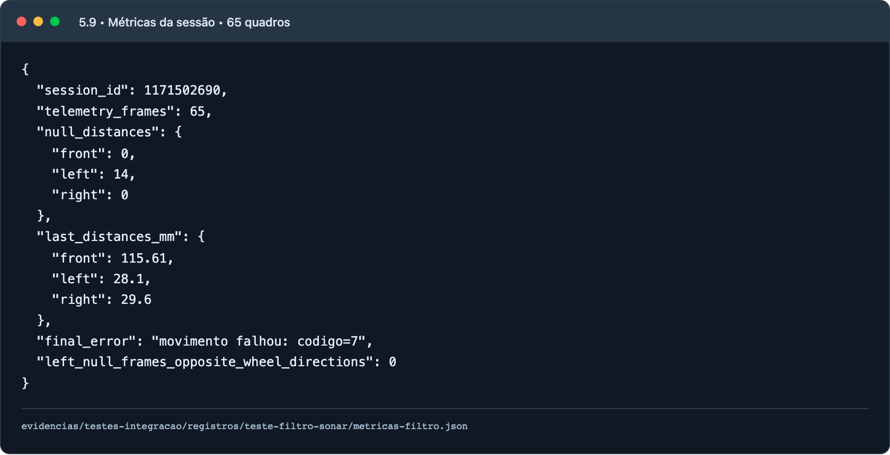

*Figura 21 — Valores arquivados, incluindo sessão, distâncias nulas e motivo final de parada.*

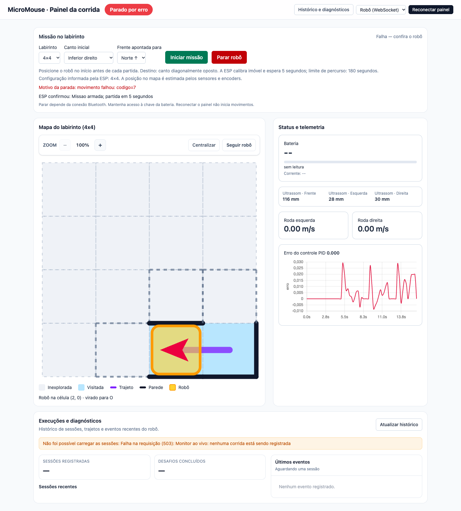

*Figura 22 — Captura do ensaio: a posição é estimada, e a distância final pode ser posterior ao evento de falha.*

### Etapa C — Comunicação e interface

#### 5.10 Bluetooth: conexão, reconexão e dados reais

| Etapa | Condição / método | Resultado |
|---|---|---|
| Bancada Bluetooth | Somente USB; motores e disparos de sonar desativados | Rádio `MicroMouse_BT_Test`; diagnóstico separado da missão |
| Porta serial virtual | Primeira captura | 42 quadros recebidos |
| Reconexão virtual | Porta abria, mas algumas tentativas não recebiam quadros | Diagnóstico motivou a adoção do receptor RFCOMM nativo |
| RFCOMM nativo | IOBluetooth no Mac | Recepção restabelecida; conexão de aplicação comprovada por dados |

| Conexão nativa | Quadros válidos | Sequência | Erros / gaps e PING/PONG |
|---|---|---|---|
| 1 | 61 | 1–61 | Sem erros/gaps reportados; PING/PONG confirmado |
| 2 | 33 | 62–94 | Sem erros/gaps reportados; PING/PONG confirmado |
| 3 | 21 | 95–115 | Sem erros/gaps reportados; PING/PONG confirmado |
| Total | 115 | 1–115 | Dados recebidos nas três conexões, com continuidade das sequências |

| Dado / estado | Interpretação |
|---|---|
| Pacotes | Sequência, uptime, memória e medidas da IMU; sem distância, tensão ou corrente reais nesse diagnóstico |
| “Desconectado” após a captura | O cliente fechava o canal ao terminar; não indica necessariamente falha da ESP |
| Pareamento momentâneo | Aparecer/conectar no Mac não comprova recepção de dados no aplicativo |

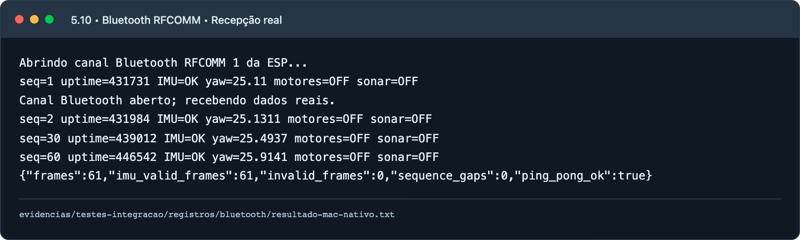

*Figura 23 — Trecho da primeira conexão RFCOMM nativa: sequência e resumo com 61 quadros válidos. Reconexões estão nos arquivos associados.*

#### 5.11 Deriva do yaw e correção no diagnóstico

| Verificação | Condição / resultado | Interpretação |
|---|---|---|
| Antes da correção | Trecho relatado: yaw ≈52,24° → 54,35° em ≈35 s, parado | Integração acumulava bias residual; não era Norte absoluto |
| Calibração | Aquecimento 2 s; 1.000 amostras a cada 5 ms | Robô imóvel; correção no firmware diagnóstico Bluetooth |
| Compensação | Detecção de repouso por 1 s; adaptação lenta do bias; mantém último ângulo | Driver/navegação compartilhados não foram alterados nessa revisão |
| Captura após correção | 121 quadros; sequência 74–194; 30,06 s | Yaw inicial/final 0,0161°; amplitude zero na resolução transmitida |
| Resíduo | Giro Z final −0,0534°/s | Zero de amplitude exibido não significa ruído físico eliminado |
| Limite | Rotação constante <0,25°/s pode ser classificada como repouso | Não homologa precisão angular dinâmica da missão |
| Interface | Recarregar/reconectar painel não é zerar IMU | Operador relatou que o yaw deixou de crescer indefinidamente |

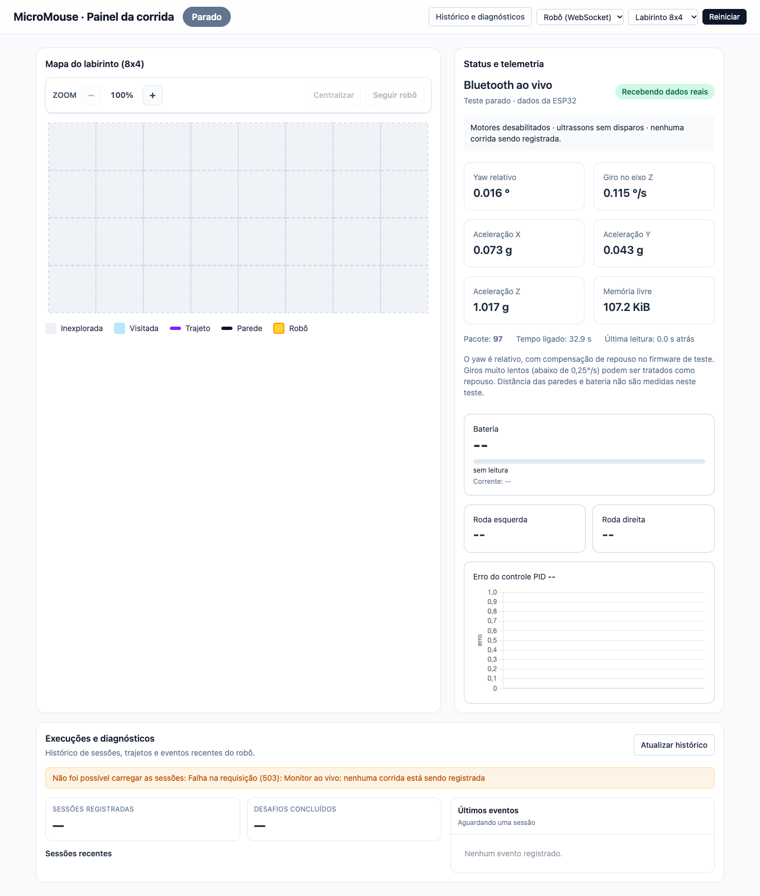

*Figura 24 — Diagnóstico parado: motores e sonares desativados. Valor do painel comparado ao pacote recebido.*

#### 5.12 Dashboard original, telemetria e controle de missão

| Interface / fluxo | Procedimento | Resultado / limite |
|---|---|---|
| Site existente | Integração Bluetooth ao mapa e aos indicadores originais | Interface original preservada e conectada aos dados reais da ESP |
| Cadeia de dados | ESP32 → RFCOMM → ponte nativa Mac → backend → WebSocket → React | Sequência e valor bruto comparados ao navegador |
| Formatos | 4×4, 8×4 e 12×4; canto e direção | Disponíveis na configuração; isso não comprova percurso físico em todos |
| Comandos | ID, confirmação da ESP, boot/conexão e prazo | Sem fila offline nem repetição automática de START |
| Partida | Calibração imóvel e espera de 5 s | Selecionar tamanho, recarregar ou reconectar painel não inicia movimentos |
| Mapa | Segue mensagens/configuração confirmadas da ESP | Posição é estimada; seleção preparatória não muda a corrida |
| Parada | STOP e parada em perda do Bluetooth durante missão remota | Depende da comunicação; chave da bateria continua necessária |
| Controle local | API restrita ao computador local | Não é controle público remoto |

| Ensaio real | Resposta | O que foi demonstrado |
|---|---|---|
| Diagnóstico Bluetooth | STOP confirmado; START bloqueado | Comando real sem habilitar navegação nesse firmware |
| Rodas suspensas / bateria dos motores desligada | START aceito; STOP confirmado 0,933 s depois do ACK, antes dos 5 s | Partida/cancelamento, não locomoção |
| Missões posteriores no chão | ACK de partida, running e error no painel | Controle/telemetria funcionaram mesmo nas falhas físicas |
| Tela de 390 px | Sem rolagem horizontal naquela verificação | Resultado daquele layout; não medição de latência |
| Histórico PostgreSQL | Monitor utilizado sem banco configurado | Telemetria ao vivo e registros locais utilizados durante os ensaios |
| Energia | INA226 ausente/não calibrado em parte dos ensaios; campos sem leitura | Nenhum valor sintético tratado como medição de bateria |

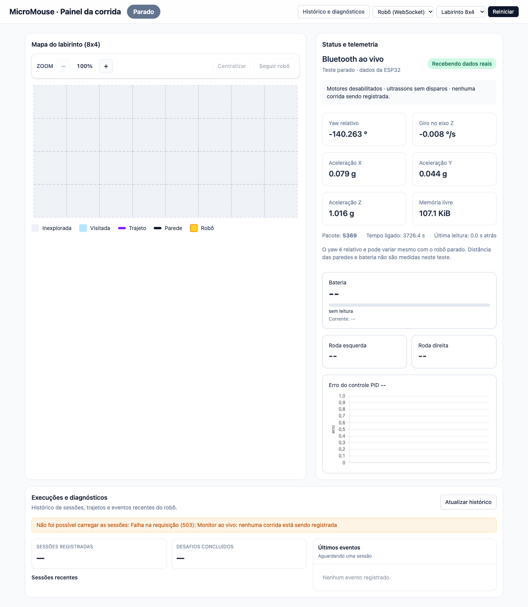

*Figura 25 — Mapa e indicadores da aplicação existente; a grade selecionada não comprova percurso físico daquele formato.*

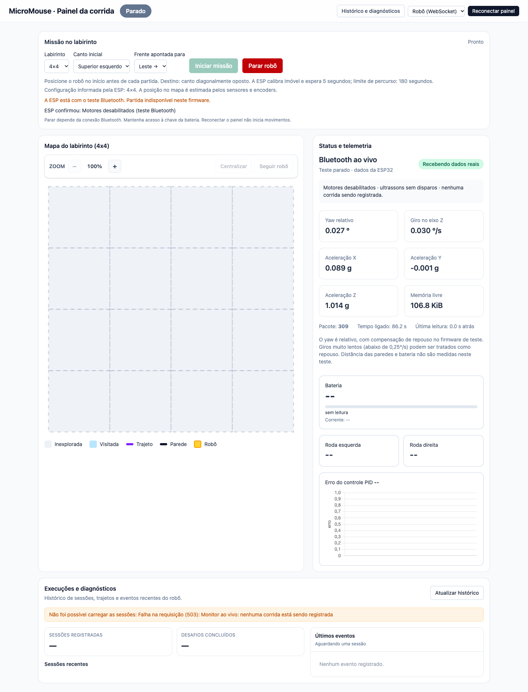

*Figura 26 — Controles no dashboard original: habilitação depende do firmware e da comunicação.*

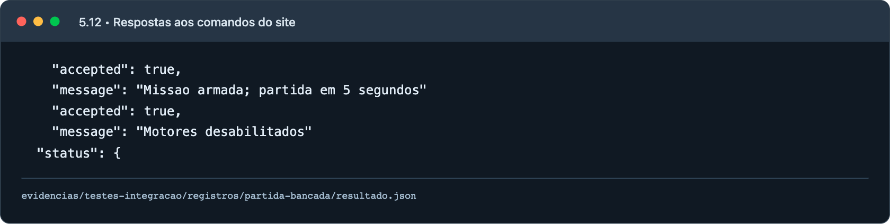

*Figura 27 — ACKs e estado final da partida/cancelamento com rodas suspensas; valores preservados no JSON.*

### Etapa D — Integração no labirinto e estratégias de curva

#### 5.13 Integração no labirinto 4×4 e evolução da locomoção

| Aspecto | Condição do teste / limite |
|---|---|
| Configuração predominante | Inferior direito, Norte; destino no canto diagonalmente oposto; mapa novo |
| Localização | Célula/orientação estimadas pela ESP; sem medição externa contínua |
| Problema físico | Robô torto/descentralizado e contato em quinas; não apenas erro de distância linear |
| Geometria | Foi necessário distinguir peça de parede, vão livre, bitola, largura total e posição do eixo |

| Tentativa | Evolução relatada | Motivo / medidas finais | Resultado |
|---|---|---|---|
| 1 | Dois avanços; curva à esquerda; quina frontal tocou | Código 8 | Colisão; falta de progresso direito |
| 2 | Uma célula; reajustes; parada | Eco frontal instável; recuperação excedida | Interrupção por leitura |
| 3 | Primeira célula; parada | F=1/E=0/D=1 por 1.500 ms; F215/D35 mm finais | Esquerda sem leitura |
| 4 | Chegada à célula da curva; contato no giro | Código 12 | Assentamento não confirmado; colisão relatada |
| 5 | Segunda célula em direção à terceira | Eco frontal instável; F119/E47/D39 mm finais | Recuperação excedida |

| Aprendizado dos cinco ensaios iniciais | Ação / evolução |
|---|---|
| Leitura frontal e lateral variava durante o percurso | Reconexão, calibração, janela de três disparos, pausa e recuperação de eco |
| Giro podia alcançar a quina antes de terminar | Revisão da geometria e comparação de trajetórias segmentadas e contínuas |
| Deslocamento no corredor já era executado | Ajustes passaram a se concentrar em posicionamento e passagem da curva |
| Falhas passaram a ter códigos e mensagens | Painel permitiu diferenciar falta de eco, reserva frontal, progresso e assentamento |
| Montagem recebeu correção mecânica | Motor substituído e bateria elevada para deixar o encoder livre |

Essas cinco tentativas descrevem a fase inicial de ajustes. Os vídeos recentes abaixo mostram a evolução posterior; o conjunto não inclui uma travessia completa cronometrada.

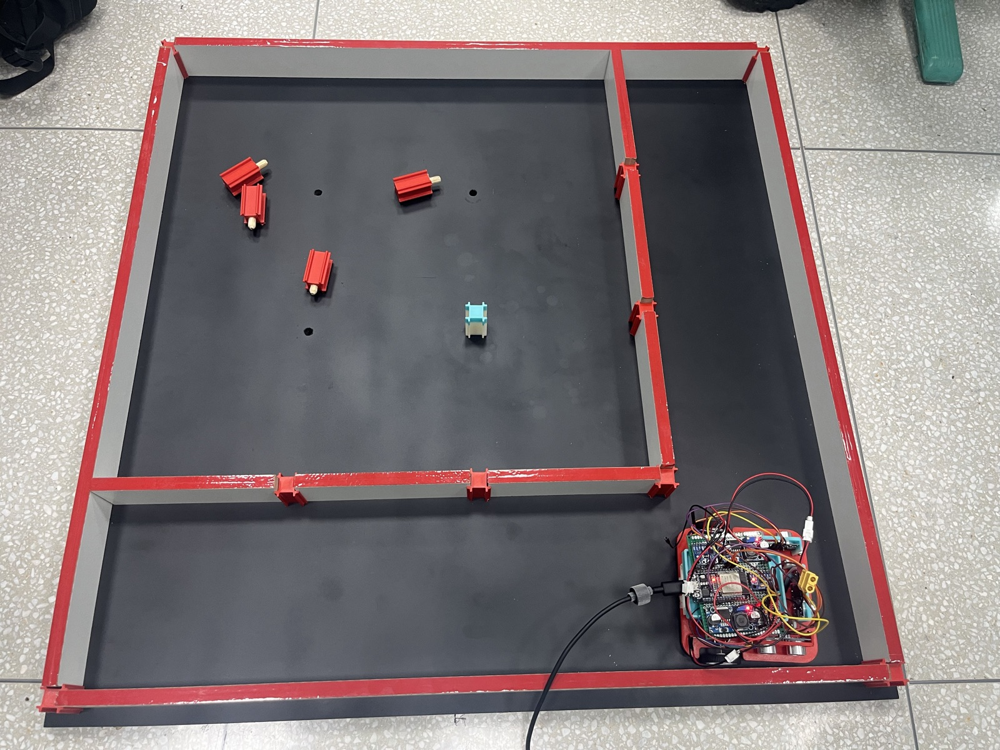

*Figura 28 — IMG_4080 — Posição após tentativa relatada como desalinhada. A perspectiva não mede deslocamento do eixo.*

##### 5.13.1 Registros recentes: curva e operação sem cabo

| Registro | O que foi observado / confirmado | Resultado |
|---|---|---|
| V12 — curva no labirinto | Aproximação e mudança de orientação junto à abertura; operador confirmou ausência de reposicionamento manual | A equipe relata que a curva passou a funcionar, embora com resultado variável entre repetições |
| V13 — locomoção sem cabo | USB da ESP desconectada; robô avança no corredor e realiza manobra junto à abertura | Movimento do robô alimentado pela bateria, sem depender do cabo USB para locomoção |
| Montagem dos dois vídeos | Motor já substituído e bateria elevada pelas espumas, conforme confirmação do operador | Correções mecânicas incorporadas às novas demonstrações |
| Uso do cabo nos ensaios anteriores | Mantido conectado para facilitar compilações e gravações sucessivas | Conveniência de desenvolvimento; a operação sem cabo está documentada em V13 |
| Repetibilidade da curva | Número total de repetições e taxa de acerto não informados | Curvas realizadas; repetibilidade em ajuste, sem série estatística registrada |

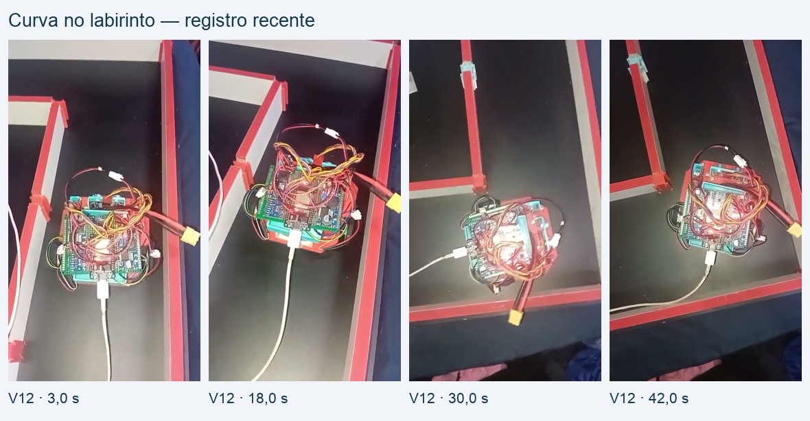

*Figura 28A — V12, quadros em 3, 18, 30 e 42 s do arquivo. A câmera muda de posição durante a gravação; os quadros não são usados para medir ângulo ou deslocamento. Não houve reposicionamento manual do robô, segundo o operador.*

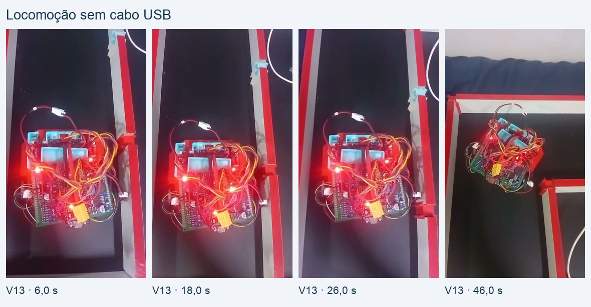

*Figura 28B — V13, quadros em 6, 18, 26 e 46 s. A conexão USB está livre durante o deslocamento; motor substituído e bateria elevada já fazem parte desta montagem.*

**Vídeos:** [V12 — curva no labirinto](https://drive.google.com/file/d/1xUHx79K4jnHy3fMGFbF1V3P_j2Rg8uib/view?usp=drivesdk) · [V13 — locomoção sem cabo](https://drive.google.com/file/d/18Eb0SE0ibbNGY7Gi4-5HUqn2CCV7Ww3g/view?usp=drivesdk).

#### 5.14 Curvas em etapas: 45°, 30° e avanços intermediários

| Condição | Regra da campanha |
|---|---|
| Tipo de teste | Manobras isoladas programadas, diferentes da descoberta autônoma de paredes |
| Partida | Posição e abertura à direita confirmadas; calibração imóvel; espera de 5 s |
| Entre etapas | Pausa de 1 s; sem repetição automática depois de movimento |
| Avanço de 10 mm | Até 20 mm/s; reserva ajustada: início >4,5 cm e parada por proximidade em 3,5 cm |
| Avanço de 20 mm | Mesma reserva de 3,5 cm → exige >5,5 cm antes de iniciar |

| Ensaio | Sequência pretendida | Resultado registrado | Contato / conclusão |
|---|---|---|---|
| 45° — primeiro | 45° D → 10 mm → 45° D | 44,51°; 9,09 mm; segundo giro 42,62°, código 6 | Contato confirmado; total angular não comprova passagem |
| 45° — repetição | Mesma sequência | 44,59°; 8,72 mm; segundo giro 21,10°, código 8 | Parte inferior direita suspeita; ponto exato não confirmado |
| 30° — reserva inicial | 30° → 10 mm → 30° → 10 mm → 30° | 29,50°; avanço bloqueado por exigência >6 cm | Primeiro giro sem contato, segundo o operador |
| Diagnóstico nos 30° | 20 leituras por canal, parado | Medianas F5,35/E6,66/D34,70 cm; 20/20 válidas | Operador confirmou frente; bloqueio por reserva, não por perda de eco |
| 30° — reserva ajustada | Mesma sequência de 10 mm | 29,35°; 8,91 mm; segundo giro 26,02°, código 7 | Operador confirmou toque na parede |
| 30° — avanços de 20 mm | 30° → 20 mm → 30° → 20 mm → 30° | 29,67°; F5,35 cm ≤5,50 cm exigidos | Nenhum avanço de 20 mm começou |

| Interpretação | Limite |
|---|---|
| Código 6 | Prazo de movimento ou falta de progresso angular; registro isolado não distingue o temporizador |
| Códigos 7/8 | Falta de progresso esquerdo/direito; contato depende de observação adicional |
| Contribuição dos ensaios | Identificaram o efeito do avanço intermediário e das reservas frontais, orientando a evolução da curva mostrada em 5.13 |

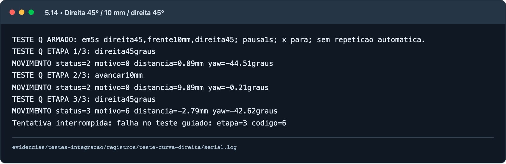

*Figura 29 — Primeira tentativa de 45°: etapas executadas e interrupção registrada na etapa 3.*

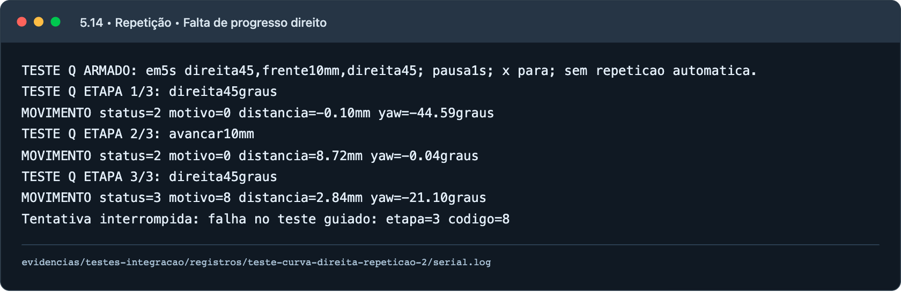

*Figura 30 — Repetição: avanço de 8,72 mm e segundo giro interrompido com código 8.*

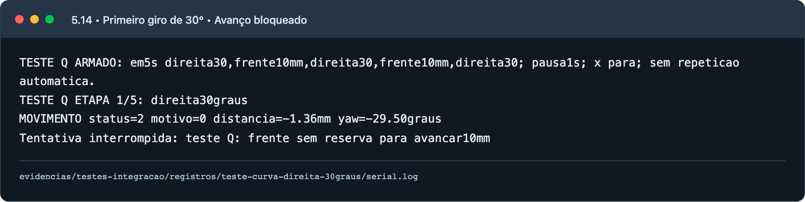

*Figura 31 — Reserva inicial: somente o primeiro giro foi concluído; o avanço de 10 mm não começou.*

*Figura 32 — Diagnóstico parado no ponto da primeira curva de 30°; o conjunto das 20 leituras foi válido.*

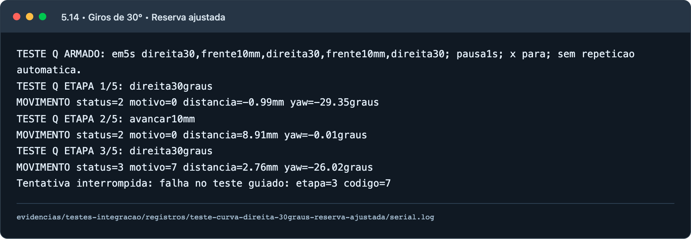

*Figura 33 — Reserva revista para avanço de 10 mm; o segundo giro foi interrompido por falta de progresso esquerdo.*

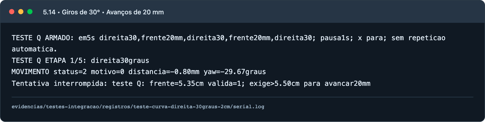

*Figura 34 — Avanço de 20 mm bloqueado: frente válida de 5,35 cm, abaixo dos >5,50 cm exigidos.*

#### 5.15 Mudança de estratégia: recuo e curva contínua

| Estratégia / modelo | Valor ou comportamento | Situação |
|---|---|---|
| Modelo diferencial; bitola 120 mm | Rodas opostas e iguais: raio 0; uma parada: 60 mm; interna recua a ⅓ da externa: 30 mm | Velocidades reais, não razões de PWM; depende de aderência |
| Perfil `esp32dev_arc_test` | Observação/planejador existentes, sem cadastrar a curva informada pelo operador | Implementado; perfil normal manteve giro parado |
| Manobra prevista | Recuar 30 mm por passagem traseira confirmada; arco de 90° com raio 30 mm | Não há sensor traseiro; passagem percorrida era referência na missão |
| Velocidades do perfil | Máximo 20°/s no arco; 40 mm/s nas retas | Progresso, prazo, eco frontal e STOP preservados |
| Saída do arco | Crédito nominal 30 mm; próximo trecho reto 150 mm, total 180 mm | Modelo simulado; posição real ainda dependia de ensaio físico |
| Comando isolado posterior | Comandar ré de 30 mm → arco 90° E → parar, sem avanço adicional | Folga atrás confirmada pelo operador; o log não aferiu a distância física final da ré |

| Verificação / tentativa histórica | Resultado | Contexto |
|---|---|---|
| Software | 72 controlador + 135 nativos = 207 aprovados no marco | Modelo e cenários do controlador verificados em software |
| Cenários de controle | Arcos esquerdo/direito, translação, pausa/retomada, parâmetros inválidos e crédito | Cobertura da lógica antes dos testes físicos |
| Descoberta de esquerda | Decisão após observar a célula alcançada, sem roteiro pré-carregado | Perfil preparado para decidir pela percepção de paredes |
| Primeira partida | Recusada: conferir três sensores | Nenhum movimento |
| Direito no diagnóstico | 20/20 perto demais; bruto ≈1,67 cm, corrigido ≈2,32 cm | Não normalizou imediatamente após pequeno reposicionamento |
| Depois de reiniciar | 20/20 válidas por canal; medianas F19,84/E3,47/D3,27 cm | Validade estática não garantiu estabilidade durante avanço |
| Missão única 4×4, inferior direito/Norte | Três pausas/retomadas; recuperação de eco excedida antes de confirmar a primeira célula | Arco não chegou a iniciar |
| Teste isolado esquerdo | Comando de recuo interrompido: código 7, yaw −0,13° | Arco não iniciou; sem distância final registrada para afirmar quanto recuou fisicamente |

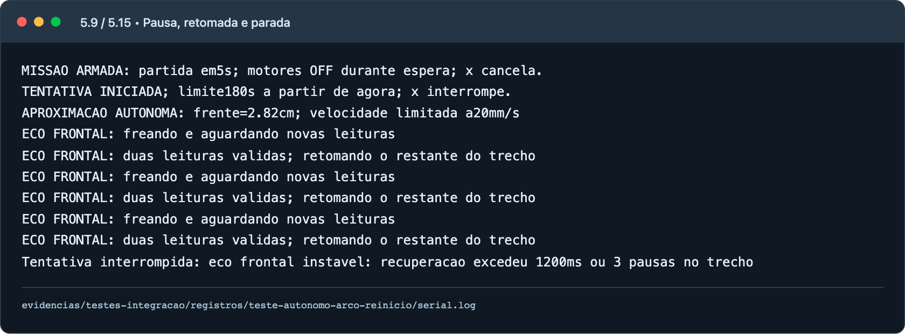

*Figura 35 — Missão após reinício: três recuperações e parada por eco; não há início de arco nesse trecho.*

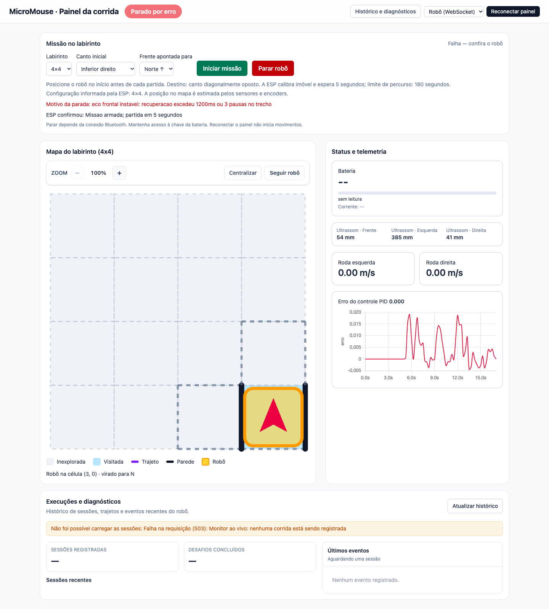

*Figura 36 — Recepção do estado e motivo de falha; o mapa não comprova chegada física à célula seguinte.*

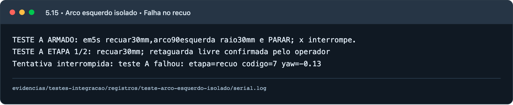

*Figura 37 — Teste isolado: abertura aceita, recuo comandado e interrompido com código 7; não comprova a distância recuada nem curva executada.*

### Etapa E — Consolidação e diagnóstico

#### 5.16 Testes automatizados e integração de software

| Marco histórico | Resultados registrados | Evolução verificada |
|---|---|---|
| Ambiente inicial | 117 bem-sucedidos; microbenchmark passou em execução isolada após falhar sob cobertura | Ambiente e suíte inicial exercitados; sensibilidade do benchmark à carga identificada |
| Integração inicial ao site | 92 backend; 11 E2E; 1 PostgreSQL não executado | Fluxo entre dados recebidos e interface verificado |
| Controle inicial pelo site | 98 backend; 167 firmware; 14 navegador; 1 PostgreSQL ignorado | Comandos e estados de missão verificados antes do ensaio no chão |
| Recuperação de eco | 177 firmware; 99 backend; 15 navegador; 1 PostgreSQL ignorado | Pausa, recuperação e comunicação dos estados cobertas por testes |
| Filtro robusto | 197 firmware | Regras de aquisição, validade e filtragem verificadas |
| Perfil de arco | 72 controlador + 135 nativos = 207 firmware | Modelo de curva, progresso e transições verificados em software |

| Regra de leitura | Aplicação |
|---|---|
| Contagens por versão | Não somar como testes distintos; não são resultado da versão atual de 23/11 |
| Execução desta revisão documental | Não houve nova bateria de testes físicos ou automatizados do robô |
| Warnings/lint | Avisos de depreciação e problemas anteriores registrados; não foi afirmada ausência de todo aviso |
| Condições controladas | Cenários e labirintos gerados validam software; alimentação, tração e folga dependem do conjunto físico |

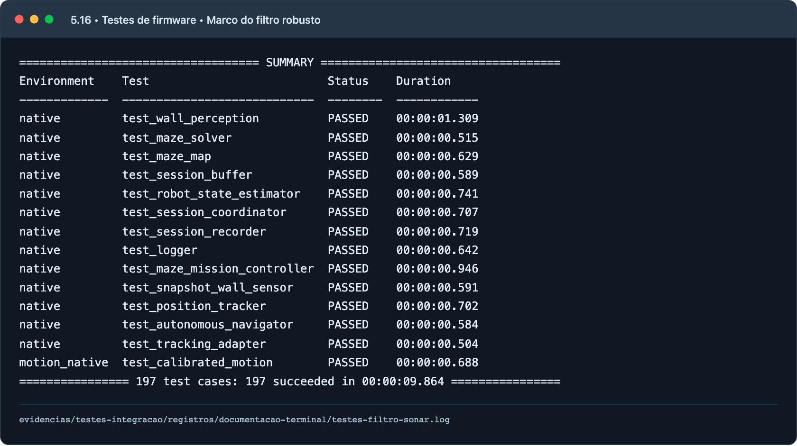

*Figura 38 — Marco do filtro robusto: 197 casos aprovados no log preservado. O marco posterior de 207 está descrito nos registros do perfil de arco.*

##### 5.16.1 Catálogo dos principais motivos de parada do recorte

| Código/mensagem | Significado na revisão ensaiada | Interpretação permitida |
|---|---|---|
| 3/4 | Falha de leitura de encoder/IMU | Falha reportada pela interface; investigar conexão/dados |
| 6 | Prazo do movimento ou falta de progresso angular | O código isolado não identifica qual hipótese física causou a parada |
| 7/8 | Roda esquerda/direita sem progresso | Pode decorrer de contato, cabo, alimentação, motor, encoder ou controle; precisa evidência adicional |
| 9 | Cancelamento | Movimento interrompido por comando/fluxo de parada |
| 11 | Limite de segurança de movimento | Excesso de erro/deslocamento/sentido conforme revisão |
| 12 | Frenagem sem assentamento confirmado | Não equivale automaticamente a falha elétrica de motor |
| `frente invalida: pulso=0us` | Ausência de eco no evento | Diferente de distância curta válida |
| `reserva frontal...` | Distância confirmada dentro do limite ativo | O painel posterior pode mostrar outra amostra |
| `eco frontal instavel...` | Recuperação excedeu prazo/quantidade permitida | Não houve autorização para seguir indefinidamente sem medição |
| `paredes instaveis por1500ms...` | Não reuniu observações suficientes no prazo | Canal sem leitura não foi interpretado como abertura |
| `frente...exige>...para avancar...` | Condição anterior à etapa não satisfeita | A etapa pode ter sido bloqueada sem começar |

Esses códigos devem ser associados ao commit/perfil do ensaio: o enum pode evoluir em revisões posteriores.

## 6. Evidências em vídeo

Os vídeos estão na pasta [PI1 Grupo 2 — Vídeos dos testes de integração](https://drive.google.com/drive/folders/1HWXcRZtt__XsECcJWotzuqxjYwnBdWcZ), no Google Drive, com acesso de leitura para qualquer pessoa com o link. As imagens selecionadas permanecem neste relatório.

| ID | Original | Intervalo disponibilizado no derivado | Evidência e interpretação |
|---|---|---|---|
| V01 | WhatsApp Video 2026-11-12 at 15.10.56.mp4 | 0–8,27 s | [Encoder esquerdo 1](https://drive.google.com/file/d/1g3uV95nU0twike6R5Prvyv-zLltl7K9L/view?usp=drivesdk); marca preta e estimativa de voltas |
| V02 | WhatsApp Video 2026-11-12 at 15.25.37.mp4 | 8–11,85 s | [Encoder esquerdo 2](https://drive.google.com/file/d/1Pcbvug-mPit7MYGtWEw2yyGuBOxlYoUc/view?usp=drivesdk); movimento no final do original |
| V03 | WhatsApp Video 2026-11-12 at 15.33.49.mp4 | 0–5,71 s | [Encoder direito](https://drive.google.com/file/d/1ffQdXgLyXSgeOBjFqEAIfD5uGMia3oBu/view?usp=drivesdk) |
| V04 | IMG_1878.MOV | 52–68 s | [Giro de 30°](https://drive.google.com/file/d/1XshExiNuJp6V0N8PnZQ97OnG-0I9o-sm/view?usp=drivesdk); preparação extensa omitida |
| V05 | IMG_4029.mov | 0–47,76 s | [Giro de 90° à direita](https://drive.google.com/file/d/1FvackZ1Vj3jki98nqpRXuJQKnRAk82ZR/view?usp=drivesdk); registro em câmera lenta |
| V06 | IMG_4031.mov | 0–8,64 s | [Giro à esquerda](https://drive.google.com/file/d/1Su8u5aY7EkhU0Si4bGWjrIw2qeWo65KM/view?usp=drivesdk) |
| V07 | IMG_4034.mov | 0–6,49 s | [Meia-volta](https://drive.google.com/file/d/1RZpXxqMh529cs7Z3KZSX6IkRdbkfwpYL/view?usp=drivesdk) |
| V08 | IMG_4037.mov | 0–23,30 s | [Avanço curto](https://drive.google.com/file/d/1SgI7gGA2wv6gW7GtrynKYS6sn2KP1OHm/view?usp=drivesdk) |
| V09 | IMG_4056.mov | 0–30,18 s | [Avanço e giro supervisionados](https://drive.google.com/file/d/1-bfJdrKqS_yH2kUeqtWG9nm4tYjyY8Xu/view?usp=drivesdk) |
| V10 | IMG_4069.mov | 0–3,44 s | [Avanço a até 80 mm/s](https://drive.google.com/file/d/1snlR8IHzIljVjgEetfgyBiRSwTzJGpde/view?usp=drivesdk) |
| V11 | IMG_4072.mov | 0–64,40 s | [Bloco a até 100 mm/s e 55°/s](https://drive.google.com/file/d/13eiValY3BYbyxBiM53FouCKT6677217W/view?usp=drivesdk); manejo do cabo relatado |
| V12 | WhatsApp Video 2026-11-22 at 19.10.47.mp4 | Integral, aproximadamente 61,23 s | [Curva no labirinto](https://drive.google.com/file/d/1xUHx79K4jnHy3fMGFbF1V3P_j2Rg8uib/view?usp=drivesdk); montagem com motor substituído e bateria elevada; sem reposicionamento manual |
| V13 | WhatsApp Video 2026-11-23 at 09.51.03.mp4 | Integral, aproximadamente 51,97 s | [Locomoção sem cabo](https://drive.google.com/file/d/18Eb0SE0ibbNGY7Gi4-5HUqn2CCV7Ww3g/view?usp=drivesdk); avanço e manobra no labirinto com USB desconectada |

V01–V11 são trechos selecionados, comprimidos e sem áudio; V12–V13 são os arquivos integrais recebidos nesta atualização. Os intervalos indicam o tempo do arquivo original, inclusive nos registros em câmera lenta.
