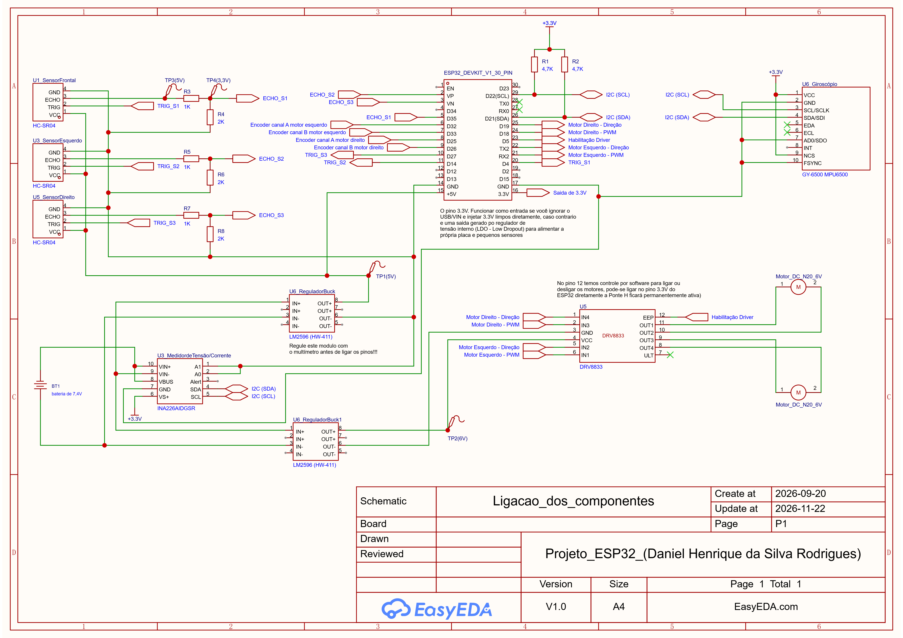
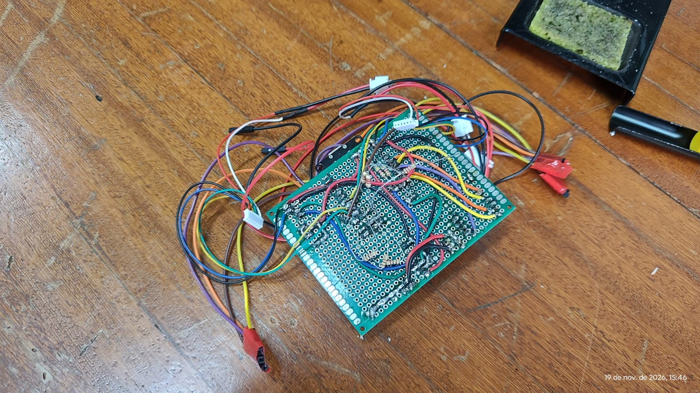
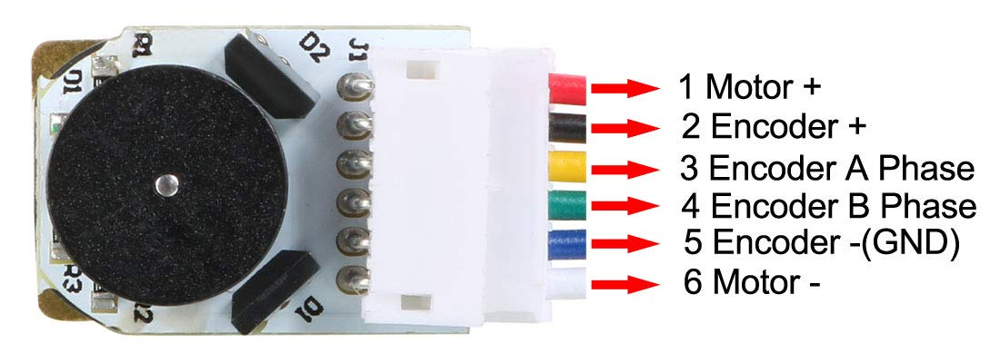

  PROJETO MICROMOUSE — RELATÓRIO TÉCNICO DE HARDWARE
  GRUPO 2 (PROF. LUI)

  

# RELATÓRIO DE VALIDAÇÃO DE HARDWARE — DADOS POS INTEGRAÇÃO
## SOLDAGEM, LIGAÇÕES DO CIRCUITO E DIAGNÓSTICO PÓS-INTEGRAÇÃO

|                                                                              |                                                |                                                                          |
| :--------------------------------------------------------------------------: | :--------------------------------------------: | :----------------------------------------------------------------------: |
| **COMPONENTE:** Placa perfurada | **Placa de Teste:**  ESP32 DevKit V1 (30 Pinos) |                      **Data do Ensaio:** 13/11/2026                      |
|                   **Projeto:** MicroMouse (PI1 - Grupo 2)                    |           **Orientador:** Prof. Lui            | **Status Geral:** APROVADO EM BANCADA |

### Objetivo

Este relatório documenta o procedimento prático adotado para a montagem elétrica do circuito do Micromouse, conforme a demanda do projeto. O objetivo é registrar os materiais utilizados, cores dos cabos para ligação dos componentes, os cuidados tomados durante a montagem e as observações técnicas relevantes para a continuidade dos testes de hardware.

A montagem foi organizada a partir dos subsistemas de processamento, locomoção, sensoriamento e alimentação. A principal referência de pinagem utilizada foi a pinagem presente no esquemaco:

 
 
 que centraliza as conexões previstas para o ESP32, elaborado com base nas informações obtidas nos datasheets da placa, dos drivers de motores, dos encoders e dos sensores utilizados no projeto.

## Materiais e Ferramentas

### Componentes Elétricos:

- Placa ESP32 DEVKIT V1 30 PIN, utilizada como unidade principal de processamento e controle;  
- Driver de motores DRV8833, utilizado para o acionamento dos dois motores de tração;  
- Dois motores N20 com encoders, responsáveis pela locomoção e pela leitura de deslocamento;  
- Três sensores Ultrassônico HC-SR04, utilizados para medição de distância nas direções  esquerda, frontal e direita;    
- Sensor inercial MPU6500, utilizado para apoio à medição angular e controle de orientação;   
- Medidor de Tensão/Corrente INA226, para ferificar a tensão da bateria;
- Dois Reguladores Buck LM2596;
- Bateria Li-ion de 7,4 V, fonte principal do protótipo;  
- Resistores de 4k7Ω, 1kΩ e 2kΩ;  
- Fios flexíveis para sinais, alimentação e terra comum; 
- Conectores, barras de pinos e tubos termo retráteis para modularização e proteção das ligações. 

### Ferramentas:

- Ferro de solda com ponta fina;  
- Estanho para soldagem eletrônica;  
- Sugador de solda para correções;  
- Alicate de corte e decapador de fios;  
- Multímetro digital para testes de continuidade, polaridade e tensão;  
- Fonte de bancada com limitação de corrente para os primeiros testes energizados.

## Metodologia de Montagem

A montagem foi conduzida de forma incremental, separando o circuito em blocos funcionais. Essa abordagem reduz o risco de falhas difíceis de isolar, pois cada subsistema pode ser testado individualmente antes da integração completa do sistema.

Inicialmente, foi realizada a revisão da pinagem do firmware e dos diagramas disponíveis. Em seguida, os fios e conectores foram preparados com comprimentos compatíveis com a estrutura do robô, evitando o excesso de cabeamento e reduzindo a possibilidade de interferências mecânicas nas rodas ou no posicionamento dos sensores.

Os únicos pontos em que foi necessário deixar os fios mais longos foram nas ligações dos sensores, dos encoders e nas saídas dos reguladores buck, a fim de permitir maior flexibilidade na montagem e facilitar futuras manutenções.

As extremidades dos fios foram decapadas, estanhadas e identificadas conforme sua
função: alimentação, terra, sinais de motor, sinais de encoder, barramento I2C e sinais de ativação dos sensores.

Durante a soldagem, todos os componentes permaneceram desenergizados. Os terminais
foram aquecidos apenas pelo tempo necessário para a fixação do estanho, evitando superaquecimento de trilhas, ilhas de solda e terminais de módulos sensíveis.

Após cada conjunto de conexões, foi realizado um teste de continuidade com multímetro e com a fonte de bancada, limitada a 200mA, para verificar a existência de curtos-circuitos entre VCC e GND, soldas frias, inversões de polaridade e possiveis maus contatos.

## Soldagem e Ligações do Circuito

### Integracao do Terra Comum e da Alimentação

As linhas de GND dos módulos reguladores e da ESP32, associadas aos sistemas de alimentação de 5 V, 6 V e 3,3 V, respectivamente, permaneceram separadas e não foram interligadas durante a montagem. Essa decisão foi adotada com o objetivo de manter os sistemas de alimentação independentes, facilitando o monitoramento individual de cada módulo e permitindo maior controle sobre seu funcionamento durante os testes e o diagnóstico de possíveis falhas.

Dessa forma, caso ocorra algum problema, torna-se mais fácil identificar e investigar sua origem, isolando a análise de cada etapa do sistema de alimentação. Entretanto, a ausência de uma referência elétrica comum entre os GNDs pode influenciar o funcionamento dos sinais de controle enviados pelo microcontrolador ao driver de motores e as leituras realizadas pelos sensores, uma vez que esses sinais normalmente dependem de uma referência de tensão compartilhada para serem interpretados corretamente.

### Verificação Eletrica Antes da Energização

Antes da energização do circuito, foi realizada uma verificação elétrica utilizando um multimetro e a fonte de tensao da bancada `(limitada a 200mA)`.

Foram conferidas a continuidade das ligações, a polaridade da alimentação e a ausência de curto-circuito entre as linhas de VCC e GND. Essa verificação reduziu o risco de danos aos componentes durante os primeiros testes energizados.

### Barramento I²C e Sensores Ultrassônico HC-SR04

Para o barramento I²C, foram utilizados dois resistores de 4,7 kΩ (4k7), responsáveis pelo *pull-up* das linhas de comunicação. Com o auxílio de um multímetro, foram realizadas as medições dos valores reais das resistências, permitindo calcular o desvio percentual em relação ao valor nominal.

| Resistores | Medidos com multímetro | Erro percentual |
|:---:|:---:|:---:|
| 4,7 kΩ | 4.698 Ω | 0,043% |
| 4,7 kΩ | 4.695 Ω | 0,106% |

Já para os sensores ultrassônicos HC-SR04, foram utilizadas seis resistências, sendo três de 1 kΩ e três de 2,2 kΩ, empregadas na adequação dos níveis de tensão dos sinais de saída. As medições realizadas em bancada permitiram verificar os desvios em relação aos valores nominais dos componentes.

| Resistores | Medidos com multímetro | Erro percentual |
|:---:|:---:|:---:|
| 1 kΩ | 1.005 Ω | 0,5% |
| 1 kΩ | 993 Ω | 0,7% |
| 1 kΩ | 990 Ω | 1,0% |
| 2,2 kΩ | 2.260 Ω | 2,73% |
| 2,2 kΩ | 2.230 Ω | 1,36% |
| 2,2 kΩ | 2.240 Ω | 1,82% |

## Foto da solda

| Placa perfurada |
| :---: |

| Figura 1: Foto da solda incompleta da parte de baixo da placa perfurada. |

## Diagnóstico Pós-Integração

Após a etapa de soldagem, foram identificados problemas de mau contato nos fios dos motores M1 e M2. Para solucionar o problema, as conexões foram ressoldadas e adaptadas com conectores, permitindo que, caso seja necessário inverter o sentido de rotação de uma das rodas, basta desconectar e trocar a posição dos fios, facilitando futuras alterações e manutenções.  

|  |
| :---: |

| Figura 2: Encoder do motor N20 de 6 V, indicando a identificação dos fios de saída do motor: vermelho (M1) e branco (M2). |

Outro problema identificado ocorreu no módulo INA266, que apresentava funcionamento intermitente, conectando-se de maneira irregular durante a operação. Após uma investigação detalhada, utilizando o multímetro para realizar verificações elétricas e consultando o professor sobre possíveis causas, foi constatado que o problema estava relacionado ao mau contato nas soldagens dos pinos do módulo. Dessa forma, as soldas foram refeitas, buscando restabelecer a conexão adequada e garantir maior estabilidade no funcionamento do componente.

### Problemas de Integração Encontrados

| Problema Encontrado | Descrição / Observações | Solução Aplicada | Status |
|:------------------:|:----------------------:|:---------------:|:----:|
| Motor esquerdo não gira após o segundo comando de movimento | Após a execução do segundo comando, o motor esquerdo deixava de girar, apresentando resistência ao movimento e aparentando estar travado. | Suspeitando de um problema mecânico no redutor do motor, foi realizada a substituição do componente. | ✅ |

## Observações Técnicas

Durante o processo de montagem, diversos componentes precisaram ser ressoldados devido à ocorrência de soldas frias, conexões inadequadas e erros de ligação identificados durante as verificações elétricas.

Essas correções demandaram um tempo adicional em relação ao inicialmente previsto para a finalização da versão destinada aos testes de software do Micromouse. Entretanto, o retrabalho foi necessário para corrigir falhas que poderiam comprometer o funcionamento do sistema durante as etapas posteriores de integração e validação.

Como resultado, as correções realizadas contribuíram para melhorar a confiabilidade elétrica da montagem, reduzindo a possibilidade de falhas decorrentes de mau contato, ligações incorretas ou invertidas e defeitos nas soldagens.