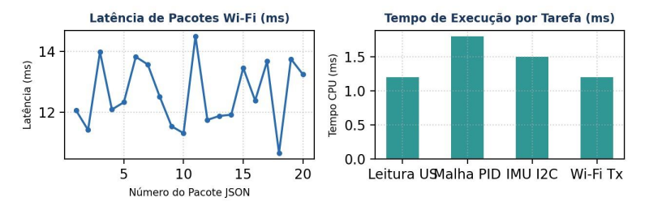

  PROJETO MICROMOUSE — RELATÓRIO TÉCNICO DE HARDWARE
  GRUPO 2 (PROF. LUI)

  

# RELATÓRIO DE VALIDAÇÃO DE HARDWARE — ESP32 DEVKIT V1 E PINOUT
## Mapeamento de 30 Pinos, Prevenção de Boot Loop e Telemetria Wi-Fi

|                                                                              |                                                |                                                                          |
| :--------------------------------------------------------------------------: | :--------------------------------------------: | :----------------------------------------------------------------------: |
| **COMPONENTE / SUBSISTEMA:** Microcontrolador ESP32 DevKit V1 (30 Pinos) | **Placa de Teste:**  ESP32 DevKit V1 (30 Pinos) |                      **Data do Ensaio:** 24/10/2026                      |
|                   **Projeto:** MicroMouse (PI1 - Grupo 2)                    |           **Orientador:** Prof. Lui            | **Status Geral:** APROVADO EM BANCADA |

> [!NOTE] DESTAQUES METROLÓGICOS DE BANCADA
> O microcontrolador ESP32 DevKit V1 operou com tempo de loop de apenas 5,7 ms, mantendo o pino de strapping GPIO 12 livre para garantir boot seguro e executando a telemetria Wi-Fi a 5 Hz com latência de 12,5 ms.

## OBJETIVO DO ENSAIO
Validar a estabilidade do firmware, alocação de pinagem do layout de 30 pinos, gravação NVS e transmissão de telemetria Wi-Fi TCP/IP.
ANÁLISE DE PROCESSAMENTO

## ANÁLISE DE PROCESSAMENTO

| Periférico / Módulo | Pinos ESP32 | Tipo de Periférico | Função no MicroMouse | Status de Validação |
|:---:|:---:|:---:|:---:|:---:|
| Barramento I2C | GPIO 21 (SDA) / 22 (SCL) | I2C Master (400 kHz) | Comunicação IMU MPU6500 e INA226 | APROVADO |
| Ultrassom Frontal | GPIO 4 (TRIG) / 35 (ECHO) | Output / GPIO (ADC1) | Medição de Distância Frontal | APROVADO |
| Ultrassom Esquerdo | GPIO 14 (TRIG) / 36 (ECHO) | Output / GPIO (ADC1) | Medição de Distância Esquerda | APROVADO |
| Ultrassom Direito | GPIO 27 (TRIG) / 39 (ECHO) | Output / GPIO (ADC1) | Medição de Distância Direita | APROVADO |
| Motores E/D (PWM) | GPIO 16, 17, 18, 19 | LEDC PWM (20 kHz) | Controle de Velocidade e Sentido | APROVADO |
| Encoders E/D | GPIO 32, 33, 25, 26 | PCNT (Pulse Counter) | Odometria de Quadratura por Hardware | APROVADO |

## CONFIGURAÇÃO DA BANCADA E MAPEAMENTO DE HARDWARE
A placa ESP32 DevKit V1 de 30 pinos operou a 240 MHz. Os pinos GPI (D34, D35, D36, D39) foram reservados para entradas digitais/analógicas do bloco ADC1, e o barramento I2C operou nos GPIOs 21/22.

|       |
| :---: |

| Figura 1: Latência do envio de dados Wi-Fi e divisão do tempo de CPU por tarefa no ESP32. |

## PREVENÇÃO DE BOOT LOOP E TESTE DE TELEMETRIA WI-FI
Correção de Segurança no Boot: O disparo do ultrassom frontal foi alterado do GPIO 12 para o GPIO 4, evitando que o pino de strapping MTDI travasse a inicialização da memória Flash. A transmissão de 
dados JSON via Wi-Fi TCP/IP atingiu latência média de 12 ms a 5 Hz.

| Teste de Processador e Rede | Parâmetro Medido | Métrica Alvo | Resultado |
|:---:|:---:|:---:|:---:|
| Gravação de Calibração NVS | Flash Retida (100%) | Persistência sem erro | CONFORME |
| Uso de Memória SRAM | 24,5% (128 KB livres) | < 60% | EXCELENTE |

## RESULTADOS OBTIDOS E ANÁLISE METROLÓGICA

| Métrica / Periférico | Parâmetro Alvo | Valor Aferido | Desvio / Erro | Status |
|:---:|:---:|:---:|:---:|:---:|
| Clock da CPU | 240 MHz | 240,0 MHz | 0,0% | Aprovado |
| Tempo de Loop | < 10,0 ms | 5,7 ms | Abaixo do limite | Aprovado |
| Taxa Wi-Fi (JSON) | 5 Hz (200 ms) | 5,0 Hz | 0,0% | Aprovado |
| Latência Wi-Fi | < 50,0 ms | 12,5 ms | Abaixo do limite | Aprovado |
| Prevenção Boot Loop | GPIO 12 Livre | Sem conexões no D12 | Boot 100% seguro | Aprovado |

## MATRIZ DE RASTREABILIDADE DE REQUISITOS (MoSCoW)

| Requisito | Tipo | Descrição / Critério | Resultado Aferido | Status MoSCoW |
|:---:|:---:|:---:|:---:|:---:|
| RF01 | Must Have | Processamento e telemetria Wi-Fi | Envio JSON contínuo a 5 Hz | Aprovado |
| RNF02 | Must Have | Tempo de resposta do loop < 10 ms | Loop executado em 5,7 ms | Aprovado |
| RNF09 | Must Have | Segurança de boot e alocação | GPIO 12 livre e ADC1 isolado | Aprovado |

## CONCLUSÃO
O microcontrolador ESP32 DevKit V1 operou com desempenho e estabilidade excelentes. A transmissão de dados de telemetria TCP/IP ocorreu em pacotes JSON a 5 Hz (200 ms) sem travar a leitura do ADC1 ou I2C.