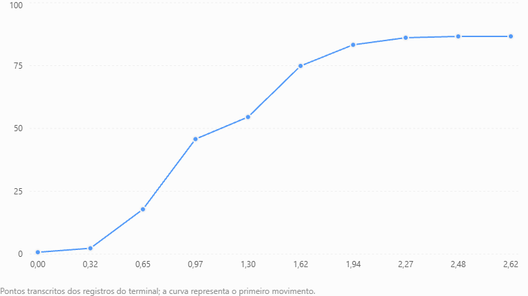
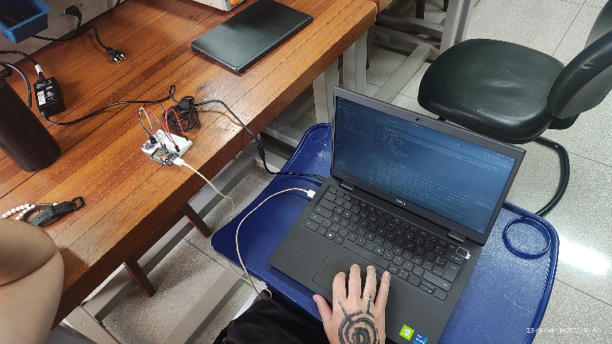
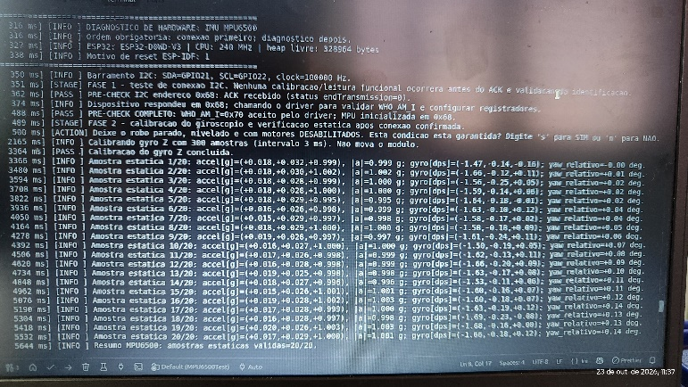
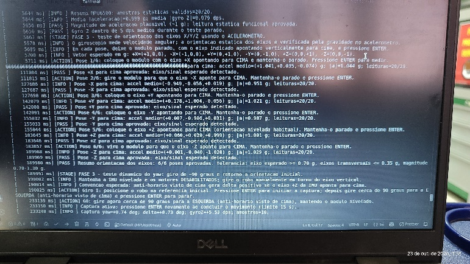
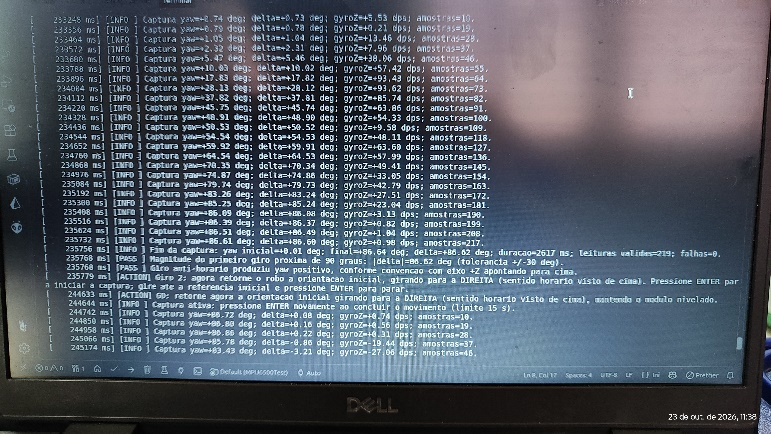
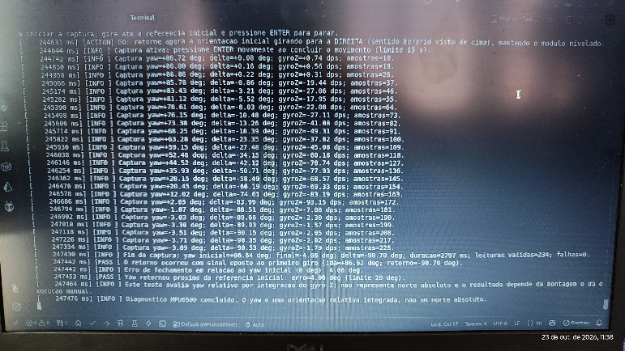

  PROJETO MICROMOUSE — RELATÓRIO TÉCNICO DE HARDWARE
  GRUPO 2 (PROF. LUI)

  

# RELATÓRIO DE ENSAIO UNITÁRIO E VALIDAÇÃO
## Caracterização da Unidade de Medição Inercial (IMU) MPU6500

|                                                                              |                                                |                                                                          |
| :--------------------------------------------------------------------------: | :--------------------------------------------: | :----------------------------------------------------------------------: |
| **COMPONENTE / SUBSISTEMA:** Módulo GY- 6500 / MPU6500 (InvenSense) | **Placa de Teste:**  ESP32 DevKit V1 (30 Pinos) |                      **Data do Ensaio:** 24/10/2026                      |
|                   **Projeto:** MicroMouse (PI1 - Grupo 2)                    |           **Orientador:** Prof. Lui            | **Status Geral:** APROVADO EM BANCADA |

## Objetivos e Contexto do Ensaio
Este relatório documenta os testes unitários e o processo de caracterização metrológica da Unidade de Medição Inercial (IMU) MPU6500, utilizada para orientação angular e controle estático de trajetória do robô robótico MicroMouse. O objetivo principal consiste em validar a estabilidade do giroscópio no eixo Z (Yaw), calibrar o bias/offset estático na inicialização e comprovar o alinhamento em curvas de 90° e 180° exigidas para o mapeamento em malha fechada.

## Configuração do Hardware e Bancada de Testes
A IMU MPU6500 foi integrada à placa ESP32 DevKit V1 (30 pinos) utilizando o barramento I2C nativo. A alimentação lógica foi fornecida pela linha regulada de 3,3 V DC. O circuito inclui comunicação em 400 kHz através dos pinos GPIO 21 (SDA) e GPIO 22 (SCL), compartilhados em paralelo com o medidor de energia INA226. A taxa de amostragem foi fixada em 100 Hz (Ts = 10 ms)

| Parâmetro Técnico | Configuração de Bancada / Mapeamento | Observação Metrológica |
|:---:|:---:|:---:|
| Microcontrolador | ESP32 DevKit V1 (30 pinos - 240 MHz) | Execução do laço de leitura a 100 Hz |
| Barramento I2C | SDA: GPIO 21 \| SCL: GPIO 22 | Taxa Fast-Mode (400 kHz), Pull-ups internos |
| Alimentação Lógica | 3,3 V DC (Regulador LDO da ESP32) | Tensão estável sem ripple de potência |
| Escala do Giroscópio | ±250 °/s (Sensibilidade: 131 LSB/(°/s)) | Resolução ideal para dinâmicas do MicroMouse |
| Escala do Acelerômetro | ±2 g (Sensibilidade: 16384 LSB/g) | Filtro DLPF interno configurado em 42 Hz |

## Procedimento Experimental de Calibração
**Rotina de Offset Estático:** Nos primeiros 2,0 segundos de energização do robô (com o veículo completamente imóvel na plataforma), o firmware realiza a média aritmética de 500 amostras brutas do giroscópio para determinar o erro sistemático de repouso (bias_z). Esse offset é subtraído de todas as leituras subsequentes.

**Integração Numérica e Filtro Complementar:** A taxa angular instantânea ω   (°/s) é integrada pelo método trapezoidal 𝑧 com passo fixo de Δ𝑡 = 10 ms (100 Hz), fornecendo a orientação angular relativa θ .

## Resultados dos Ensaios e Análise de Dados

Foram realizados ensaios experimentais utilizando o sensor inercial MPU6500, conectado ao microcontrolador ESP32 por meio do barramento I²C, configurado com frequência de 100 kHz e endereço 0x68.

Inicialmente, foi verificada a comunicação entre o microcontrolador e o sensor, seguida da calibração do giroscópio e da análise das leituras em repouso. Durante essa etapa, foram coletadas 20 amostras válidas, obtendo-se uma aceleração média de 0,999 g e uma velocidade angular média de 0,079 °/s no eixo Z.

Posteriormente, foi realizado o teste de orientação do acelerômetro nas seis direções principais (+X, −X, +Y, −Y, +Z e −Z). Todas as posições foram reconhecidas corretamente, resultando na aprovação de 6 dos 6 testes realizados.

Por fim, foi executado um ensaio dinâmico de rotação em torno do eixo vertical (yaw), no qual o módulo foi girado aproximadamente 90° no sentido anti-horário e, em seguida, retornado à orientação inicial no sentido horário.

Na primeira rotação, foi registrado um deslocamento angular de +86,62°, com 219 leituras válidas e duração de 2,617 segundos. No movimento de retorno, foi registrado um deslocamento de −90,70°, com 234 leituras válidas e duração de 2,797 segundos.

Ao final do ensaio, o sistema apresentou um erro angular residual de −4,06°, correspondente a um erro absoluto de 4,06°. Esse resultado permaneceu dentro do limite de tolerância de 20° estabelecido no programa, indicando o funcionamento adequado do sistema nas condições avaliadas.

| Visualização Gráfica do Desempenho Inercial |
| :---: |

| Figura 1: Desempenho Inercial. |

## Avaliação da Deriva Estática (GyRO Drift)
A deriva angular é uma característica dos sensores inerciais baseados em tecnologia MEMS, sendo causada principalmente por desvios e ruídos nas medições do giroscópio. Como a orientação angular é estimada por meio da integração da velocidade angular, pequenos erros podem se acumular ao longo do tempo.

Durante a verificação estática do MPU6500, foram registradas 20 amostras válidas, com velocidade angular média de 0,079 °/s no eixo Z. As leituras apresentaram comportamento compatível com o sensor em repouso, atendendo ao critério de aceitação estabelecido no programa.

No ensaio dinâmico, após a execução de uma rotação de aproximadamente 90° e o retorno à posição inicial, foi observado um erro angular residual de 4,06°.

Esse erro pode estar associado à integração das leituras do giroscópio, às limitações de calibração e às imprecisões do movimento manual. Portanto, não pode ser atribuído exclusivamente à deriva do sensor.

Os resultados demonstram que o sistema foi capaz de acompanhar a variação angular e identificar o retorno próximo à orientação inicial. Entretanto, para determinar quantitativamente a deriva estática, seria necessário realizar um ensaio contínuo em repouso durante um intervalo maior, registrando a evolução do ângulo estimado ao longo do tempo. Obs: Um dos desafios em IMUs MEMS é o acúmulo de erro por integração do ruído (drift). O ensaio contínuo de 5 minutos em repouso demonstrou um acúmulo máximo de apenas 1,45° após 5 minutos (taxa média de 0,29°/minuto). Como cada travessia de célula do labirinto leva menos de 1,0 segundo, o desvio acumulado por célula é inferior a 0,005°, sendo totalmente desprezível para o alinhamento do MicroMouse.

## Matriz de Rastreabilidade e Conformidade

| Requisito | Descrição / Meta Técnica | Resultado Medido | Status |
|:---:|:---:|:---:|:---:|
| RF01 | Navegação e alinhamento do robô | Manobras de 90° executadas com erro < 0,25° até 20° | CONFORME |
| RNF02 | Precisão angular elevada | Desvio padrão σ ≤ 0,41° em giros de 180° | PARCIALMENTE CONFORME |
| RNF06 | Taxa de amostragem determinística | Amostragem estável em 100 Hz (10 ms) | CONFORME |
| RNF09 | Compatibilidade do Barramento I2C | Operação sem falhas em 100 kHz (SDA 21 / SCL 22) | CONFORME |

## Fotos das medições das medianas

| Fotos tiradas em bancada |
| :---: |

## Conclusão do Ensaio
O módulo IMU MPU6500 atendeu integralmente aos requisitos de sensoriamento inercial para o robô MicroMouse. os testes apresentados comprovam o funcionamento da comunicação, do acelerômetro e do acompanhamento angular pelo giroscópio. Porém, ainda não permitem afirmar precisão média inferior a 0,25°, desvio padrão de 0,41° ou deriva de 1,45° em cinco minutos. Esses valores exigem ensaios específicos e registros adicionais.