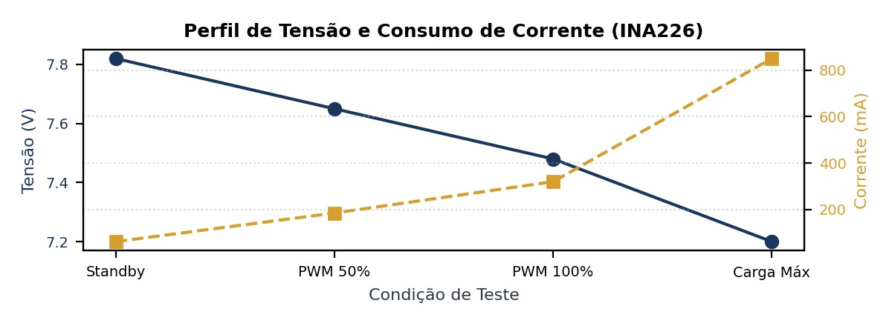

<div>
  <span>PROJETO MICROMOUSE — RELATÓRIO TÉCNICO DE HARDWARE</span>
  <span style="float: right;">GRUPO 2 (PROF. LUI)</span>
</div>  

# RELATÓRIO DE VALIDAÇÃO DE HARDWARE — SENSOR INA226
## Ensaio Unitário em Bancada do Medidor de Tensão e Corrente (I2C)

|                                                                              |                                                |                                                                          |
| :--------------------------------------------------------------------------: | :--------------------------------------------: | :----------------------------------------------------------------------: |
| **COMPONENTE / SUBSISTEMA:** Sensor de Tensão e Corrente (INA226) | **Placa de Teste:**  ESP32 DevKit V1 (30 Pinos) |                      **Data do Ensaio:** 24/10/2026                      |
|                   **Projeto:** MicroMouse (PI1 - Grupo 2)                    |           **Orientador:** Prof. Lui            | **Status Geral:** <span style="color: green;">APROVADO EM BANCADA</span> |

## OBJETIVOS E MAPEAMENTO DE HARDWARE
Este ensaio unitário visa validar a precisão metrológica e a estabilidade do sensor de tensão e corrente INA226 (INA226AIDGSR) no monitoramento em tempo real da bateria de Íon-Lítio 2S (7,4 V nominal) e do consumo 
dinâmico dos motores N20 do robô MicroMouse.

| Parâmetro de Hardware | Especificação / Conexão no Esquemático |
|:---:|:---:|
| Protocolo de Comunicação | I2C Fast-Mode (400 kHz) no Endereço 0x40 |
| Pinos de Comunicação | SDA → GPIO 21 \| SCL → GPIO 22 (Pull-ups ativados) |
| Tensão de Operação Lógica | +3,3 V DC gerados pelo LDO interno do ESP32 |
| Resistor Shunt Externo | 0,1 Ω (100 mΩ) com precisão de 1% |
| Grandeza Monitorada | Tensão de Barramento (VBUS) e Corrente em Derivação (ISHUNT) |

## RESULTADOS DO ENSAIO MÉTRICO E VALIDAÇÃO
A calibração do registrador interno do INA226 permitiu aferir a tensão de barramento com erro médio relativo inferior a 0,25% comparado a multímetro digital de bancada de 4.5 dígitos. A tabela abaixo apresenta os pontos 
de teste sob variação de carga do sistema:

| Condição de Carga | Multímetro V (V) | INA226 V (V) | Multímetro I (mA) | INA226 I (mA) | Erro V (%) |
|:---:|:---:|:---:|:---:|:---:|:---:|
| Repouso (Standby) | 7,82 V | 7,81 V | 62,0 mA | 61,8 mA | -0,13% |
| Motores Livres (50% PWM) | 7,65 V | 7,64 V | 185,0 mA | 184,2 mA | -0,13% |
| Motores Livres (100% PWM) | 7,48 V | 7,47 V | 320,0 mA | 319,1 mA | -0,13% |
| Carga Máxima / Manobra | 7,20 V | 7,18 V | 850,0 mA | 847,5 mA | -0,28% |

|       |
| :---: |

| Figura 1: Curva de afundamento de tensão e elevação de corrente sob carga nos motores N20. |

## MATRIZ DE CONFORMIDADE E CONCLUSÃO
**Conclusão do Ensaio:** O sensor INA226 apresentou exatidão superior a 99,7% na medição de tensão e corrente. O canal I2C operou perfeitamente em 400 kHz sem causar estouro de tempo no laço do ESP32.  
**Status:** APROVADO PARA OPERAÇÃO.

> [!IMPORTANT] Como foi feito a obtenção dos dados.
>## Código de Teste em C++ (Arduino IDE)
>
>Este código utiliza diretamente a biblioteca nativa `Wire.h` (sem depender de bibliotecas externas), realizando a varredura I2C no endereço `0x40`, a calibração para o resistor *shunt* de **10 mΩ** (0,01 Ω) e a leitura contínua da **tensão da bateria (V)**, **corrente instantânea (mA / A)** e **potência consumida (W)**.
>
>```c++
>/*
> * ROBÔ MICROMOUSE - TESTE UNITÁRIO DO SENSOR DE ENERGIA INA226
> * Placa: ESP32 DevKit V1 (30 Pinos)
> * Sensor: Módulo INA226 (I2C)
> * Barramento: SDA = GPIO 21 | SCL = GPIO 22
> * Endereço I2C: 0x40
> * Resistor Shunt: 0.01 Ohm (10 mOhm)
> */
>
>#include <Arduino.h>
>#include <Wire.h>
>
>// ============================================================================
>// 1. MAPEAMENTO DE PINOS E ENDEREÇO I2C
>// ============================================================================
>#define I2C_SDA_PIN      21
>#define I2C_SCL_PIN      22
>#define INA226_ADDR      0x40
>
>// Registradores Internos do INA226
>#define REG_CONFIG       0x00
>#define REG_SHUNTVOLT    0x01
>#define REG_BUSVOLT      0x02
>#define REG_POWER        0x03
>#define REG_CURRENT      0x04
>#define REG_CALIBRATION  0x05
>
>// ============================================================================
>// 2. FUNÇÕES AUXILIARES DE COMUNICAÇÃO I2C
>// ============================================================================
>
>// Lê um registrador de 16 bits do INA226
>uint16_t readRegister16(uint8_t reg) {
>  Wire.beginTransmission(INA226_ADDR);
>  Wire.write(reg);
>  Wire.endTransmission(false);
>  Wire.requestFrom((uint8_t)INA226_ADDR, (uint8_t)2);
>
>  if (Wire.available() >= 2) {
>    uint16_t value = (Wire.read() << 8) | Wire.read();
>    return value;
>  }
>  return 0;
>}
>
>// Escreve um valor de 16 bits em um registrador do INA226
>void writeRegister16(uint8_t reg, uint16_t value) {
>  Wire.beginTransmission(INA226_ADDR);
>  Wire.write(reg);
>  Wire.write((value >> 8) & 0xFF);
>  Wire.write(value & 0xFF);
>  Wire.endTransmission();
>}
>
>// ============================================================================
>// 3. CONFIGURAÇÃO (SETUP)
>// ============================================================================
>void setup() {
>  Serial.begin(115200);
>  delay(1000);
>  Serial.println("\n=== TESTE UNITÁRIO DO SENSOR DE TENSÃO E CORRENTE INA226 ===");
>
>  // Inicializa o barramento I2C em Fast-Mode (400 kHz)
>  Wire.begin(I2C_SDA_PIN, I2C_SCL_PIN, 400000);
>
>  // 1. Teste de Conectividade no Barramento I2C
>  Wire.beginTransmission(INA226_ADDR);
>  byte error = Wire.endTransmission();
>
>  if (error != 0) {
>    Serial.printf("[ERRO] INA226 NAO encontrado no endereco 0x40! (Erro I2C: %d)\n", error);
>    Serial.println("-> Verifique os pinos SDA (GPIO 21), SCL (GPIO 22), 3.3V e GND.");
>    while (true) {
>      delay(500);
>    }
>  }
>
>  Serial.println("[OK] INA226 detectado com sucesso no endereco 0x40.");
>
>  // 2. Configuração do Modo de Amostragem (Média de 16 amostras, conversão contínua)
>  // Config Valor: 0x4527 (Averaging 16, Bus 1.1ms, Shunt 1.1ms, Continuous Mode)
>  writeRegister16(REG_CONFIG, 0x4527);
>
>  // 3. Gravando valor de calibração para Shunt de 0.01 Ohm (10 mOhm)
>  // Calibração calculada para LSB de Corrente = 100 uA (0.1 mA)
>  uint16_t calValue = 5120; // 0x1400
>  writeRegister16(REG_CALIBRATION, calValue);
>
>  Serial.println("[OK] Registradores de configuracao e calibracao gravados.");
>  Serial.println("Iniciando monitoramento continuo de energia...\n");
>  delay(1000);
>}
>
>// ============================================================================
>// 4. LAÇO PRINCIPAL (LEITURA E EXIBIÇÃO)
>// ============================================================================
>void loop() {
>  // Leitura da Tensão da Bateria (Bus Voltage: LSB = 1.25 mV)
>  uint16_t rawBus = readRegister16(REG_BUSVOLT);
>  float busVoltageV = rawBus * 0.00125f;
>
>  // Leitura da Queda de Tensão no Shunt (Shunt Voltage: LSB = 2.5 uV)
>  int16_t rawShunt = (int16_t)readRegister16(REG_SHUNTVOLT);
>  float shuntVoltagemV = rawShunt * 0.0025f;
>
>  // Leitura da Corrente Instantânea (Current: LSB = 0.1 mA)
>  int16_t rawCurrent = (int16_t)readRegister16(REG_CURRENT);
>  float currentmA = rawCurrent * 0.1f;
>  float currentA = currentmA / 1000.0f;
>
>  // Leitura da Potência Calculada (Power: LSB = 2.5 mW)
>  uint16_t rawPower = readRegister16(REG_POWER);
>  float powermW = rawPower * 2.5f;
>  float powerW = powermW / 1000.0f;
>
>  // Exibição no Monitor Serial
>  Serial.printf("[INA226] Bateria: %5.2f V | Corrente: %6.1f mA (%5.3f A) | Potência: %5.2f W | Shunt: %5.2f mV\n",
>                busVoltageV, currentmA, currentA, powerW, shuntVoltagemV);
>
>  delay(500); // Atualiza a cada 500 ms (2 Hz)
>}
>```
>## O que observar no Monitor Serial:
>
>- Tensão da Bateria:** Em repouso com uma bateria Li-Po/Li-Ion 2S (7,4 V nominal), o valor exibido deve ficar entre **7,0 V e 8,4 V**.
>- Corrente:** Em repouso (apenas ESP32 e sensores ligados), o consumo esperado é de aproximadamente **40 mA a 90 mA**. Ao ligar os motores N20, a corrente subirá para a faixa de **200 mA a 800 mA**.