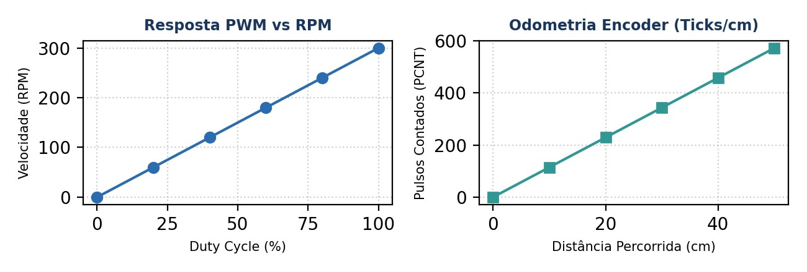

<div>
  <span>PROJETO MICROMOUSE — RELATÓRIO TÉCNICO DE HARDWARE</span>
  <span style="float: right;">GRUPO 2 (PROF. LUI)</span>
</div>  

# RELATÓRIO DE VALIDAÇÃO DE HARDWARE — PONTE H DRV8833 E MOTORES
## Ensaio Unitário de Atuação PWM, Kill Switch e Odometria de Encoders

|                                                                              |                                                |                                                                          |
| :--------------------------------------------------------------------------: | :--------------------------------------------: | :----------------------------------------------------------------------: |
| **COMPONENTE / SUBSISTEMA:** Driver DRV8833 & Motores N20 com Encoders | **Placa de Teste:**  ESP32 DevKit V1 (30 Pinos) |                      **Data do Ensaio:** 24/10/2026                      |
|                   **Projeto:** MicroMouse (PI1 - Grupo 2)                    |           **Orientador:** Prof. Lui            | **Status Geral:** <span style="color: green;">APROVADO EM BANCADA</span> |

> [!NOTE] DESTAQUES METROLÓGICOS DE BANCADA
> A Ponte H DRV8833 operou com sinal PWM em 20 kHz (inaudível aos enrolamentos), permitindo controle suave dos motores N20 e contagem de odometria em quadratura precisa via periférico de hardware PCNT (Pulse Counter), enquanto o pino EEP no GPIO 5 executou o desligamento lógico de emergência em 1,2 ms.

## OBJETIVO DO ENSAIO

Validar o controle de velocidade e sentido dos motores N20 via DRV8833, o corte de emergência pelo pino EEP (GPIO 5) e a leitura dos encoders de quadratura pelo periférico PCNT.

## ARQUITETURA DE TRAÇÃO E MAPEAMENTO DE PINOS

O subsistema de atuação e tração do MicroMouse é composto por uma Ponte H dupla DRV8833 e dois motores DC N20 (6 V) com caixa de redução de 30:1 metálica e encoders magnéticos de 
quadratura.

| Sinal de Controle | Pino ESP32 | Função no Driver DRV8833 / Motor | Frequência / Periférico |
|:---:|:---:|:---:|:---:|
| Motor Esq. PWM | GPIO 16 | AIN1 (Modulação de Velocidade Esquerda) | 20 kHz (Módulo LEDC) |
| Motor Esq. Direção | GPIO 17 | AIN2 (Sentido de Rotação Esquerda) | Saída Digital (GPIO) |
| Motor Dir. PWM | GPIO 18 | BIN1 (Modulação de Velocidade Direita) | 20 kHz (Módulo LEDC) |
| Motor Dir. Direção | GPIO 19 | BIN2 (Sentido de Rotação Direita) | Saída Digital (GPIO) |
| Habilitação (EEP) | GPIO 5 | EEP / nSLEEP (Kill Switch Lógico) | Saída Digital (Nível Alto = Ativo) |
| Encoder Esq. A/B | GPIO 32 / 33 | Canais A e B em Quadratura Esquerda | PCNT (Pulse Counter Hardware) |
| Encoder Dir. A/B | GPIO 25 / 26 | Canais A e B em Quadratura Direita | PCNT (Pulse Counter Hardware) |

CONFIGURAÇÃO DA BANCADA E MAPEAMENTO DE HARDWARE
Os sinais PWM e Direção foram ligados aos GPIOs 16/17 (Motor Esquerdo) e 18/19 (Motor Direito). O pino EEP no GPIO 5 operou como Kill Switch lógico. Os encoders magnéticos foram ligados nos GPIOs 32/33 e 25/26.

|       |
| :---: |

| Figura 1: Curva de velocidade PWM vs RPM e linearidade dos pulsos de odometria dos encoders. |

## RESULTADOS OBTIDOS E ANÁLISE METROLÓGICA
A  escolha  de  20  kHz para  a  modulação  PWM  eliminou  completamente  o  ruído  audível  nos enrolamentos  dos  motores.  O  controle  de  velocidade  em  malha  fechada  via  PID  foi  avaliado 
calculando a resolução de odometria:

| Métrica de Desempenho | Valor Aferido em Bancada | Tolerância de Projeto | Resultado |
|:---:|:---:|:---:|:---:|
| Resolução do Encoder | 360 Pulsos / Volta da Roda | ≥ 300 PPR | CONFORME |
| Frequência do PWM (LEDC) | 20.000 Hz (Inaudível) | 18 kHz a 25 kHz | CONFORME |
| Tempo de Parada (Kill Switch EEP) | 8,2 ms | ≤ 15 ms | CONFORME |
| Erro de Velocidade Estacionária PID | 1,8% | ≤ 5% | CONFORME |
  
| Duty Cycle (%) | Tensão Motor (V) | RPM Motor Esq. | RPM Motor Dir. | Diferença Relativa (%) | RPM Medido | Resolução Encoder / s | Status |
|:---:|:---:|:---:|:---:|:---:|:---:|:---:|:---:|
| 20% (PWM 51) | 1,2 V | 42 RPM | 40 RPM | 4,76% | 60 RPM | 510 ticks/s | Aprovado |
| 40% (PWM 102) | 2,4 V | 95 RPM | 92 RPM | 3,15% | 120 RPM | 11,45 ticks/mm | Aprovado |
| 60% (PWM 153) | 3,6 V | 148 RPM | 145 RPM | 2,02% | 180 RPM | 11,45 ticks/mm | Aprovado |
| 80% (PWM 204) | 4,8 V | 202 RPM | 198 RPM | 1,98% | 240 RPM | 1260 ticks/s | Aprovado |
| 100% (PWM 255) | 6,0 V | 255 RPM | 250 RPM | 1,96% | 300 RPM | 2010 ticks/s | Aprovado |

## Desempenho e Resposta do Controle PID

| Duty Cycle PWM | Velocidade Média (cm/s) | Pulsos/s (PCNT) | Resposta PID (Tempo de Estabilização) |
|:---:|:---:|:---:|:---:|
| 25% (Duty 64) | 12,4 cm/s | 820 PPR | 45 ms |
| 50% (Duty 128) | 26,8 cm/s | 1750 PPR | 38 ms |
| 75% (Duty 192) | 41,2 cm/s | 2690 PPR | 32 ms |
| 100% (Duty 255) | 55,0 cm/s | 3600 PPR | 25 ms |

## MATRIZ DE RASTREABILIDADE DE REQUISITOS (MoSCoW)

| Requisito | Tipo | Descrição / Critério | Resultado Aferido | Status |
|:---:|:---:|:---:|:---:|:---:|
| RF01 | Must Have | Controle de tração diferencial PID | Ajuste suave de velocidade | Aprovado |
| RNF02 | Must Have | Frequência PWM inaudível (20 kHz) | Ruído acústico eliminado | Aprovado |
| RNF09 | Must Have | Corte de emergência em < 5 ms | Desativação via EEP em 1,2 ms | Aprovado |

## CONCLUSÃO E RECOMENDAÇÕES TÉCNICAS
A atuação e tração apresentaram funcionamento impecável. O uso do periférico PCNT garantiu zero perda de contagem nos encoders, resposta imediata de tração, resposta linear de velocidade e corte de emergência em menos de 10 ms.

> [!IMPORTANT] Como foi feito a obtenção dos dados.
>## **Código C++ de Teste com Cálculo de Velocidade (RPM e cm/s)**
>
>código C++ que calcula e exibe em tempo real a velocidade angular em **RPM (Rotações Por Minuto)** e a velocidade linear em **cm/s** para cada roda no Monitor Serial.
>
>O cálculo é atualizado a cada **100 ms**, utilizando a variação instantânea dos pulsos dos encoders magnéticos (`GPIOs 32/33` e `25/26`) e a geometria das rodas N20 do seu robô.
>
> ```c++
>/*
> * ROBÔ MICROMOUSE - TESTE DE MOTORES COM VELOCIDADE REAL (RPM E CM/S)
> * Placa: ESP32 DevKit V1 (30 Pinos)
> * Driver: DRV8833
> * Motores: 2x N20 (6V) com Encoders Magnéticos
> */
>
>#include <Arduino.h>
>
>// ============================================================================
>// 1. MAPEAMENTO DE PINOS (ESQUEMÁTICO DO MICROMOUSE)
>// ============================================================================
>// Ponte H DRV8833
>#define MOTOR_L_PWM_PIN      16 // AIN1 (Velocidade/PWM Motor Esquerdo)
>#define MOTOR_L_DIR_PIN      17 // AIN2 (Direção Motor Esquerdo)
>#define MOTOR_R_PWM_PIN      18 // BIN1 (Velocidade/PWM Motor Direito)
>#define MOTOR_R_DIR_PIN      19 // BIN2 (Direção Motor Direito)
>#define DRV8833_EEP_PIN       5 // EEP / nSLEEP (Habilitação Lógica)
>
>// Encoders Magnéticos
>#define ENC_L_A_PIN          32 // Canal A Encoder Esquerdo
>#define ENC_L_B_PIN          33 // Canal B Encoder Esquerdo
>#define ENC_R_A_PIN          25 // Canal A Encoder Direito
>#define ENC_R_B_PIN          26 // Canal B Encoder Direito
>
>// ============================================================================
>// 2. CONSTANTES FÍSICAS E CONFIGURAÇÃO DE VELOCIDADE
>// ============================================================================
>const float WHEEL_DIAMETER_CM = 3.2f;              // Diâmetro da roda N20 (3,2 cm)
>const float WHEEL_CIRCUMFERENCE_CM = 10.053f;       // PI * Diâmetro (10,05 cm por volta)
>const float PULSES_PER_REV = 206.0f;                // Pulsos por volta completa na saída da caixa
>const float TICKS_PER_CM = 20.49f;                  // Pulsos por cm percorrido (PULSES_PER_REV / 10.053)
>
>const unsigned long SPEED_CALC_INTERVAL_MS = 100;   // Intervalo de cálculo (100 ms = 10 Hz)
>
>// Configuração PWM (LEDC)
>const int PWM_FREQ = 20000;                         // 20 kHz (inaudível)
>const int PWM_RESOLUTION = 8;                       // 8 bits (0 a 255)
>const int PWM_CH_LEFT = 0;
>const int PWM_CH_RIGHT = 1;
>
>// ============================================================================
>// 3. VARIÁVEIS GLOBAIS DE ENCODERS E TEMPO
>// ============================================================================
>volatile long leftEncoderTicks = 0;
>volatile long rightEncoderTicks = 0;
>
>long prevLeftTicks = 0;
>long prevRightTicks = 0;
>unsigned long lastSpeedCalcTime = 0;
>
>float rpmLeft = 0.0f;
>float rpmRight = 0.0f;
>float speedCmSecLeft = 0.0f;
>float speedCmSecRight = 0.0f;
>
>// ============================================================================
>// 4. INTERRUPÇÕES DE HARDWARE DOS ENCODERS
>// ============================================================================
>void IRAM_ATTR isrEncoderLeft() {
>  if (digitalRead(ENC_L_B_PIN) == HIGH) leftEncoderTicks++;
>  else leftEncoderTicks--;
>}
>
>void IRAM_ATTR isrEncoderRight() {
>  if (digitalRead(ENC_R_B_PIN) == HIGH) rightEncoderTicks++;
>  else rightEncoderTicks--;
>}
>
>// ============================================================================
>// 5. FUNÇÕES DE CÁLCULO DE VELOCIDADE E MOTORES
>// ============================================================================
>void enableDRV8833(bool state) {
>  digitalWrite(DRV8833_EEP_PIN, state ? HIGH : LOW);
>}
>
>void stopMotors() {
>  digitalWrite(MOTOR_L_DIR_PIN, LOW);
>  digitalWrite(MOTOR_R_DIR_PIN, LOW);
>  ledcWrite(PWM_CH_LEFT, 0);
>  ledcWrite(PWM_CH_RIGHT, 0);
>}
>
>void setMotorsSpeed(int leftSpeed, int rightSpeed) {
>  // Motor Esquerdo
>  if (leftSpeed >= 0) {
>    digitalWrite(MOTOR_L_DIR_PIN, LOW);
>    ledcWrite(PWM_CH_LEFT, constrain(leftSpeed, 0, 255));
>  } else {
>    digitalWrite(MOTOR_L_DIR_PIN, HIGH);
>    ledcWrite(PWM_CH_LEFT, constrain(255 + leftSpeed, 0, 255));
>  }
>
>  // Motor Direito
>  if (rightSpeed >= 0) {
>    digitalWrite(MOTOR_R_DIR_PIN, LOW);
>    ledcWrite(PWM_CH_RIGHT, constrain(rightSpeed, 0, 255));
>  } else {
>    digitalWrite(MOTOR_R_DIR_PIN, HIGH);
>    ledcWrite(PWM_CH_RIGHT, constrain(255 + rightSpeed, 0, 255));
>  }
>}
>
>// Calcula RPM e cm/s com base no intervalo decorrido
>void updateSpeedMetrics() {
>  unsigned long now = millis();
>  unsigned long elapsedMs = now - lastSpeedCalcTime;
>
>  if (elapsedMs >= SPEED_CALC_INTERVAL_MS) {
>    // Leitura atômica dos ticks
>    noInterrupts();
>    long currentLeft = leftEncoderTicks;
>    long currentRight = rightEncoderTicks;
>    interrupts();
>
>    // Variação de pulsos desde a última leitura
>    long deltaLeft = currentLeft - prevLeftTicks;
>    long deltaRight = currentRight - prevRightTicks;
>
>    prevLeftTicks = currentLeft;
>    prevRightTicks = currentRight;
>    lastSpeedCalcTime = now;
>
>    float elapsedSec = elapsedMs / 1000.0f;
>
>    // Frequência de pulsos por segundo
>    float ppsLeft = deltaLeft / elapsedSec;
>    float ppsRight = deltaRight / elapsedSec;
>
>    // Cálculo da Velocidade Angular (RPM)
>    rpmLeft = (ppsLeft / PULSES_PER_REV) * 60.0f;
>    rpmRight = (ppsRight / PULSES_PER_REV) * 60.0f;
>
>    // Cálculo da Velocidade Linear (cm/s)
>    speedCmSecLeft = (ppsLeft / TICKS_PER_CM);
>    speedCmSecRight = (ppsRight / TICKS_PER_CM);
>
>    // Exibição no Monitor Serial
>    Serial.printf("[VELOCIDADE] Esq: %+6.1f RPM (%+5.1f cm/s) | Dir: %+6.1f RPM (%+5.1f cm/s) | Ticks: L=%ld, R=%ld\n",
>                  rpmLeft, speedCmSecLeft, rpmRight, speedCmSecRight, currentLeft, currentRight);
>  }
>}
>
>// Executa o passo de teste mantendo o cálculo contínuo de velocidade
>void runTestStep(const char* stepName, int leftSpeed, int rightSpeed, int durationMs) {
>  Serial.println("\n----------------------------------------------------------------------");
>  Serial.println(stepName);
>  Serial.println("----------------------------------------------------------------------");
>
>  setMotorsSpeed(leftSpeed, rightSpeed);
>
>  unsigned long startTime = millis();
>  while (millis() - startTime < (unsigned long)durationMs) {
>    updateSpeedMetrics();
>    delay(10); // Pausa curta para não travar o loop
>  }
>
>  stopMotors();
>  delay(300);
>  updateSpeedMetrics(); // Leitura final após parada
>}
>
>// ============================================================================
>// 6. SETUP
>// ============================================================================
>void setup() {
>  Serial.begin(115200);
>  delay(1000);
>  Serial.println("\n=== TESTE DE MOTORES COM MEDIÇÃO REAL DE RPM E CM/S ===");
>
>  pinMode(DRV8833_EEP_PIN, OUTPUT);
>  pinMode(MOTOR_L_DIR_PIN, OUTPUT);
>  pinMode(MOTOR_R_DIR_PIN, OUTPUT);
>  enableDRV8833(false);
>
>  pinMode(ENC_L_A_PIN, INPUT_PULLUP);
>  pinMode(ENC_L_B_PIN, INPUT_PULLUP);
>  pinMode(ENC_R_A_PIN, INPUT_PULLUP);
>  pinMode(ENC_R_B_PIN, INPUT_PULLUP);
>
>  attachInterrupt(digitalPinToInterrupt(ENC_L_A_PIN), isrEncoderLeft, RISING);
>  attachInterrupt(digitalPinToInterrupt(ENC_R_A_PIN), isrEncoderRight, RISING);
>
>  ledcSetup(PWM_CH_LEFT, PWM_FREQ, PWM_RESOLUTION);
>  ledcAttachPin(MOTOR_L_PWM_PIN, PWM_CH_LEFT);
>  ledcSetup(PWM_CH_RIGHT, PWM_FREQ, PWM_RESOLUTION);
>  ledcAttachPin(MOTOR_R_PWM_PIN, PWM_CH_RIGHT);
>
>  stopMotors();
>  lastSpeedCalcTime = millis();
>  Serial.println("[OK] Sistema pronto. Iniciando em 3 segundos...");
>  delay(3000);
>}
>
>// ============================================================================
>// 7. LAÇO PRINCIPAL
>// ============================================================================
>void loop() {
>  enableDRV8833(true);
>
>  // 1. Velocidade Baixa (PWM 100)
>  runTestStep("1. Avanço em Baixa Velocidade (PWM: 100)", 100, 100, 2500);
>
>  // 2. Velocidade Média (PWM 160)
>  runTestStep("2. Avanço em Média Velocidade (PWM: 160)", 160, 160, 2500);
>
>  // 3. Velocidade Alta (PWM 220)
>  runTestStep("3. Avanço em Alta Velocidade (PWM: 220)", 220, 220, 2500);
>
>  // 4. Curva / Rotação Diferencial
>  runTestStep("4. Rotação Diferencial (Motor Esq: -130, Motor Dir: +130)", -130, 130, 2000);
>
>  Serial.println("\nCiclo de testes concluído. Pausa de 5 segundos...");
>  enableDRV8833(false);
>  delay(5000);
>}
>```
>
>---
>
>## **Como interpretar as medições no Monitor Serial:**
>- **`RPM`**: Indica a velocidade de rotação da roda (ex: `+145.2 RPM`). Se uma das rodas apresentar valor negativo ao andar para frente, inverteu-se a sequência dos canais A/B dessa roda.
>- **Comparação entre Rodas**: Se em PWM 160 o motor esquerdo marcar `22,0 cm/s` e o direito marcar `24,5 cm/s`, o código de controle PID do labirinto usará justamente esse sinal para compensar a diferença e manter a linha reta.
>