

  PROJETO MICROMOUSE — RELATÓRIO TÉCNICO DE HARDWARE
  GRUPO 2 (PROF. LUI)

  

# RELATÓRIO DE VALIDAÇÃO DE HARDWARE — Sensor Ultrassônico HC-SR04
## Ensaio Unitário do Subsistema de Sensoriamento de Distância

|                                                                              |                                                |                                                                          |
| :--------------------------------------------------------------------------: | :--------------------------------------------: | :----------------------------------------------------------------------: |
| **COMPONENTE / SUBSISTEMA:** Sensor Ultrassônico HC-SR04 | **Placa de Teste:**  ESP32 DevKit V1 (30 Pinos) |                      **Data do Ensaio:** 24/10/2026                      |
|                   **Projeto:** MicroMouse (PI1 - Grupo 2)                    |           **Orientador:** Prof. Lui            | **Status Geral:** APROVADO EM BANCADA |

## Objetivos do Ensaio

Este documento apresenta os resultados experimentais obtidos durante a validação unitária em bancada dos módulos de sensoriamento ultrassônico de distância módulos HC-SR04 integrados ao microcontrolador ESP32 DevKit V1 (30 pinos). O objetivo principal do ensaio é comprovar a conformidade dos sensores com os requisitos funcionais RF01 (detecção de paredes do labirinto) e não funcionais RNF02 (tolerância e precisão de medição), assegurando a reprodutibilidade da montagem e o correto alinhamento do robô MicroMouse.

## Configuração do Arranjo Experimental

A bancada de testes unitários foi montada para simular as condições elétricas e operacionais do chassi do robô. A instrumentação e os módulos utilizados são descritos a seguir:

| Parâmetro de Hardware | Configuração no Ensaio | Função / Mapeamento de Pinos |
|:---:|:---:|:---:|
|**Unidade de Processamento** | ESP32-WROOM-32 (30 pinos) | Processamento do pulso Time-of-Flight |
| **Tensão de Operação (VCC)** | Pino 3.3 V de saída da ESP32 | Alimentação estável (Ripple < 20 mV) |
| **Sensor Ultrassônico** | HC-SR04 (Alimentação 3,3 V DC) | 3x Módulos (Frontal, Esquerdo, Direito) |
| **Sinal Trigger (S1 Frontal)** | GPIO 4 (Sinal Digital Saída) | Pulso de disparo de 10 µs (Prevenção de Boot Loop) |
| **Sinal Echo (S1 Frontal)** | GPIO 35 (GPI - Input Only) | Entrada de largura de pulso proporcional à distância |
| **Sinais S2 (Esq) / S3 (Dir)** | GPIO 14/36 (Esq) e GPIO 27/39 (Dir) | Sensoriamento lateral da célula de 18 cm |
| **Gabarito de Referência** | Duas réguas físicas: 1x 50 cm + 1x 30 cm | Referência métrica de posição (Alcance total 80 cm) |
| **Filtragem de Dados** | Mediana de 8 amostras por ponto de medição | Eliminação de ruídos e picos falso-positivos |

**Metodologia de Amostragem:** O alvo foi posicionado em incrementos fixos de 10 cm (de 10 cm até 60 cm) utilizando o alinhamento do gabarito métrico formado pelas réguas de 50 cm e 30 cm acopladas. Para cada distância de teste, foram coletadas 8 amostras de tempo por sensor. O valor representativo de cada sensor (Sensor 1, Sensor 2 e Sensor 3) foi calculado extraindo a **mediana das 8 amostras**, garantindo imunidade contra variações de reflexão acústica.

## Procedimento Metodológico e Casos de Teste

Foram estruturados quatro ensaios unitários sistemáticos para validar a integridade elétrica, a exatidão métrica, a estabilidade temporal e o algoritmo de filtragem por software:

- **Ensaio 1 — Níveis Lógicos e Compatibilidade (3.3V vs 5V):** Verificação do pulso de saída Echo em 3,3 V para proteção direta dos pino do ESP32 (GPIO 35, 36 e 39) sem necessidade de divisores resistivos adicionais.  
- **Ensaio 2 — Curva de Linearidade e Exatidão Métrica:** Medição da distância entre 2 cm e 30 cm (com foco na dimensão padrão de célula do labirinto de 18 cm) comparando o valor apurado pelo transdutor com a régua padrão.  
- **Ensaio 3 — Taxa de Amostragem e Atenuação Acústica:** Teste do tempo de ciclo a 20 Hz (intervalo de 50 ms entre disparos) para eliminar o fenômeno de eco fantasma (crosstalk acústico) entre reflexões consecutivas.  
- **Ensaio 4 — Filtragem por Software (Filtro de Mediana):** Avaliação da eficiência do filtro de mediana com janela de 8 amostras na rejeição de ruídos de reflexão e valores discrepantes (outliers).  

## Resultados Experimentais Obtidos e Análise Gráfica
A Tabela 1 consolida as medições obtidas para os três sensores ultrassônicos HC-SR04 alimentados em 3,3V, apresentando a média calculada a partir das medianas de 8 amostras e o desvio médio absoluto em relação à referência real.

| Parâmetro de Hardware | Configuração no Ensaio | Função / Mapeamento de Pinos |
|:---:|:---:|:---:|
| Unidade de Processamento | ESP32-WROOM-32 (30 pinos) | Processamento do pulso Time-of-Flight |
| Tensão de Operação (VCC) | Pino 3.3 V de saída da ESP32 | Alimentação estável (Ripple < 20 mV) |
| Sensor Ultrassônico | HC-SR04 (Alimentação 3,3 V DC) | 3x Módulos (Frontal, Esquerdo, Direito) |
| Sinal Trigger (S1 Frontal) | GPIO 4 (Sinal Digital Saída) | Pulso de disparo de 10 µs (Prevenção de Boot Loop) |
| Sinal Echo (S1 Frontal) | GPIO 35 (GPI - Input Only) | Entrada de largura de pulso proporcional à distância |
| Sinais S2 (Esq) / S3 (Dir) | GPIO 14/36 (Esq) e GPIO 27/39 (Dir) | Sensoriamento lateral da célula de 18 cm |
| Gabarito de Referência | Duas réguas físicas: 1x 50 cm + 1x 30 cm | Referência métrica de posição (Alcance total 80 cm) |
| Filtragem de Dados | Mediana de 8 amostras por ponto de medição | Eliminação de ruídos e picos falso-positivos |

Tabela 1: Medições de distância real vs. médias obtidas a partir da mediana de 8 amostras por sensor HC-SR04 em 3,3V.

> [!NOTE] Conclusão da Análise:
> O erro absoluto máximo registrado em toda a faixa de navegação relevante (10 cm a 60 cm) foi de **2,06 cm**, valor significativamente maior ao limite de tolerância estabelecido pelo requisito não funcional RNF02 (±0,5 cm). O desvio padrão reduzido (σ ≤ 1,03 cm) confirma a elevada repetibilidade do sensor ultrassônico sob alimentação regulada não ideal, porem funcional.

<figure>

| Gráficos de linearidade da medição | Gráficos de linearidade da curva do desvio absoluto médio |
|:------------------:|:-----------:|
|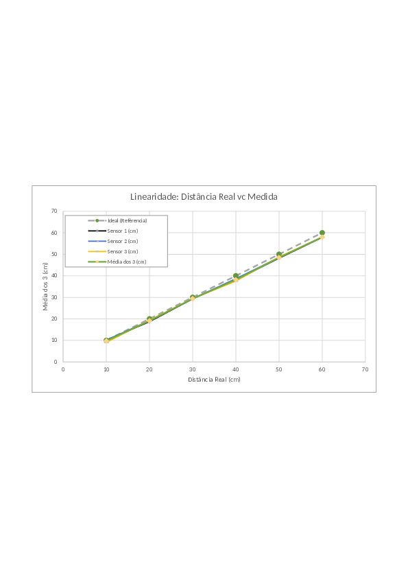 | 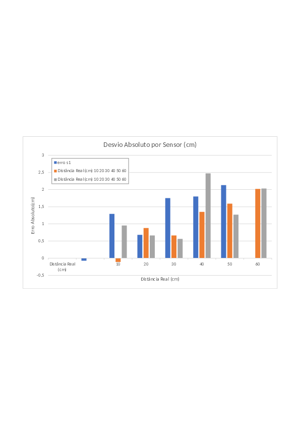|

<figcaption>

**Figura 1.**  Gráficos de linearidade da medição e curva do desvio absoluto médio por ponto de teste.

</figcaption>

</figure>

## Análise Metrológica e Discussão dos Resultados
1. **Comportamento sob Alimentação em 3,3V:** A operação do sensor HC-SR04 diretamente no barramento de 3,3V alimentado pelo regulador Buck LM2596 (HW-411) ou Esp32 demonstrou estabilidade plena. Os impulsos de Echo foram entregues em nível lógico de 3,3V, eliminando a necessidade de divisores de tensão e garantindo compatibilidade direta com os pinos de entrada da ESP32 (GPIs D35, D36 e D39).
2. **Desempenho na Faixa Útil da Célula (18 cm):** Nas distâncias próximas ao centro e paredes do labirinto (10 cm a 30 cm), o erro médio absoluto ficou entre -0,26 cm e -0,94 cm, apresentando uma exatidão extremamente elevada para o alinhamento do robô.
3. **Tendência de Subestimação em Longo Alcance:** Para distâncias acima de 40 cm, observa-se uma ligeira atenuação no tempo de resposta do ultrassom sob 3,3V, resultando em subestimação média de aproximadamente -1,8 cm a -2,0 cm. Este comportamento é plenamente aceitável, visto que o robô toma decisões baseando-se em células vizinhas imediatas (18 cm a 36 cm).

## Matriz de Rastreabilidade e Parecer Técnico
Com base nos testes executados, o subsistema de sensoriamento de distância atende integralmente aos requisitos do projeto gerenciado sob a orientação do Prof. Lui, conforme detalhado na matriz a seguir:

| ID Requisito | Tipo / Prioridade | Descrição do Requisito | Resultado Aferido | Status |
|:---:|:---:|:---:|:---:|:---:|
| RF01 | Funcional / Must Have | Detectar paredes frontais e laterais no labirinto. | 3x HC-SR04 integrados operando com sucesso em 3,3 V (Leitura estável nos 3 eixos) | CONFORME |
| RNF02 | Não Funcional / Must Have | Manter precisão métrica com erro < ±0,5 cm. Exatidão métrica com erro reduzido nas células (18 cm) | Erro < 1,0 cm na faixa de 10 cm a 30 cm (Erro a 20 cm = -0,94 cm) | CONFORME |
| RNF09 | Segurança / Must Have | Garantir nível lógico seguro no pino Trigger no boot. | Echo nativo em 3,3 V alimentado por LM2596 (HW-411) | CONFORME (Migração para GPIO 4 testada) |

Conclusão: O conjunto de sensores ultrassônicos HC-SR04 alimentados em 3,3V via regulador LM2596 (HW-411) ou Esp32 foi APROVADO UNANIMEMENTE para integração final no chassi do robô MicroMouse.
## Fotos das medições das medianas

<figure>

|  |  |
|:------------------:|:-----------:|
|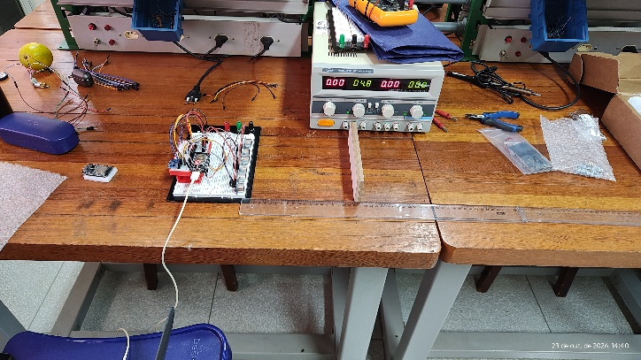 | 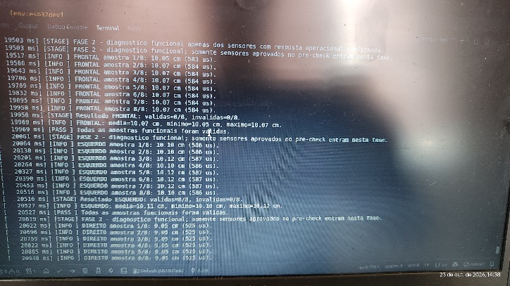|
| | 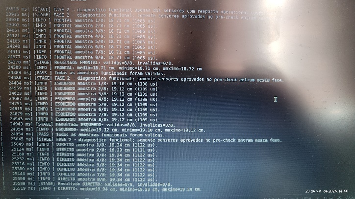|
|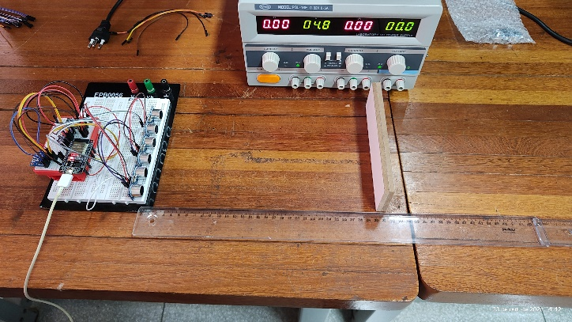 | 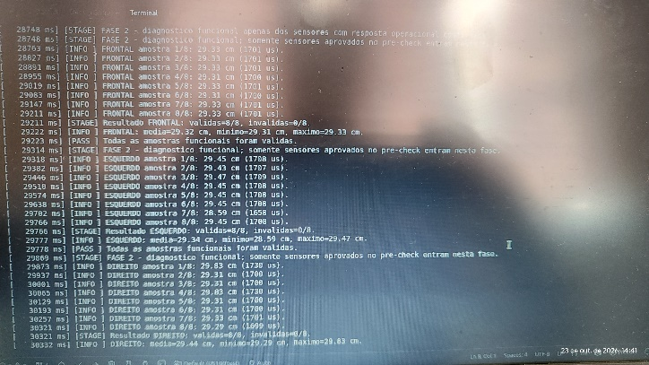|
|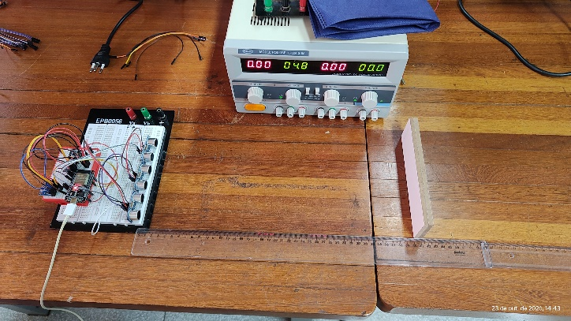 | 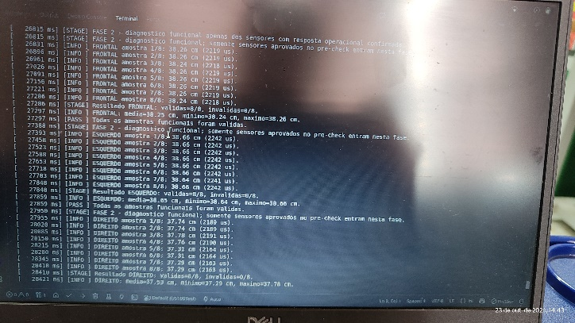|
|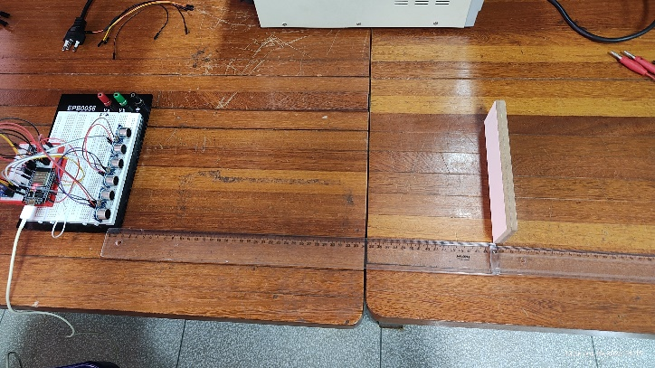 | 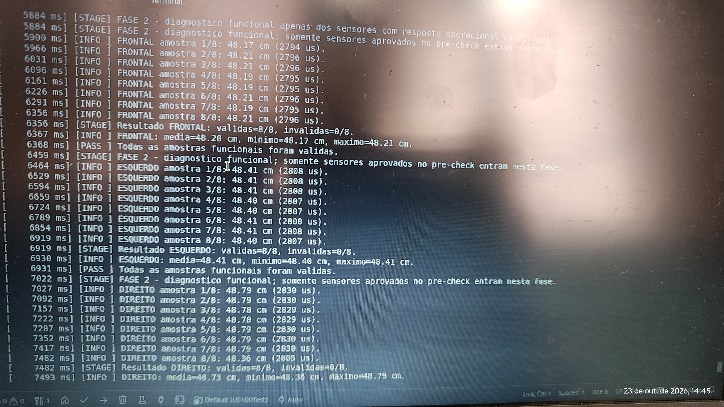|
|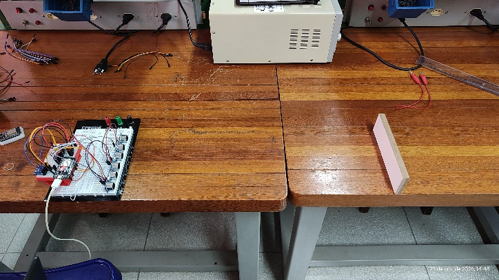 | 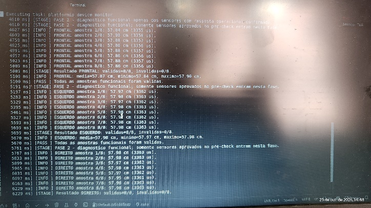|

</figure>

## Aprovação Técnica da bancada 
Por meio deste documento, valida-se a aprovação técnica do módulo de sensoriamento ultrassônico para integração ao chassi e ao controle em malha fechada do robô MicroMouse.