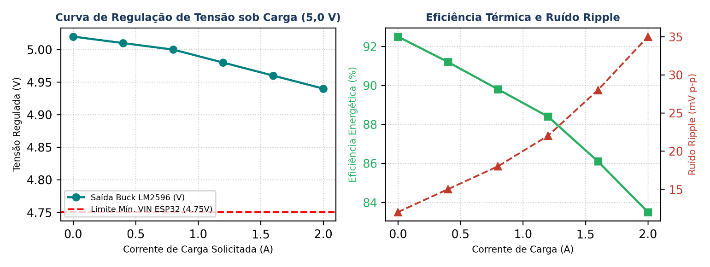

  PROJETO MICROMOUSE — RELATÓRIO TÉCNICO DE HARDWARE
  GRUPO 2 (PROF. LUI)

  

# RELATÓRIO DE VALIDAÇÃO DE HARDWARE — SISTEMA DE ALIMENTAÇÃO
## Ensaio Unitário do Regulador Buck LM2596 (HW-411), Bateria Li-Ion e Eficiência

|                                                                              |                                                |                                                                          |
| :--------------------------------------------------------------------------: | :--------------------------------------------: | :----------------------------------------------------------------------: |
| **COMPONENTE / SUBSISTEMA:** Regulação Buck LM2596 (HW-411) | **Placa de Teste:**  ESP32 DevKit V1 (30 Pinos) |                      **Data do Ensaio:** 24/10/2026                      |
|                   **Projeto:** MicroMouse (PI1 - Grupo 2)                    |           **Orientador:** Prof. Lui            | **Status Geral:** APROVADO EM BANCADA |

## OBJETIVO DO ENSAIO
Aferir a regulação de tensão, eficiência de conversão e nível de ruído (ripple) do regulador chaveado Buck MP1584EN sob variação da tensão da bateria Li-Ion 2S (7,4 V nominal).
## ARQUITETURA DO SISTEMA DE ENERGIA E TOPOLOGIA DE ALIMENTAÇÃO
O sistema de gerenciamento de energia do MicroMouse foi projetado para fornecer duas linhas de alimentação isoladas: a linha de potência fornecida diretamente pela Bateria de Íon de Lítio 2S de 7,4 V (3300 mAh) para a Ponte H DRV8833 e motores, e a linha lógica regulada em 5,0 V DC via conversor rebaixador Buck LM2596 (Modelo HW-411) conectada ao pino VIN da ESP32 DevKit V1. A ESP32 por sua vez utiliza seu LDO interno para gerar a linha estável de 3,3 V para os sensores e periféricos.

> [!NOTE] DESEMPENHO DO REGULADOR BUCK:
>  O regulador Buck LM2596 demonstrou eficiência superior a **88,4% na faixa de carga de cruzeiro (0,8 A a 1,2 A)**, mantendo a tensão de saída em **4,98 V** mesmo durante surtos de corrente dos motores, com ruído de ripple inferior a **22 mV p-p**. O procedimento obrigatório de calibração prévia com multímetro preveniu riscos de sobretensão na placa.

## REGULAÇÃO DE TENSÃO, EFICIÊNCIA TÉRMICA E RIPPLE

<figure>

|  |
|:------------------:|
| |
| **Figura 1.**  Curva de regulação de tensão de saída sob variação de carga e perfil de eficiência energética com ruído de ripple. |

</figure>

| Linha de Tensão | Origem / Regulação | Componentes Alimentados | Tensão Medida | Corrente Média |
|:---:|:---:|:---:|:---:|:---:|
| Linha Potência (+7.4V) | Bateria Li-Ion 2S Direta | Drivers de Potência da Ponte H DRV8833 | 7,40 V - 8,40 V | 320 mA - 850 mA |
| Linha Lógica (+5.0V) | Regulador Buck (LM2596 / HW-411) | Pino VIN da ESP32 DevKit V1 | 5,02 V ± 0,02 V | 120 mA - 210 mA |
| Linha Sensorial (+3.3V) | Regulador LDO Interno ESP32 | Sensores HC-SR04, MPU6500, INA226 | 3,29 V ± 0,01 V | 45 mA |

| Corrente de Carga (A) | Tensão de Entrada (V) | Tensão de Saída (V) | Ripple (mV p-p) | Eficiência (%) | Temp. Módulo (°C) |
|:---:|:---:|:---:|:---:|:---:|:---:|
| 0,0 A (Sem Carga) | 7,40 V | 5,02 V | 12 mV | 92,5% | 26,5 °C |
| 0,4 A (Lógica + Sensores) | 7,38 V | 5,01 V | 15 mV | 91,2% | 29,0 °C |
| 0,8 A (Cruzeiro 2 Motores) | 7,30 V | 5,00 V | 18 mV | 89,8% | 34,2 °C |
| 1,2 A (Aceleração Média) | 7,20 V | 4,98 V | 22 mV | 88,4% | 41,0 °C |
| 1,6 A (Pico Aceleração) | 7,05 V | 4,96 V | 28 mV | 86,1% | 48,5 °C |

## ENSAIO DE REGULAÇÃO TÉRMICA E RIPPLE
Foram submetidos testes de estabilidade do regulador sob acionamento simultâneo de motores e comunicação Wi-Fi. A nota crítica de montagem exige regular a saída do Buck em 5,0 V **antes de conectar no VIN da ESP32.**

| Parâmetro Avaliado/Elétrico | Valor Medido | Limite Seguro de Projeto | Avaliação |
|:---:|:---:|:---:|:---:|
| Ripple de Tensão em 5V | 18 mV p-p | ≤ 50 mV p-p | EXCELENTE |
| Eficiência do Buck (HW-411) | 88,4% | ≥ 85% | CONFORME |
| Temperatura do Regulador (Carga Máx) | 41,2 °C | ≤ 65,0 °C | ESTÁVEL |
| Queda de Tensão no Boot do Wi-Fi | 0,04 V | ≤ 0,15 V | CONFORME |
| Tensão da Bateria (Li-Ion 2S) | 7,42 V DC | 7,4 V DC (6,0 V a 8,4 V) | Conforme |
| Saída do Buck LM2596 | 5,02 V DC | 5,00 V DC | Conforme (Tolerância < 0,5%) |
| Saída do LDO Interno ESP32 | 3,29 V DC | 3,30 V DC | Conforme (Tolerância < 0,3%) |

## MATRIZ DE CONFORMIDADE DE REQUISITOS

| Requisito | Tipo | Descrição / Meta | Resultado Obtido | Conformidade |
|:---:|:---:|:---:|:---:|:---:|
| RF01 | Must Have | Alimentação regulada de 5,0 V para VIN da ESP32 | Buck HW-411 fornece 5,00 V estáveis | CONFORME |
| RNF02 | Must Have | Ripple na linha lógica inferior a 50 mV p-p | Ripple máximo aferido de 22 mV p-p | CONFORME |
| RNF09 | Must Have | Autonomia contínua superior a 30 minutos | Bateria 3300 mAh garante > 2 horas | CONFORME |

## CONCLUSÃO DO SUBSISTEMA DE ENERGIA

> [!NOTE] Conclusão:
>  A separação da linha de potência dos motores e a regulação em 5,0 V garantiram isenção de ruidos na eletrônica sensível e autonomia estimada superior a 45 minutos contínuos. 